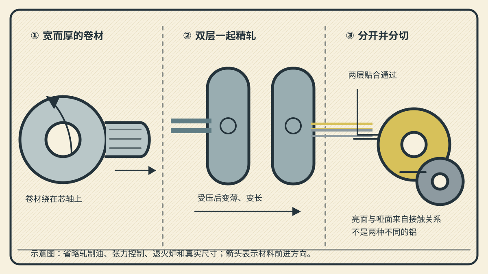
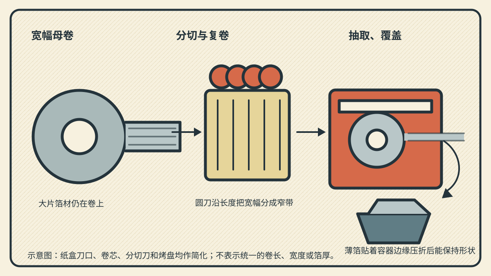

从纸盒侧面的锯齿口拉出一段铝箔，盖在烤盘上，手指沿盘边一压，它就服帖地留在折角里。翻过来，常会发现一面更亮、一面更哑：难道两面用了不同的金属吗？

这里选**普通家用、无涂层的卷装铝箔**，从已经铸成的铝合金锭或厚带开始，沿热轧、冷轧、薄箔双层轧制、分切和复卷讲解。它不等同于压成餐盒的较厚容器箔，也不把印刷、涂层、纸塑复合的包装箔拼进同一条生产线。

*配图随机选用木刻版画风格，为 AI 辅助编写的可编辑 SVG 示意图。颜色和比例用来区分部件与状态，不是工厂实拍，也不代表标准厚度或设备尺寸。*

## 一、纸盒里拉出的，是一条连续的金属带

铝箔是很薄的铝板带。欧洲铝箔协会将铝箔的范围说明为约 0.006 mm 到 0.2 mm；家用箔只是其中面向烹饪、覆盖和贮藏的一类成品。[欧洲铝箔协会：铝箔的范围与制造](https://www.alufoil.org/facts-and-properties)

它的主体是铝。再往前追，铝来自铝土矿，经氧化铝和电解等环节成为金属；本文不把那条冶炼线塞进轧制车间，而是从已具化学成分、可加工的铝锭或铸造厚带开始。为适合特定性能，铝中可以加入少量合金元素；具体牌号、状态和最终厚度要由产品要求决定，不能用一卷厨房箔推断所有铝箔的配方。[欧洲铝箔协会：铝与合金的来源](https://www.alufoil.org/facts-and-properties)

家用箔的功能不只在“发亮”。完整、未穿孔的铝箔能阻隔光、气体和水汽；它又足够柔软，压出的折边不会立刻弹开。这种能保持折痕的特性，才让一片平面的金属带能包住食物或贴住容器。[欧洲铝箔协会：家用箔的阻隔与折痕特性](https://www.alufoil.org/household-foil-and-domestic-uses)

## 二、先把厚锭轧成能卷起来的带材

一开始的铝不是纸盒里那样的薄片。传统路线中，受热后的铝锭进入热轧机：两根大直径轧辊相向转动，锭从中间的辊缝穿过。辊缝的厚度小于来料厚度，材料在压力下变薄、沿前进方向变长；每一段通过后都可卷成线圈，供后续处理。欧洲铝箔协会列举的典型范围是，热轧先把锭轧成约 2–4 mm 的卷材。[欧洲铝箔协会：从热轧到卷材](https://www.alufoil.org/facts-and-properties)

也有连续铸轧路线：熔融金属直接形成厚带并随即轧成卷，绕过先铸大锭、再热轧的安排。两条路线的前段不同，但本文在得到可继续轧制的卷材后再会合，不能把“熔体进铸机”和“热锭进热轧机”说成同一次操作。[美国铝业协会：连续铸轧与板带生产](https://www.aluminum.org/processing-101)

热轧后的卷仍是毫米级带材，既不够薄，也还不适合随手撕下一段。进入冷轧机后，卷材从放卷机拉出，再反复穿过一对精密轧辊；另一端的卷取机把变薄、变长的带材重新收紧成卷。这里的“冷”指材料不是在热轧那样的加热状态下进行减薄，并非把铝送进冷冻设备。轧制会让材料逐渐加工硬化，工厂会按需要安排热处理，使它在下一阶段还能继续加工，或得到所需状态。[美国铝业协会：板带的冷轧与热处理](https://www.aluminum.org/processing-101)

## 三、薄到最后，为什么要两层一起压？

越接近成品厚度，带材越像一条连续的银色薄带。箔轧机的核心仍是上下相对的轧辊，但要同时控制辊缝、带材张力和收放卷的稳定性；不能只靠“把两个滚轮压得更紧”来得到均匀薄箔。

为取得特别薄的箔，两层箔会叠在一起通过最后的轧制。它们各自从前段的卷上出来，贴合后进入辊缝，出来时仍是两层相贴的薄箔，随后再分开。这样做留下了著名的双面外观：每一层中贴着轧辊的一面较亮，面对另一层的一面较哑。**亮面和哑面是同一片箔两侧在双层轧制中接触条件不同的结果，不是亮面镀了另一层金属。**[欧洲铝箔协会：双层轧制与两面外观](https://www.alufoil.org/facts-and-properties)

*三幅剖面依次展示减薄、双层轧制、分离。中图两条带材刻意画开，便于看清它们是两层；实际通过辊缝时会紧贴。亮、哑颜色仅标识表面接触关系。*

双层轧制不是所有铝箔都必须采用的步骤。较厚、单层轧制的箔也可能用于其他产品；家用产品的厚度和状态由厂家选定。因而也不能根据一卷箔的两面外观，倒推出它的精确厚度。

轧制中还会使用帮助加工的轧制油等工艺介质。成品箔会经历与工艺相配的退火或清洁安排；高温退火也使铝箔达到卫生用途所需的洁净状态。这里应区分：退火处理的是成卷材料的状态与残留，不是在厨房里把铝箔“烤熟”。[欧洲铝箔协会：退火与卫生](https://www.alufoil.org/facts-and-properties)

## 四、宽幅大卷，怎样变成纸盒里的小卷？

分开后的箔先是宽幅的大卷。它被装到分切复卷机的放卷轴上，薄带平整地经过多个导辊。圆形分切刀沿机器方向把一整幅箔裁成若干条需要的宽度；刀切的是连续移动的带材，不是先把整卷摊开成一张巨大的纸再逐张裁。

每一条窄带随后绕到自己的纸芯上，成为小卷。复卷时还要让边缘整齐、卷层松紧合适；边缘若跑偏，用户从盒中拉出时就可能皱折或撕裂。最后，小卷装入带锯齿撕口的纸盒。分切和复卷改变的是宽度、卷径和包装形式，铝箔本身仍是一条连续薄带。[欧洲铝箔协会：分切成适合终端用途的卷材](https://www.alufoil.org/facts-and-properties)

*示意图省略真实刀具防护、张力控制和纸盒的锯齿细节。右图强调的是压折后保持形状，不表示所有烤盘或使用方法。*

## 五、回到厨房：折住食物，不等于什么都能包

使用时，先按容器或食物尺寸拉出一段，在纸盒撕口处裁断；盖住容器后沿边缘压折，利用薄箔的可塑性把开口合住。它可以用于覆盖、冷藏冷冻的包裹，以及在适合的烹饪设备中辅助烘烤。铝箔对光、蒸汽、香气和液体的阻隔，是这些做法的材料基础。[欧洲铝箔协会：厨房中的家用箔](https://www.alufoil.org/household-foil-and-domestic-uses)

亮面朝里还是朝外，通常不必当成一条通用的烹饪规则。对普通双层轧制的家用箔来说，两面差异来自制造时的表面接触关系；选朝向更该服从具体产品说明、非粘涂层和使用场景，而非把颜色当作两种不同材料。

未涂层铝箔与绝大多数食物接触没有问题，但很咸或很酸的食物可能引起局部孔洞或变色；需要时可按食品和产品说明采取隔离或轻涂油等做法。它也不是微波炉里的通用容器：金属会反射微波，错误放置可能产生电弧；是否能用，应以设备和食品包装说明为准。[欧洲铝箔协会：酸咸食物与微波炉使用边界](https://www.alufoil.org/facts-and-properties)

## 六、怎样知道它是一卷合格的箔？

生产中，检查的对象不是只看一面是否“够亮”。轧制阶段会关注厚度沿长度和宽度的稳定性、表面缺陷与边缘状态；分切复卷后还要检查宽度、卷绕和是否有可见破损。铝箔协会的表面特性资料把轧制条纹等外观异常与轧辊局部磨损、材料夹杂或温度、平整度差异联系起来，说明一条亮线并不只是审美问题。[欧洲铝箔协会：铝箔表面特性与可能原因](https://www.alufoil.org/surface-characteristics?cid=2608&file=files%2Fimages_alufoil%2Fabout_alufoil%2Freference_library%2Fsurface_characteristics%2FAluminium_Foil_Surface_Characteristics_Catalogue_June20.pdf)

这些检查针对的是规定的材料和生产条件，不能把它们简化成家里拿强光一照就能完成的“密封性认证”。使用中看见压痕、小孔或被撕开的边缘，就应按实际需要更换或避开；一卷箔能否用于特定食品、设备或长期保存，也仍要看商品标签和相应要求。

再把纸盒里的那一片亮哑薄带展开，整条来路便能接起来：

> **铝锭或铸造厚带 → 热轧后的卷材 → 多道冷轧的薄带 → 双层精轧后分开的亮、哑铝箔 → 分切复卷的小卷 → 拉出、裁断、压折使用。**

轧辊并没有把金属磨成粉，而是一次次把同一块材料挤得更薄、更长；纸盒里看似轻飘的一片，仍保留着从厚卷材一路被拉长、被卷起的方向。
