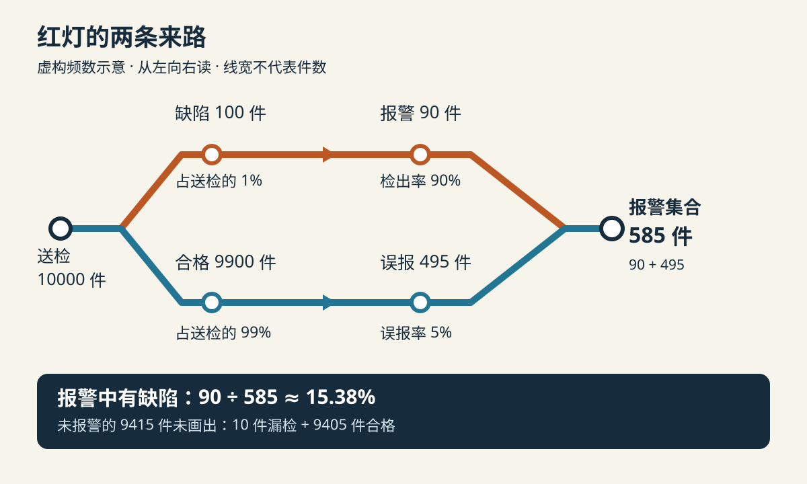

零件厂准备上线一台自动检测仪。供应商说：“有缺陷的零件，九成能被它找出来。”第一批货经过机器，一件零件亮了红灯，操作员便把它放进报废箱：“九成把握有问题，还留着做什么？”

质检员拦住他：“九成缺陷件会报警，和报警的零件九成有缺陷，是同一件事吗？”

差别藏在分母里。前一句从缺陷件出发，后一句从所有报警件出发；报警件中，还可能混入被误报的合格件。要知道混入多少，除了看仪器，还得看送检零件本来有多大比例存在缺陷。

这个原有比例就是本例的**基准率**。把它与检测证据结合，更新对缺陷可能性的判断，是贝叶斯更新的一种应用。这里用的是概率关系，不是“经验通常比新证据可靠”的口号。[OpenStax：条件概率与贝叶斯定理](https://openstax.org/books/principles-data-science/pages/3-4-probability-theory)

下面的工厂、零件、比例和成本全部是**虚构演示设定**。先回答“只知道报警时，缺陷概率是多少”，再讨论“该不该报废”；两者需要的信息不同。

## 一、把三个百分数放回各自的分母

我们只看同一工艺、同一型号的一批零件。缺陷指某项尺寸超出事先规定的公差，演示假设另有可靠的参考测量可以判定真实状态。每件只经过一次初检，仪器阈值固定。

设定这类送检零件中，缺陷件占 1%；在缺陷件里，90% 会报警；在合格件里，5% 也会报警。

| 输入 | 本例数值 | 分母是谁 |
|---|---:|---|
| 缺陷基准率 | 1% | 全部送检零件 |
| 检出率 | 90% | 全部真实缺陷件 |
| 误报率 | 5% | 全部真实合格件 |

90% 不意味着其余零件中有 10% 被误报。它的补数 10% 指**缺陷件中的漏检比例**；误报率来自另一组零件，必须另行获得。供应商如果只提供“准确率很高”，却不交代统计口径，我们还不能往下算。

为把关系看清，先把这三个比例当作已知且适用于当前批次的参数。真实使用中，它们只是根据样本估计的数值，需要核对样本数量、工艺、检测阈值与判定标准；后面再回到这个限制。

## 二、先数一万件，红灯来自两条路

想象送检 10000 件零件，按上述比例展开。以下整数是演示模型的频数，不是声称下一批必定恰好出现这些数量。

1. 其中缺陷件为 `10000 × 1% = 100 件`，合格件为 9900 件。
2. 100 件缺陷件中，`100 × 90% = 90 件` 报警，10 件漏过。
3. 9900 件合格件中，`9900 × 5% = 495 件` 也报警，9405 件不报警。
4. 报警集合于是共有 `90 + 495 = 585 件`，其中真正有缺陷的只有 90 件。

所以，仅知道某件零件报警时，模型给出的缺陷概率为：

> **真正缺陷且报警的件数 ÷ 全部报警件数 = 90 ÷ 585 ≈ 15.38%。**

*作者以 AI 辅助编写 SVG 绘制的虚构频数示意，风格随机选为地铁线路图。按箭头从左往右读，橙线是缺陷件路径，蓝线是合格件路径；两线汇合表示合并报警集合，不表示零件状态发生转化。线宽、站距不代表数量；省略的未报警件共 9415 件。*

这个结果并没有否定仪器的检出率。100 件缺陷件中确实找到了 90 件，只是合格件的基数太大，即使仅有 5% 被误报，也带来了 495 件。

用共同总体下的件数展开，再从目标集合中取比例，是一种自然频数表达。相关研究发现，这类表达在所研究的贝叶斯推理任务中有助于正确作答；它的作用是让集合关系容易看见，不是让输入数据自动变可靠。[Hoffrage 等，2015：Natural frequencies improve Bayesian reasoning in simple and complex inference tasks](https://www.frontiersin.org/journals/psychology/articles/10.3389/fpsyg.2015.01473/full)

如果以后数据不便凑成整数，可以保留同样的结构：

`报警后缺陷概率 = 基准率 × 检出率 ÷ [基准率 × 检出率 + (1 − 基准率) × 误报率]`。

分母里的两项分别是“真实缺陷带来的报警”和“合格件带来的报警”。这里两类真实状态互斥且覆盖全部零件；有无法判定状态的样本时，应先处理判定问题，不能偷偷算成合格。

## 三、15.38% 很低，是否说明报警没有价值？

操作员听完，又想把红灯零件直接放回去：“大部分还是合格，那就不用管了。”

这也跳过了一步。检测前，随机拿一件的缺陷概率是 1%；只看报警件时，已经升到约 15.38%。报警提供了信息，只是信息没有强到足以把概率推到 90%。

再看未报警集合：缺陷件有 10 件，总数为 `10 + 9405 = 9415 件`，缺陷比例约为 `10 ÷ 9415 = 0.106%`。它低于检测前，但仍不等于零。是否能直接放行，取决于允许的漏检风险和后续工序要求，不能单靠“没有红灯”。

基准率也不是固定不动的标签。假设只改变送检批次的缺陷比例，检出率与误报率暂时保持不变：

| 缺陷基准率 | 每万件中的真实报警 | 每万件中的误报警 | 报警后缺陷比例 |
|---|---:|---:|---:|
| 1% | 90 | 495 | 90 / 585 ≈ 15.38% |
| 10% | 900 | 450 | 900 / 1350 ≈ 66.67% |
| 20% | 1800 | 400 | 1800 / 2200 ≈ 81.82% |

同一套仪器参数，在不同送检群体中，报警的含义可以差很多。表格是**保持其他参数不变的敏感性推演**；实际换工艺时，缺陷类型、表面状态也可能改变仪器表现，不能保证只换基准率就够了。

若仍固定 90% 与 5%，要让报警后的缺陷概率达到一半，两种报警来源就必须一样多。设基准率为 `p`，则 `0.9p = 0.05(1 − p)`，得到 `p = 1/19 ≈ 5.26%`。这个门槛用于理解数量关系，不是报废门槛。

## 四、再测一遍，能不能变得很确定？

操作员提议把同一件零件再送进同一台机器。如果又报警，是否就能把两次检出率、两次误报率分别相乘？

只有在额外假设成立时才行：**在真实缺陷状态固定后，两次结果仍相互独立；在合格状态固定后也一样。** 这叫给定真实状态后的条件独立，还要假设两次检测性能相同。

在这个专门的演示情景下，每万件中，两次都报警的缺陷件期望数为 `100 × 0.9 × 0.9 = 81`，合格件期望数为 `9900 × 0.05 × 0.05 = 24.75`，于是缺陷概率约为 `81 ÷ (81 + 24.75) = 76.60%`。24.75 是模型期望数，不是可以切开四分之一件零件。

但同一处反光、固定摆放角度或仪器校准偏差，可能让同一件合格品反复误报。极端地，如果重复检测总是复制第一次结果，第二次红灯就没有增加信息，概率仍是约 15.38%。把一条证据看两遍，不能算成两条独立证据。

因此，复核是否有用，需要查看真实联合结果，或者选用经验证、具有不同误差来源的参考测量；“换了设备”本身也不证明条件独立。缺少这些资料时，应保留未知，而不是用相乘后的漂亮数字代替验证。

## 五、概率算完，还要比较行动的代价

回到最初那件红灯零件，为什么先暂存复核可能比直接报废更合理？给这个演示再加入一组简化条件：每件参考复核花 2 元，能正确确认状态；误报合格件若被报废，会损失 20 元；缺陷件最终都应报废，其处置成本在两种方案中相同。暂不计等待、搬运和复核产能成本。

在 585 件报警品上比较两种安排：

- 直接全部报废：额外误废 495 件合格品，损失 `495 × 20 = 9900 元`。
- 全部参考复核：成本 `585 × 2 = 1170 元`，随后只报废确认有缺陷的零件。

在这些假设下，复核相比直接报废少损失 `9900 − 1170 = 8730 元`。若只比较这两种安排，单件复核成本低于 `9900 ÷ 585 ≈ 16.92 元` 时，复核更划算。

这不是“15.38% 以下都该放行”的规则。此处没有计算直接放行的后果，也没有把漏检损失、安全要求和生产中断算进去。若参考复核有误差，或一天只能测一百件，就必须把残余错误与等待成本补进方案。概率回答可能是什么，行动还要回答判断错了会怎样、有哪些可行替代办法。

## 六、让下一批数据有机会纠正这张表

质检员最终把那件零件移到待复核区，并先核对当前批次是否真的适用 1% 的基准率和原仪器参数。

后续记录应把初检结果与参考测量结果对应起来，保留批次、型号、阈值与日期。**不能只复核报警件，再用这些零件估计整批缺陷率**：报警集合本就富集了缺陷，未报警件中的漏检也会因此看不见。

一个可行的验证安排是：在初期独立抽取覆盖全批的代表性样本，不因初检结果决定是否进入样本，对其做参考测量，再分别统计真实缺陷与真实合格两组中的报警比例。若另行提高报警件抽样比例，汇总时就需考虑不同抽样概率，不能直接混算。

样本里只有少数缺陷件时，检出率估计会很不稳定；一次恰好全部检出也不证明以后没有漏检。工艺、材料或检测阈值改变后，要重新核查适用性，并用新一批、未参与参数估计的数据比较预测报警比例与实际复核结果。若明显不符，先检查输入与样本来源，而不是责怪公式。

这次争论留下了一条可以重复使用的顺序：

> **先看对象原本有多常见 → 分别数出真报警与误报警 → 在全部报警中重算比例 → 检查新证据是否独立 → 按行动后果决定下一步。**

红灯仍然值得重视。只是这一次，它把零件送去了一个需要继续核实的地方，而不是替人作出了报废决定。
