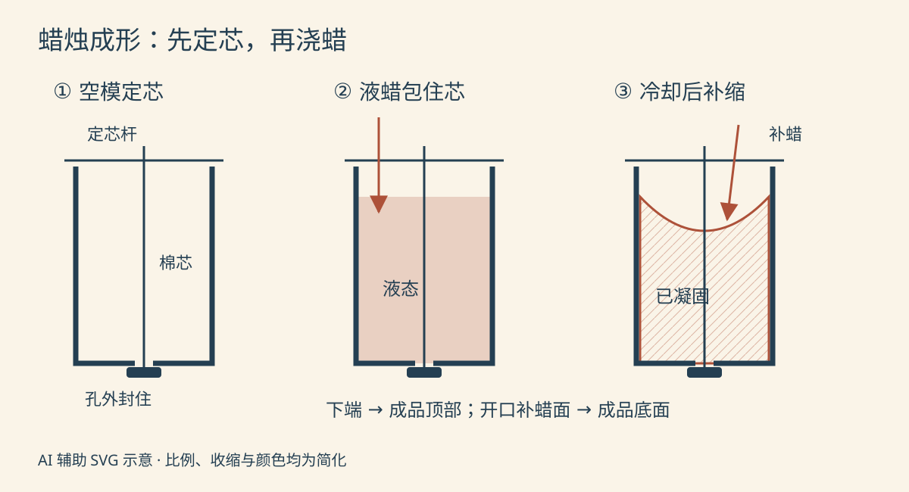
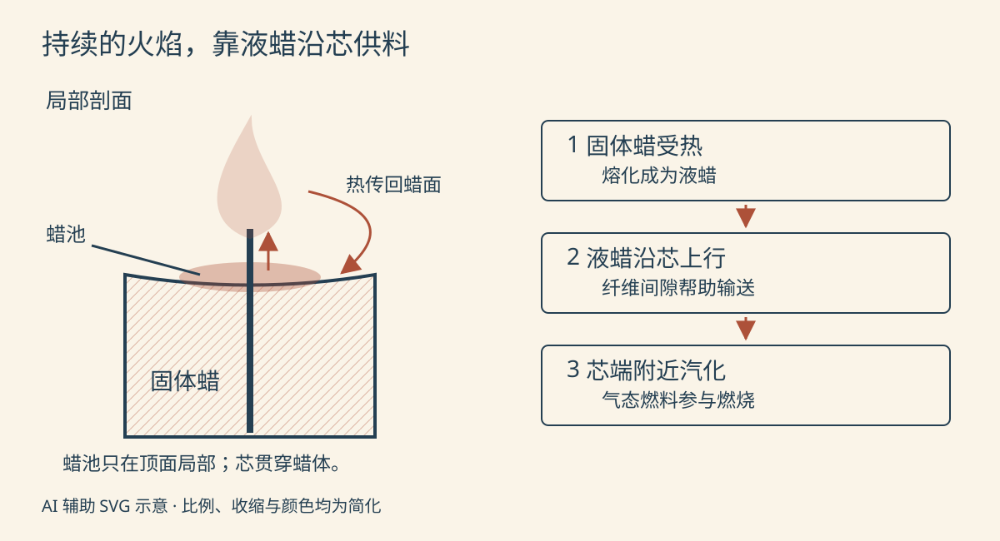

把一支白色柱蜡放稳，点着露出来的短芯。过一会儿，芯脚周围出现一小汪透明的液体，火焰继续亮着，蜡柱却一点点变矮。

细芯看起来像一根线，为什么能烧那么久？白色的蜡又是怎样把它包在正中间的？

这里选**以石蜡为主要燃料、使用编织棉芯的无香柱蜡**，沿小批量金属模浇注的路线讲解。它脱模后能独立站立；玻璃杯留在外面的杯蜡、反复浸蘸增粗的细蜡烛，以及压制蜡粒的工艺，都有不同安排。

*配图随机选用复古双色线描风格，为 AI 辅助编写的可编辑 SVG 示意图。颜色区分状态与部件，不是工厂实拍；尺寸、液面和收缩程度不代表工艺标准。*

## 一、蜡是燃料，芯是输送通道

石蜡来自石油加工中分离并精制的蜡质成分。到了制烛环节，采购的已经是固体蜡料，可以是块片或颗粒；这条生产线从蜡料开始，不在制烛锅里提炼原油。常温下它能保持形状，受热后成为可以倒出的液体。[美国国家蜡烛协会：蜡的来源与性质](https://candles.org/elements-of-a-candle-wax/)

柱蜡需要兼顾站立、脱模和燃烧，不能随手把为容器蜡设计的软蜡换过来。有些原料是供应商已经调好的柱蜡配方，制作者不必再自行添加硬化或改性材料。本文选用适合模具浇注的石蜡基柱蜡料，不给所有石蜡指定一种添加剂比例。香料和染料是可选的后加材料，这支白色无香蜡烛不需要它们。[Candlewic：柱蜡原料、预配蜡与选型](https://candlewic.com/learn/candlemaking-how-to/how-to-make-pillar-candles/)

另一路原料是成卷的编织棉芯。棉纤维先成为纱线，再编成连续的芯带；细小间隙能让液态蜡向上移动。芯既要保持供料，也会在火焰中逐渐消耗，因此不能把它理解成一根永远不烧坏的管子。

蜡的种类、柱体粗细和添加物都会影响选芯。芯过大或过小，都可能让燃料输送与燃烧不匹配；“换一根更粗的线”并不是提高品质的通用方法。[美国国家蜡烛协会：烛芯的结构与选用](https://candles.org/elements-of-a-candle-wicks/)

## 二、先在空模具里把芯固定好

圆柱形金属模像一个细长的金属杯：一端敞开用来灌蜡，另一端封闭，中间留有穿芯的小孔。这里选用封闭端带造型的倒置浇注模，**浇注时朝下的一端，脱模翻转后成为蜡烛顶部；朝上的灌入口，最终成为底面。**

把裁好的芯穿过小孔，在模具外侧封住孔周，防止热蜡漏出。开口处横放定芯杆，将另一端拉直并固定。此时芯沿模腔中轴贯穿，四周仍然是空的；不是先做实心蜡柱，再拿钻头打孔塞线。[CandleScience：柱蜡模的穿芯、封孔与定芯](https://www.candlescience.com/learning/how-to-wick-a-pillar-mold/)

芯只在两端受到约束，中间还没有蜡支撑。灌注时若把它冲歪，冷却后偏心的位置也会留下来。模具内壁同样要清洁，表面的残蜡和污物可能转印到新蜡柱上；是否预热或使用脱模剂，应按模具和蜡料的要求决定。

*从左到右为定芯、浇注、冷却补缩。砖红色区域表示蜡，深蓝色表示工具与芯；右图凹陷刻意放大。三幅的下端都是成品顶部，补蜡面最终朝下，不是点火后的蜡池。*

## 三、固体蜡怎样变成能浇注的液体？

蜡料先按质量称量，装进有把手和倾倒嘴的金属熔蜡壶。小批量可以采用隔水加热：外锅装水，内壶盛蜡，外部电热源先加热水，再经壶壁把热传给蜡。水留在外锅，不能倒进蜡里当作稀释剂。较大批量可以使用水夹套熔蜡设备，热量同样通过容器壁传入。[Candlewic：熔蜡壶与水夹套加热设备](https://candlewic.com/learn/candlemaking-how-to/candle-making-needs/)

刚开始，蜡块仍有清楚的棱角；随后边缘融化，固体逐渐减少，最后成为均匀的液体。搅动有助于均匀受热，温度计测的是壶内蜡液，不能拿外锅水温代替。

这一步改变的是状态，不是把蜡烧成另一种材料。也不是等“冒烟了”才算熔好：熔化、保温和适合浇注的温度各有用途，应以具体蜡料说明为准。加热要有人看管，避免过热；热水不能保证蜡可以无限时间放着不管。

完全熔化后，按所用材料的条件调整到浇注状态，再缓缓倒入已经定芯的模腔。液体沿空隙铺开，包住棉芯并接触模壁。此时外形虽被模具限定，内部仍然会流动，还不能拿出来使用。

## 四、冷却后少掉的一块，为什么还要补？

蜡液把热传给模具和周围环境，逐渐凝固。石蜡柱蜡在冷却过程中会收缩：模腔看似已经灌满，后来开口处却可能凹下一块。表面出现硬壳，也不等于内部已经完全冷却。

因此，第一次浇注时要留出同批蜡料供后续补浇。按配方要求冷却后，把留料重新熔化，在合适温度下补入凹陷，使底面完整。补蜡不能漫过原有边界；已经收缩离开模壁的部位可能形成缝隙，蜡若沿缝流下去，会在成品外侧留下痕迹。[Aussie Candle Supplies：石蜡柱蜡的收缩与二次补浇](https://www.aussiecandlesupplies.com.au/blogs/aussie-candle-supplies/how-to-make-a-paraffin-pillar-candle)

补浇时机和温度不能从一种蜡直接搬到另一种蜡。不同资料中“冷却多久再补”的安排并不完全相同，它与配方、柱体尺寸和冷却条件有关。这里保留工序关系，不把某个教程的小时数当成工厂统一节拍。

补浇后还要再次冷却。等整体稳定，再解除定芯杆和封孔处的固定，脱出蜡柱，翻转到使用方向并修整底面和外露芯。收缩有助于蜡体离开模壁，但不意味着可以拽着芯硬拉，否则芯可能先被拉松。[CandleScience：补浇边界、充分冷却与脱模](https://www.candlescience.com/learning/how-to-make-a-pillar-candle/)

至此，模具留下外形，棉芯留在内部，制造时流动的液体又成了固体。冷却并非把水“晾干”，而是让熔融蜡凝固。

## 五、点着以后，烧的是芯，还是蜡？

把成品放在稳固、耐热且适合柱蜡的烛台或托盘上，清理蜡面杂物，按产品说明修剪外露芯，再点燃。火焰先加热芯附近的蜡，顶面出现小蜡池；液态蜡沿芯的纤维间隙上升，到热的芯端附近汽化，再参与火焰中的燃烧。

所以，支撑持续火焰的主要燃料来自蜡体。芯提供了集中、连续的输送路径，让大量固体蜡不必同时变热、同时燃烧。火焰又把一部分热传回蜡面，继续熔化附近的蜡，供料就能接着进行。[美国国家蜡烛协会：蜡烛怎样燃烧](https://candles.org/candle-science/)

*左侧为局部剖面，右侧拆开材料经历的状态。箭头表示供料与传热方向，不表示真实流速；火焰轮廓、芯宽和蜡池深度均作简化，没有描绘完整的火焰化学分区。*

蜡池与制造时的凹陷虽然都在画面上方，来由完全不同：前者是使用时受热融化，后者是倒置浇注时冷却收缩。熄灭后，剩下的液蜡还能重新凝固；已经燃烧的部分则不会再回到蜡柱里。

使用时避开吹向火焰的气流和可燃物，有人照看。蜡仍呈液态时不要搬动；熄灭可用灭烛罩，不向热蜡浇水，并确认芯已熄灭、蜡已冷却再处理。[美国国家蜡烛协会：摆放、燃烧与熄灭注意事项](https://candles.org/candle-safety-tips/)

## 六、外表光滑，还不能说明它烧得好

脱模后能检查尺寸、裂纹、底面是否平稳，以及两端所见的芯是否居中。但内部有没有空洞、整支燃烧是否稳定，不能只看一张漂亮的成品照。

试烧应比较完整的蜡、芯和外形组合。保持蜡料、柱径、修芯方式与环境条件一致，记录不同阶段的火焰、蜡池、流蜡和可见烟炱；若要比较消耗速度，可在相同燃烧时段前后、蜡冷却后称量整支蜡烛。试烧需要有人照看，不能只看刚点着的几分钟。

这些记录能帮助筛查配合问题，却不能替代正式的产品安全测试。一次冒烟也不能直接归因为“石蜡不好”：气流、外露芯长度和供料状态都可能改变燃烧。尺寸相同的蜡柱换了芯，表现也可能明显不同。

---

再看火焰下那一小汪蜡，便能把两段过程接起来：

> **固体柱蜡料 → 熔化后的蜡液 → 浇入定好芯的模腔 → 冷却、补缩、再冷却 → 脱模后的蜡烛 → 局部熔化 → 液蜡沿芯上行 → 汽化后燃烧。**

制造时，模具把液体留成一个便于摆放的形状；使用时，细芯又把这个固体储存的燃料，一点点送到火焰中。
