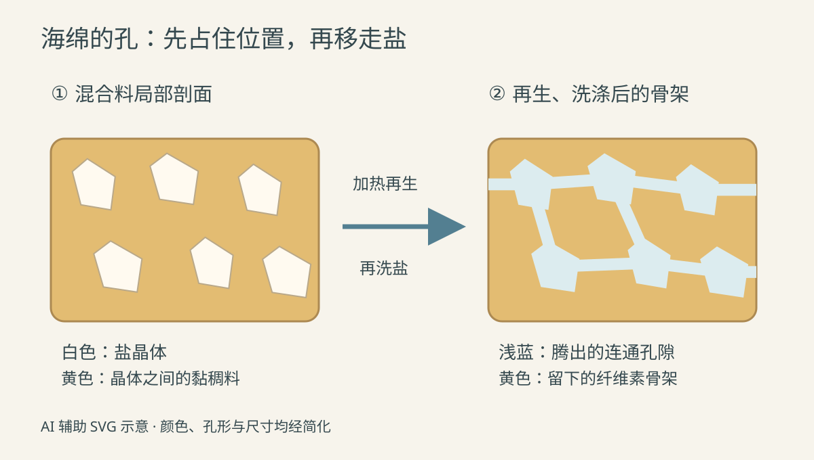
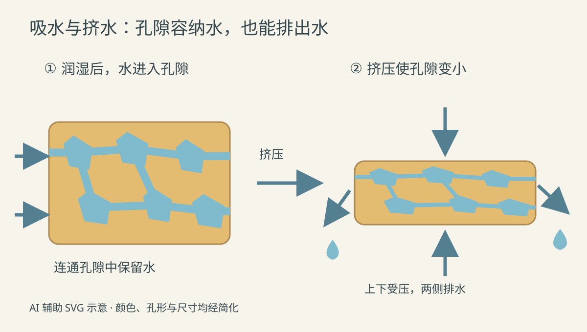

水槽边溅了一小片水。拿海绵贴过去，水迹很快缩小；把海绵移到水槽上方一捏，水又流了出来。松手后，小方块恢复一些厚度，还能接着擦。

这些孔是怎样留在材料里的？如果原料来自木头，为什么成品既不像木板，也不像一团纸浆？

这里选**木浆来源、黏胶法制造、先成大块再裁切的纤维素清洁海绵**。日常叫“海绵”的东西还包括聚氨酯泡沫、三聚氰胺泡沫等；它们的成孔方式不同。本文也不加入表面的粗糙百洁布层，以免把吸水材料与磨擦层混成一种材料。

*配图随机选用柔和色块剖面风格，是 AI 辅助编写的可编辑 SVG 示意图。颜色、孔形、数量及尺寸都经过简化，不是工厂实拍或配方依据。*

## 一、木浆留下骨架，盐晶体暂时占住位置

工厂使用的是已经提纯的纤维素浆料，不是把木屑倒进水里搅成团。木材前端经过制浆，去掉大量木质素等成分，得到适合继续加工的纤维素原料。

同样来自植物的材料，在配料中可以有两种身份：一部分纤维素要先转成能加工的黏胶，最后重新形成海绵骨架；另外加入的短纤维则分散在其中，起增强作用。它们不能一概写成“木浆融化了”。Spontex 的原料介绍列出木浆、棉等植物材料，并说明产品先制成块，再按用途加工。[Spontex：原料与块材路线](https://www.spontexindustrial.com/cellulose-sponge/composition)

另一个关键原料是**芒硝，也就是十水硫酸钠晶体**。在这类传统黏胶路线里，它作为成孔剂混入材料，随后被移走。它既不是厨房食盐，也不是要一直留在成品里帮助吸水的粉末。[制造专利：芒硝与增强纤维的作用](https://patents.google.com/patent/US2827661A/en)

可以先记住这个分工：**留下的材料构成孔壁，后来移走的晶体为孔隙腾出空间。**

## 二、纤维素怎样变成黏稠的料？

纤维素不会像糖一样直接溶进清水。传统黏胶法先用氢氧化钠溶液处理浆料，压榨并将料打散，经受控的熟成等处理，再与二硫化碳反应，得到纤维素黄原酸酯；随后用稀碱液配成黏胶。

这是先进行化学转化，再制成可加工流体的过程，不是靠高温把木头熔化。压榨装置挤出多余液体，打散装置把压实的料松开，反应和溶解则在相应的密闭处理设备里进行。输出已经是黏稠、可以混配的料，而不是原先可辨认的浆片。

公开专利对普通黏胶原料的制备给出了这条前处理路线；其中另行提出的改性添加剂与实验配方，不属于本文的普通清洁海绵。[Nisshinbo 专利：普通黏胶原料的制备背景](https://patents.google.com/patent/EP0670344A1/en)

这里涉及工业化学处理和回收控制，并不是把木浆、碱和盐放进家用搅拌器的制作教程。具体浓度、熟成条件与设备配置需要按生产线确定。

## 三、混匀，不等于把所有东西磨细

黏胶进入捏合设备后，与盐晶体、短纤维及所需着色材料混合。捏合机可以理解为带转动搅拌件的料槽：它不断翻动、折叠黏料，让晶体与纤维分散到料体内部，而不只浮在表面。

这一步特别容易被误写成“把原料全部打成细浆”。实际需要保留晶体颗粒来参与成孔；混料阶段还要控制温升，避免盐晶体过早溶解。短纤维也需要分布开，不能留成一团团筋结。专利中的捏合说明明确区分了黏胶、成孔盐和切短纤维，并提醒混合时避免过度升温。[制造专利：捏合与混料温度控制](https://patents.google.com/patent/US2827661A/en)

输出是含有分散颗粒与纤维的稠料。此时孔的位置正在由内部材料分布决定，却还没有成为能拿来擦桌子的海绵。

*左图白色多边形表示暂时占位的盐晶体，右图浅蓝区域表示洗盐后可容纳水的孔隙。此图只解释成孔关系，省略增强纤维和微小孔隙；实际孔壁、孔径与连通程度不会像图上这样整齐。*

## 四、入模加热：把流动的料变成有孔的块

本文采用块状模制路线：混合料装入模具，模腔限定整块材料的外形，随后连同模具进入专用加热设备。此时装进去的是含晶体的稠料，并非已经有孔的海绵。

加热处理促使黏胶凝固、纤维素再生，形成能够保持形状的骨架；盐晶体在这个过程中发生熔解等变化，再通过后续洗涤移出。**这里的孔不是靠往木浆里打入大量空气形成的，也不是拿针逐个扎出来的。**

Spontex 公布的工艺概览明确列出“入模—专用炉加热—洗涤、柔软处理—切块”。它没有公开炉子的具体热源、模具运行方式和完整温度曲线，因此不能据此画出一台确定的燃气隧道炉，也不能给出所有产品通用的加热温度。[MAPA Spontex：2026 产品目录中的纤维素海绵制造流程，第 6–7 页](https://www.mapa-pro.com/fileadmin/sites/uk/user_upload/MAPA_SPONTEX_GENERAL_CATALOGUE_2026.pdf)

要区分加热和洗涤的任务：前者使材料形成骨架，后者把可溶残留带出去。洗涤时，清洗液需要进入块体内部，再带着盐等残留排出；只冲一下外表，不能替代内部清洗。关于芒硝在再生及后续漂洗阶段被移除的关系，也见于相关工艺资料。[Nisshinbo 专利：成孔盐的移除与漂洗](https://patents.google.com/patent/EP0670344A1/en)

出来的块材仍然含水，已有可以观察到的孔壁和孔隙。它经历的是化学再生与清洗，不能仅称为“把浆烘干”。

## 五、大块材料怎样成为水槽边的小方块？

处理后的块材进入切割环节。刀具沿所需切面分开块体，先得到片材或条材，再按订单尺寸分成小块；需要特殊轮廓时，还可使用冲切等加工方式。切开会露出内部孔隙，所以成品截面能看见大小不一的孔。

这一步改变外形尺寸，不负责把实心材料“切成有孔”。供应商公开的加工能力包括锯切、冲切、钻孔和三维切割，说明同一种海绵块材可以继续成为不同形状的产品。[Spontex：海绵块材与后续加工能力](https://www.spontexindustrial.com/products/materials/cellulose-sponge/)

最终可以按产品要求以干态或湿态供应，含水状态也会影响手感。颜色并不自动代表材料种类或清洁能力；更不能凭黄色外观就把一块纤维素海绵与黄色塑料泡沫认作同一种东西。

## 六、水怎样进去，又怎样被挤出来？

用它擦水前，先按产品说明冲洗、润湿，再挤掉多余水。湿润的海绵贴住台面时，水接触亲水的纤维素表面，并进入连通孔隙；细小通道中的毛细作用参与这个过程。开孔结构提供了储水空间，材料也会因水而改变柔软程度。[Spontex：开孔结构、吸水与湿态弹性](https://www.spontexindustrial.com/cellulose-sponge/characteristics)

挤压时，骨架变形，孔隙所占的空间缩小，一部分水被压出。松开后，湿态材料恢复形状，孔隙重新有了容纳水的空间。它并不会把水化学分解，也不会在吸满后无限继续吸水。

*从左到右为吸水、挤水。蓝色表示水，黄色表示骨架；右图只画挤压方向，省略手掌，变形程度与排水量不按比例。*

擦油污时，海绵负责承载清洗液、接触表面并带走污物，清洁剂按其标签用量加入。吸水快不等于能磨掉所有焦垢；若商品另带粗糙百洁层，那一层的磨擦性能应单独判断。

使用后冲去残留，挤水并放到能够晾干的位置。3M 的纤维素海绵布使用资料也采用冲洗、挤水、晾干的顺序，但它是另一种薄片产品，不能把其中的吸水倍数、耐洗温度直接搬给本文的块状海绵。[3M：纤维素海绵布的使用与护理说明](https://multimedia.3m.com/mws/media/1661435O/scotch-brite-18-spong-cloth.pdf)

## 七、比较吸水能力，先说清楚称的是什么

想做一个日常观察，可以取尺寸相近、起始状态相同的样品，先称质量，再充分浸湿，以同样方式、同样时间沥去自由滴水后称量。后一次比前一次增加的质量，是这套条件下样品多带住的水。

如果起初只是“摸起来不湿”，就不能把它当作严格干重，更不能直接拿结果与厂家标注的“相当于干重多少倍”比较。沥水时间、有没有挤压、样品大小和干湿状态都会影响数字。这个小观察能比较使用体验，不能代替规定方法的性能检测。

还可以观察反复挤压后有没有明显裂口、掉块，以及回弹是否改变。厂家也会检验材料的拉伸表现，但家里一次用力拧坏，并不足以判断是哪一道制造工序出了问题。[Spontex：生产中的拉伸性能控制](https://www.spontexindustrial.com/cellulose-sponge/characteristics)

再拿起水槽边的小方块，可以把它的来路连成一条线：

> **纤维素浆料 → 化学处理后的黏胶 → 混入盐晶体和增强纤维的稠料 → 入模、加热再生 → 洗去盐等残留的多孔块材 → 裁切成清洁海绵 → 润湿吸水、挤压排水。**

木浆最终留下支撑，盐晶体让出空间。手指一捏时流出来的水，刚才就暂存在这副可以变形的多孔骨架中。
