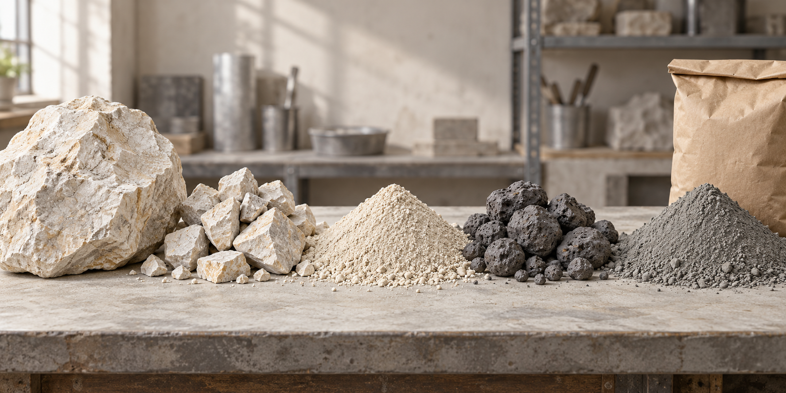
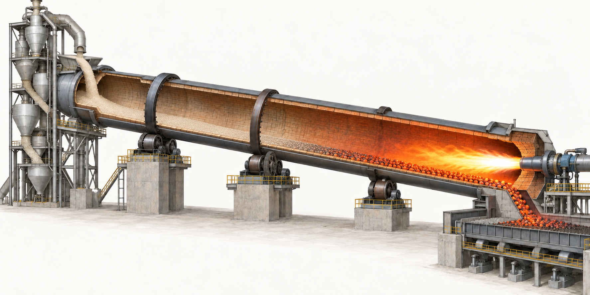
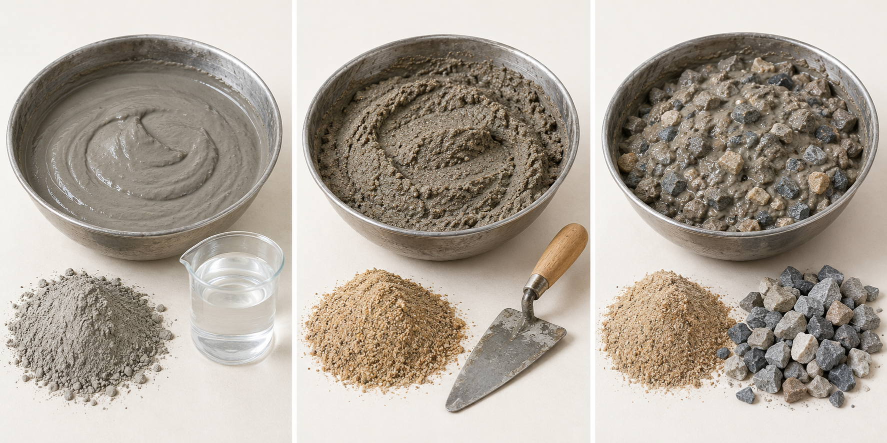

撕开一袋水泥，里面是细细的灰色粉末。倒进容器，加水搅拌，它会变成黏稠的浆体。拌入砂，可以制成砌砖、抹墙用的砂浆；再加入石子，就能制成混凝土，用来浇筑地面、基础和建筑构件。

刚拌好的材料能够摊铺、填进模板。经过凝结和硬化，水泥形成的浆体将砂石黏结起来，使它们成为坚硬的整体。[美国水泥协会：水泥与混凝土](https://www.cement.org/cement-concrete/cement-concrete-faq/)

这袋粉末，在来到施工现场之前，经历了什么？

下面以常见的硅酸盐水泥体系和现代干法生产流程为例，沿着材料的变化往下看。

*封面及正文配图为 AI 生成示意图，用于辅助理解材料形态和工艺关系；颜色、粒径和设备比例不代表具体产品或生产线。*

## 一、准备原料：哪些石头和泥土能用？

制造水泥，主要需要提供钙、硅、铝、铁等元素的原料。

**石灰石**主要提供钙。它是一种以碳酸钙为主的岩石，通常从矿山开采出来。

**黏土或页岩**提供硅、铝等成分。根据它们的实际组成，工厂还可能加入硅质、铁质等原料，调整配料。

这些原料不是随便混在一起就行。同样是石灰石，不同矿山的成分也可能不同，因此需要取样化验，再确定用量。[美国水泥协会：水泥原料](https://www.cement.org/cement-concrete/how-cement-is-made/)

还有一种常见材料叫**石膏**，不过它通常在熟料烧成以后、制造成品水泥时加入，用来调节凝结时间。它与前面的入窑原料承担不同任务。[海德堡材料：水泥粉磨与石膏](https://www.heidelbergmaterials.my/en/cement-production-process)

原料选好以后，先解决一个直观的问题：从矿山运来的岩石太大了。

## 二、先破碎：把大石头变成小石块

矿山开采出来的石灰石大小不一。大块岩石先进入破碎设备，被加工成便于输送和后续处理的碎块。

**这一阶段出来的仍然是石块，不是粉末。**

碎块有明显的形状和颗粒，可以堆放，也可以用输送设备运走。它们的具体尺寸由破碎设备和后续工序决定，不能把某一个工厂的出料大小当作通用要求。[海德堡材料：破碎与运输](https://www.heidelbergmaterials.com/en/products-and-services/cement/how-cement-is-made)

为什么不直接把大石头磨成粉？

因为大块岩石需要先减小尺寸，才能适合后面的设备处理。破碎先完成这项工作，进一步磨细则交给磨机。

经过破碎的原料还要储存、均化。不同批次的原料成分可能有波动，把它们适当混合，可以让后续配料更加稳定。

因此，这一步的结果是：

> **大块岩石 → 较小的碎块。**

还没有进入烧制，也还没有得到水泥。

## 三、再粉磨：碎块什么时候变成粉？

接下来，工厂按化验和配料要求，将处理过的石灰石、黏土或页岩，以及需要的其他原料计量后送入磨机。

磨机进一步减小颗粒。以立式辊磨为例，可以把它理解为：物料落在磨盘上，受到磨辊的碾压，逐渐变细。粉磨过程中还可以利用热气干燥物料。

最终得到的细粉叫**生料**，经过进一步均化后，送往烧制系统。[海德堡材料：生料制备](https://www.heidelbergmaterials.com/en/products-and-services/cement/how-cement-is-made)

磨细有两个重要作用：让不同原料能够更充分地混合，也为后续加热和反应提供合适的颗粒条件。

此时，原料的外观已经从碎石变成了粉末，但它仍然不能当作水泥使用。它还缺少高温转化这一步。

到这里，可以把两道工序分清楚：

| 工序 | 进去时是什么样 | 出来时是什么样 |
|---|---|---|
| 破碎 | 大块岩石 | 有明显颗粒的碎块 |
| 生料粉磨 | 按比例加入的碎块和其他原料 | 混合均匀的生料粉 |

“石头要打碎，但不打成粉”，描述的通常是前面的破碎工序。后面还有专门的粉磨工序。

*材料状态对照：从左到右为大块石灰石、碎块、生料粉、熟料颗粒和水泥粉。破碎后仍能看见石块，粉磨后才成为粉末；烧制则改变了材料的组成。*

## 四、烧制：水泥窑是什么样的？

现代水泥厂常见的回转窑，像一根很长、略微倾斜的钢制圆筒，架在支承装置上，缓慢转动。筒体内部衬有耐火材料，用来承受高温。

物料从较高的一端进入。圆筒转动时，物料不断翻滚，并逐渐向较低的一端移动。较低的一端安装燃烧器，火焰向窑内提供热量。

这种结构让物料能够一边移动，一边受热。[美国水泥协会：窑内烧制](https://www.cement.org/cement-concrete/how-cement-is-made/)

*回转窑剖面示意：左侧为较高的进料端，右侧为较低的出料端。生料沿窑底向右移动，燃烧器从右端向窑内提供热量。预热系统和冷却设备经过简化，耐火内衬通过剖面展示。*

不过，生料通常并不是冷着直接进入最热的地方。现代干法生产线一般先让它经过预热、预分解系统，再进入回转窑。

### 先预热，再进入回转窑

水泥厂里的预热系统往往是一座高塔，里面设置多级设备，让生料与高温气体接触。

它利用系统中的热量加热生料，减少后续烧制所需的能量。预分解阶段则完成相当一部分碳酸盐分解反应。[澳大利亚水泥行业协会：预热与烧制](https://cement.org.au/australias-cement-industry/about-cement/)

可以把整套烧制系统理解为连续加工：原料先逐步升温、发生部分反应，再进入回转窑继续转化。

### 在高温中，原料变成了什么？

加热过程中，石灰石中的碳酸钙发生分解，释放二氧化碳。随后，原料中的成分继续反应，形成新的矿物组成。

在约 **1450℃** 的高温阶段，形成制造水泥所需的**熟料**。这个数字指的是烧成阶段的物料温度，不能理解为整座窑从入口到出口都保持同一个温度。[美国能源部：水泥制造](https://www.energy.gov/cmei/ito/cement-and-concrete-manufacturing)

原本的细粉经过烧制，形成一颗颗坚硬的熟料颗粒。

“熟料”中的“熟”，表示它已经经历了制造所需的高温反应。不过，它仍然不是可以直接装袋使用的水泥。

烧制也不能只凭“温度到了”判断完成。原料组成、物料在系统中的停留和移动情况，以及温度控制，都需要配合。水泥厂会结合生产数据和化验结果控制整个过程。[海德堡材料：生产质量控制](https://www.heidelbergmaterials.com/en/products-and-services/cement/how-cement-is-made)

## 五、冷却和粉磨：为什么烧完又要磨一次？

灼热的熟料出窑后，要进入冷却设备。冷却系统还可以回收热量，将加热后的空气用于生产过程。[美国水泥协会：熟料冷却](https://www.cement.org/cement-concrete/how-cement-is-made/)

冷却后的熟料仍然是硬颗粒，需要与适量石膏及配方要求的其他材料一起粉磨，才能成为成品水泥。

以球磨机为例，它是一种内部装有钢球的旋转筒体。筒体转动时，钢球对物料产生冲击和研磨，使熟料逐渐变成细粉。[海德堡材料：最终粉磨](https://www.heidelbergmaterials.my/en/cement-production-process)

这也是水泥制造中容易混淆的地方：**烧制前磨一次，烧制后还要磨一次。**

前一次磨的是原料，得到生料；后一次磨的是熟料，得到水泥。

完整的材料变化是：

> **大块岩石 → 碎块 → 生料粉 → 熟料颗粒 → 水泥粉。**

看起来前后都有石块、都有粉末，但材料的组成已经发生了变化。

成品水泥随后进入储存设施，通过散装运输或装袋离开工厂。到这一步，一袋水泥才真正制造完成。[澳大利亚水泥行业协会：熟料到成品](https://cement.org.au/australias-cement-industry/about-cement/)

## 六、使用：水泥、砂和石子分别做什么？

到了施工现场，首先要确定用途。

水泥是黏结材料，砂和石子是骨料。它们在混合物里承担不同的作用。

| 混合材料 | 得到什么 | 常见用途 |
|---|---|---|
| 水泥、水 | 水泥浆 | 构成砂浆、混凝土中的黏结浆体 |
| 水泥、水、砂 | 水泥砂浆 | 砌筑、抹面等 |
| 水泥、水、砂、石子 | 混凝土 | 地面、基础、建筑构件等 |

实际配方还可能加入其他胶凝材料和外加剂。[澳大利亚水泥行业协会：水泥用途](https://cement.org.au/australias-cement-industry/about-cement/)

*从左到右为水泥浆、砂浆和混凝土的形态示意。加入砂后出现细颗粒质感，加入粗骨料后能够看见石子；配图不表示材料的实际配合比。*

这里的石子，与工厂制造水泥时使用的石灰石原料，要分开理解。

工厂里的石灰石经过粉磨、烧制，成为水泥的一部分；施工时加入的石子作为粗骨料，保留着颗粒形态，留在混凝土中。砂也不需要重新磨成水泥那样的细粉。

### 搅拌时，水要加多少？

水要按配合比控制。它既参与水泥的水化反应，也影响混合物是否便于搅拌、浇筑和密实。

为了让材料“更稀、更好倒”而随意加水，可能降低最终性能；用水太少、材料难以施工，也可能影响成形质量。合适的用量需要结合具体材料、配方和施工要求确定。[美国水泥协会：水灰比与施工性能](https://www.cement.org/cement-concrete/applications-of-cement/)

因此，砌墙、抹面、浇筑地面和制作承重构件，不能都套用一个“几铲水泥、几铲砂”的比例。

### 拌好以后，怎样成形？

砂浆可以铺在砖之间，也可以抹到经过处理的基层上。

混凝土则放入准备好的模板或施工区域。普通混凝土通常需要适当捣实或振捣，使材料填满空间、包裹钢筋，并减少较大的夹带空气孔隙。

浇筑地面时，还要找平，并根据用途进行表面处理。振捣和表面收整都有相应的操作要求，不能理解为“振得越久、抹得越多就越好”。[美国水泥协会：混凝土浇筑与密实](https://www.cement.org/cement-concrete/working-with-concrete/)

施工接触湿水泥材料时，还要保护皮肤和眼睛。湿水泥具有较强碱性，直接或长时间接触可能造成伤害。[美国水泥协会：施工防护](https://www.cement.org/cement-concrete/working-with-concrete/)

## 七、成形以后：它怎样变硬，怎样确认强度？

水泥与水接触后，会发生水化反应，形成新的产物，逐渐将材料连接起来。

早期，混合物失去流动性和可塑性，这叫凝结；随后，强度继续发展，这叫硬化。摸起来已经硬了，并不表示已经达到使用所需的强度。[美国水泥协会：水化与强度发展](https://www.cement.org/cement-concrete/cement-concrete-faq/)

所以，成形以后还需要养护，为反应提供合适的湿度和温度条件，避免过早失水。[美国水泥协会：养护](https://www.cement.org/cement-concrete/applications-of-cement/)

确认强度，则需要试验。以混凝土抗压试验为例，按照相应标准制作试件、养护，再用设备逐渐施加压力，测量破坏时的荷载，并根据受压面积计算抗压强度。

混凝土常用28天抗压强度作为评价指标之一。这里的28天是约定的测试时间点，之后强度仍可能继续增长。[美国水泥协会：28天强度](https://www.cement.org/cement-concrete/cement-concrete-faq/)

至于“这块楼板能承重多少”，还需要结合构件尺寸、跨度、支撑和配筋等条件判断。材料强度是其中一项依据，不能直接等同于整个结构的允许承重。

---

再看一袋水泥，它的来路已经可以连起来了：

矿山里的岩石被开采、破碎，经过配料和粉磨成为生料；生料在高温中转化为熟料；熟料冷却后与石膏等材料再次磨细，成为水泥。来到施工现场后，它与水、砂石混合，经过成形和养护，最终成为建筑材料的一部分。

我们看见的是一袋粉末，而它的制造过程，经历了两次粉磨、一次高温转化。
