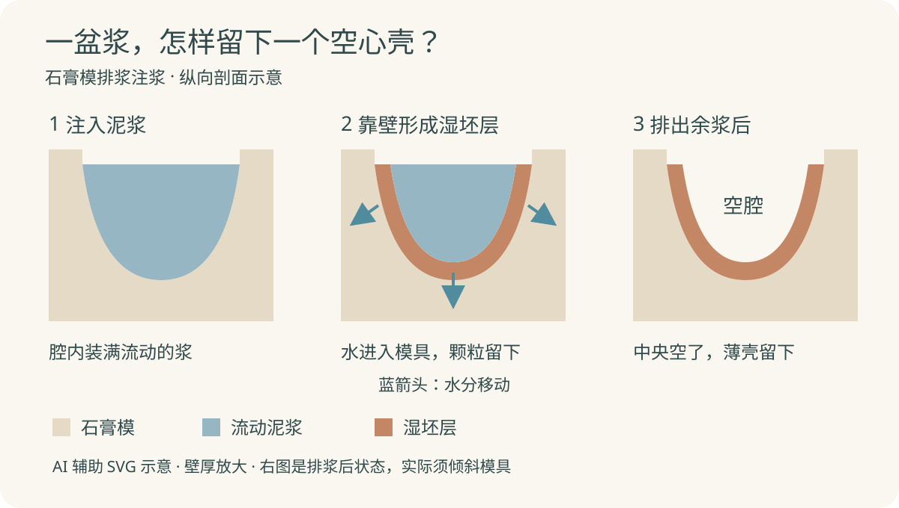
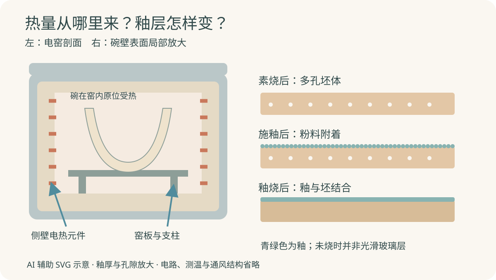

盛一碗汤，手掌托住碗底，勺子沿着内壁滑过去。汤留在碗里，冲洗后，光滑的表面又露出来。把碗翻过来，底下与桌面接触的一圈，有时却没有同样的光泽。

这个空心的硬壳怎样做出来？里面是挖空的吗？表面亮亮的一层，是刷上去就能用的吗？

陶瓷碗有许多成形方法。这里选**石膏模排浆注浆成形、先素烧再釉烧的白瓷碗**，用小批量电窑生产说明加热过程。这是一条可以制造薄壁碗的路线，不代表所有餐具厂都这样做；拉坯、滚压和高压注浆另有设备安排。

*配图采用随机选定的柔和色块剖面风格，为 AI 辅助编写的可编辑 SVG 示意图。颜色区分材料状态，不是工厂实拍；壁厚、孔隙和设备比例均作了简化。*

## 一、先分清碗的身体和表面

碗壁的主体叫**坯体**，表面烧成后的一层叫**釉**。两者紧密结合，却不是同一份材料在同一步骤里完成的。

传统白瓷坯料常用高岭土等黏土、长石和石英。它们来自矿物原料，经过选料、提纯与细化后供应生产；进入本文的配料环节时，已是适合制瓷的细料，不是随手铲来的泥土。

黏土帮助未烧的坯保持整体；长石在烧成时提供助熔作用，促进玻璃相形成；石英参与调节坯体组成和烧成后的表现。它们不是三种颜色不同、作用相同的填料。配比要兼顾成形、干燥和烧成，不能用一份通用比例概括所有瓷碗。[Digitalfire：传统瓷的原料与烧成变化](https://digitalfire.com/glossary/porcelain)

水让粉料成为能流动的泥浆，少量分散剂则帮助颗粒分开，使泥浆在含有较多固体的情况下仍能流动。**泥浆流得动，并不等于里面大半都是多余的水。** 单纯加水稀释，会增加后面需要排走的水，也会改变成坯表现。[Digitalfire：解凝与低含水泥浆](https://digitalfire.com/glossary/deflocculation)

釉料是另外准备的细粉配方，可以含矿物原料和预先熔制、再粉碎的熔块。加水制成釉浆后，它看着也像一桶浑浊液体，但用途是形成表面薄层，不能把它当作造碗壁的泥浆。[Digitalfire：陶瓷釉的组成与作用](https://digitalfire.com/glossary/ceramic+glaze)

## 二、把细料调成能倒、能排的泥浆

配料按质量称量，再在搅拌桶中与水、分散剂混合。桶里有伸入料中的轴和叶片，电机带着叶片转动，使细料分散开来。本文从已经细化的原料开始；若使用需要进一步粉磨的矿物料，还要另设粉磨工序，不能指望搅拌叶片把石块直接变成制瓷细粉。

混好的浆经过筛分，除去粗粒、团块等不合适的物质。此时得到的是悬浮着细颗粒的浆体，不是矿物全部溶解成了透明溶液。实际调浆还要控制气泡与流动状态，否则倒入模具后，局部缺陷也可能留在坯上。

操作人员会用固定体积的容器称量泥浆，并在相同条件下观察流出表现。这两件事分别帮助判断固体含量与流动性，不能只凭“像酸奶一样稠”就认为每一桶都一样。合适的泥浆既要进入模腔，也要在下一步顺利排出。[Digitalfire：注浆泥浆的混合、筛分与流动测量](https://digitalfire.com/glossary/slip+casting)

## 三、碗壁在模具里面慢慢长出来

石膏模是一个厚壁、带凹腔的吸水模具。选用口大底小、没有倒扣的简单碗形时，凹腔限定碗的外表面，开口留在上方。把泥浆倒进去，起初腔内装的是会流动的浆。

接触石膏的那一层先发生变化：水进入模具孔隙，固体颗粒逐渐在模壁一侧积成有厚度的湿坯层。停留一段时间后，靠壁处已经较实，中间却仍然能流动。

壁厚达到本次生产需要时，倾斜模具，把中间的余浆倒回收集容器。留下的就是沿模壁形成的空心壳。**空腔来自排走余浆，不是从一整块凝固的泥里挖出来的。** 停留时间、泥浆状态、模具干湿都会影响壁厚，因此不存在每只碗都适用的固定分钟数。[Digitalfire：吸水成层、排浆与脱模](https://digitalfire.com/glossary/slip+casting)

*剖面示意。中图蓝箭头表示水分移动，不表示整股泥浆穿过石膏；右图展示排浆后的状态，实际排浆要倾斜模具。碗口余量和圈足细节省略。*

排浆后还需让坯在模中继续失水，获得足以拿取的强度，并稍微收缩离模。过早去掰，会把薄壁拉变形。脱模得到的仍是湿坯，不是可以装水的成品；用过的石膏模也需要恢复合适的干湿状态，才能稳定地进行下一轮生产。

## 四、晾干以后，为什么还不能拿来盛汤？

坯达到能支承自身、又便于修整的状态后，修去碗口多余的泥边，整理接触面和局部毛边，再继续干燥。修坯处理的是尚未烧成的材料，不能与成品磨底混成同一件事。

干燥时，水分逐渐离开，坯体也会收缩。碗口薄、碗底较厚，失水步调未必一致；局部先缩、另一处还被湿料牵住，便可能产生翘曲或裂纹。生产上要安排合适的摆放、通风和干燥条件，而非只追求吹得越快越好。[Digitalfire：干燥收缩与不均匀失水](https://digitalfire.com/glossary/drying+shrinkage)

干坯已经能保持碗形，手感也硬了，却仍然脆弱。干燥主要移走可蒸发的水，不能代替烧成中发生的材料变化。

## 五、先素烧，再给碗穿上釉层

这里采用上开盖电窑：外部是金属壳，里面有耐火保温层，窑壁槽中布置电热元件。干坯放在耐火窑板上，随窑板和支柱分层装入；合盖后，电热元件把电能变为热量。碗在这次烧成中留在窑内原位，不是一边旋转一边穿过火焰。

第一次不带釉的烧成叫**素烧**。坯体经受受控升温和冷却，变得更能承受拿取与上釉操作，同时保留适合吸收釉浆水分的孔隙。它不是简单把剩余水分烘完，也不意味着瓷质已经达到最终致密程度。[Digitalfire：素烧与施釉吸水性](https://digitalfire.com/glossary/bisque)

釉浆使用前混匀。把素坯浸入、取出并沥掉多余釉浆，内外表面便能挂上一层粉料。素坯吸走部分水分，帮助釉层留在表面；釉浆状态、浸入时间和素坯吸水性共同影响厚薄。内腔也可以通过倒入釉浆再倒出的方式覆盖。[Digitalfire：浸釉与倒釉](https://digitalfire.com/glossary/dipping+glaze)

这时釉层尚未成为光滑玻璃质表面。它更像贴在坯上的粉质外衣，还需要干燥和第二次烧成。底部与窑板接触的圈足要清理掉釉，避免釉熔后把碗粘在窑板上；于是，一只成品碗会留下那圈不同触感的足底。

*左图仅解释热源与承载关系，省略电路、测温和通风结构；不是装窑施工图。右图将釉层明显放大，烧后仍保留坯体主体，不表示整只碗熔成玻璃。*

第二次是**釉烧**。在与坯、釉配套的烧成制度下，表面釉料熔融并与坯体结合；坯体进一步烧结、致密化。冷却后，表面形成连续的釉层，内部仍是含晶体与玻璃相的陶瓷主体。釉的配方还要与坯的热膨胀表现协调，否则外观刚出窑时不错，后续仍可能出现裂纹等问题。[Digitalfire：釉与坯的配合](https://digitalfire.com/glossary/ceramic+glaze)

烧得更热也不一定更好。超过适合的成熟范围，坯体可能变形或鼓泡；不足则可能达不到所需致密程度。烧成要看升温、保温和冷却的整体安排，而非只记一个最高温度。[Digitalfire：坯体成熟与过烧](https://digitalfire.com/glossary/vitrification)

电窑的装载、坯件厚薄和含水状态会影响安排。控制器完成程序，也不等于可以立即开盖取碗；应按设备要求等到适合的温度再卸窑。[Skutt：装窑、升温和开窑条件](https://skutt.com/best-practices-for-loading-and-firing-your-skutt-kiln/)

## 六、回到餐桌，怎样看待这只碗？

冷却卸窑后，检查碗口是否变形、表面有无明显缺陷，并整理可能刮手、刮桌面的底足。成品用来盛饭盛汤，靠的是坯体的形状与强度、烧成后的致密程度，以及釉面的共同作用。

拿到餐具后按产品说明清洗使用即可，不需要再调泥浆或在家“养护成瓷”。能否放进微波炉、烤箱或洗碗机，要看具体产品说明；不能因为它曾在窑里经受高温，就推断它适合任何日常加热方式。

制造中如何确认坯体烧到了合适程度？一个办法是用同批坯料制作试样，在明确的烧成条件下烧好，称干重，再按规定的吸水程序处理、去除表面水并称湿重，用增重与干重的比值计算吸水率。比较时，试样、烧成制度和吸水方法都要一致。[Digitalfire：收缩与吸水试验](https://digitalfire.com/test/shab)

这检验的是坯料在相应条件下的表现，不是随便往一只上釉碗里倒水、看有没有漏，就能完成的测试。外观、吸水率和实际餐具适用性也不能相互替代；敲起来清脆，并不足以替代产品应有的检验。

再看碗底那圈没有釉的接触面，整条来路便能连起来：

> **矿物细料 → 调匀的泥浆 → 模壁吸水形成湿坯层 → 排浆留下空心壳 → 脱模、修整、干燥 → 素烧坯 → 施釉、釉烧、冷却 → 检查整理后的瓷碗。**

先借模具取走水，让一盆浆留下碗形；再借热量改变材料，让这个形状经得住日常拿取和清洗。勺子滑过的那层光滑表面，则是在碗已经有了身体之后，另行施加并烧成的釉。
