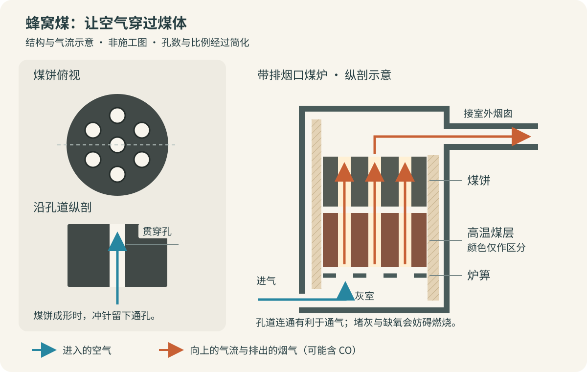
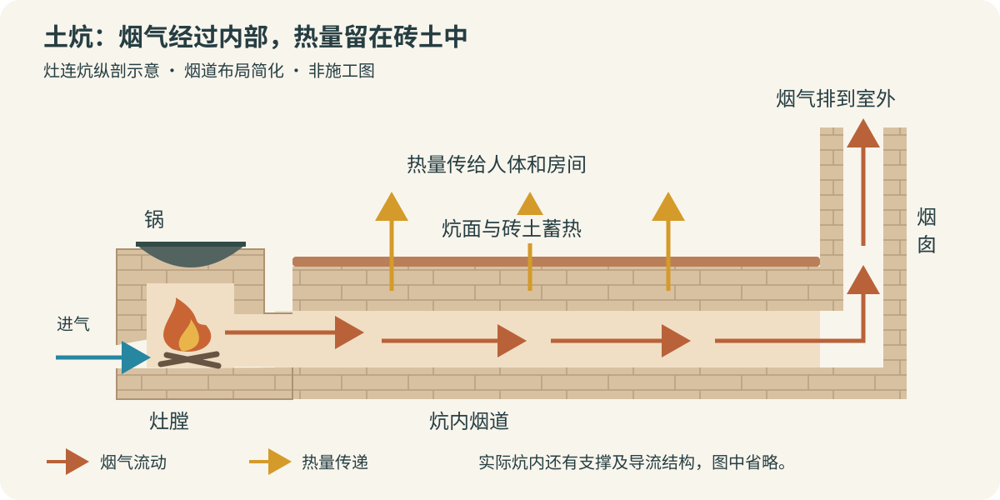

冬天，灶膛里烧着火，锅里的水逐渐沸腾，旁边的土炕也慢慢暖起来。等到火熄了，炕面还能保持一段时间的温热。

这幅生活场景里，发生着三件不同的事：燃料燃烧释放热量，烟气把热量带进炕体，砖土把热量储存下来。如果燃烧或排烟出了问题，同一套系统也可能把一氧化碳带进屋内。

蜂窝煤是一种燃料，土炕是一种利用烟气供暖的设施，两者不一定配套使用。传统土炕也常烧木柴、秸秆和玉米芯。下面分别沿着煤的加工、炕的受热和烟气的去向，看看这些过程怎样连接起来。

*封面及正文剖面图为按文中原理绘制的矢量示意图。设备比例、孔数、颜色和烟道布局经过简化，用于理解结构与流动关系，不作为炉具改装或土炕施工图。*

## 一、从煤粉到煤饼：蜂窝煤怎样做出来？

蜂窝煤属于“型煤”：把细碎的煤加工成方便搬运和使用的固定形状。

以传统的黏土黏结型蜂窝煤为例，煤是提供热量的主体，黏土帮助松散的煤粒黏结成形，水让混合料具有适合压制的湿度。有些配方还加入石灰等材料。不同煤种和生产方式需要不同配料，不能把一种配方当成所有蜂窝煤的通用比例。[传统型煤制作方法专利](https://patents.google.com/patent/CN1058802A/zh)

较大的煤块先进入破碎设备，被打成较小的颗粒，再进一步处理成适合成形的细料。这里的目标是让颗粒能均匀混合、压实，而不是无限制地磨细。处理后的煤与黏结材料、水混匀，成为可以压实的湿料；水过少会影响成形，过多也会影响脱模和湿煤饼的强度。

成型机上有装料斗、圆筒状模腔和上下运动的冲头。湿料落入模腔后，冲头下压，把它压成煤饼；冲头上的一组冲针同时形成贯穿煤饼的孔道。随后将煤饼推出模腔，经过干燥，得到能拿取、堆放的蜂窝煤。[蜂窝煤成型机结构专利](https://patents.google.com/patent/CN2078225U/zh)

所以，一块蜂窝煤经历的变化是：

> **煤块与细碎煤 → 适合成形的细颗粒 → 加水和黏结材料混匀的湿料 → 压出通孔的煤饼 → 干燥后的蜂窝煤。**

## 二、煤饼上的孔，给空气留了什么路？

煤粉颗粒虽细，但如果紧紧堆成一团，空气很难进入内部，外层烧起来以后，里面仍可能缺氧。

蜂窝煤把通孔贯穿整个煤饼，让空气可以沿孔道流动，也让更多煤体表面接触流经的空气。在适配的炉具中，空气从下部进入，经过炉箅和煤饼孔道，烟气从上部离开。上下煤饼的孔道连通时，这条气流路径更顺畅。

*蜂窝煤与煤炉剖面：蓝色箭头表示进气，棕橙色箭头表示煤层中的上升气流及离开的烟气。右图选用带排烟口的炉具结构，未画炊具；真实炉型和燃烧状态各有不同。*

孔道还把一大块煤体分成较薄的孔壁。燃烧可以沿孔壁展开，不必只从煤饼外缘向中心推进。

不过，**有孔只是改善了通气条件，不能保证煤一定完全燃烧。** 炉具进气不足、孔道被灰堵住、排烟不畅，都会影响实际燃烧。

煤烧完后仍会留下灰，有时还能看出原来的蜂窝形状。那是煤中矿物质以及黏结材料形成的残留骨架；是否还有未燃尽的碳，不能只凭形状判断。

## 三、土炕里面：烟气从哪里经过？

常见的灶连炕系统，由灶膛、炕体和烟囱组成。炕体外面像一座砖土砌成的平台，内部则留有烟气通道。

砌筑时，砖石或土坯形成支撑和内部通道，上面铺设炕面结构，再做表面层。具体布局因地区和炕型而异，有的采用分隔烟道，有的内部空间较宽。它们共同的作用，是让灶膛出来的热烟气先经过炕体，再进入烟囱。[土炕结构与传热研究](https://www.sciencedirect.com/science/article/pii/S2214157X2100085X)

*土炕剖面：棕橙色箭头标出烟气路径，黄色箭头标出热量传递。图中用一条通道代表炕内烟道，省略内部支撑和导流结构；烟气应留在排烟通道内，不能直接进入居住空间。*

热烟气经过炕内时，先把热量传给内壁，内壁再通过导热把热量传到炕面。炕面升温后，通过接触向人体传热，同时通过辐射和空气对流向房间散热。

砖土有一定的质量和热容量，升温时吸收热量，降温时又逐渐释放。因此，火已经熄灭，炕也不会立即变冷。研究中所说的炕体“蓄热”，就是利用这部分材料的热容量。[土炕蓄热性能研究](https://hub.hku.hk/handle/10722/58995)

炕头往往靠近热烟气入口，受热更直接；烟气沿途放出热量后，后面的区域可能较凉。实际温度还受烟道布局、燃烧强度和炕体结构影响，不能给所有土炕套用一个保温时长。

## 四、烟囱为什么能把烟带出去？

正常工作时，烟囱内的烟气比室外空气热，密度较低。烟囱内外气柱的密度差形成压差，推动烟气向上排出，并帮助灶膛吸入新鲜空气，这就是自然抽力。

这股抽力必须克服灶膛、炕内通道和烟囱的流动阻力。烟道积灰、局部堵塞、烟囱条件不合适，或室内补气不足，都可能妨碍排烟。土炕的传热研究也需要把烟气流动与炕体受热一起考虑。[土炕热工与气流模型](https://hub.hku.hk/handle/10722/58995)

让烟气经过炕体可以回收热量，但烟道并不是越长越曲折越好。路径增加会带来阻力，烟气冷却也会削弱自然抽力。炕的供暖效果和排烟能力必须一起考虑。

## 五、一氧化碳在燃烧的哪一步产生？

煤里的碳与氧反应，可以生成二氧化碳，也可以生成一氧化碳。用简化反应式表示：

> C + O₂ → CO₂  
> 2C + O₂ → 2CO

已经生成的一氧化碳，在合适的燃烧条件下还能继续氧化：

> 2CO + O₂ → 2CO₂

这些式子帮助理解物质去向，真实煤炉内还有挥发分燃烧和其他反应。

关键不只是“房间里有没有空气”，而是氧气能否到达正在反应的位置。煤层内部可能局部缺氧，气流也可能绕过部分燃料；生成的一氧化碳如果没有与足够的氧气混合，或温度和停留时间不足以让它继续反应，就会随烟气离开。含碳材料不完全燃烧，是一氧化碳的重要来源。[CDC：一氧化碳的产生](https://www.cdc.gov/niosh/carbon-monoxide/about/)

在高温碳层中，还可能发生另一条反应：

> CO₂ + C ⇌ 2CO

也就是说，二氧化碳经过炽热的碳时，在相应条件下可以参与生成一氧化碳。它的程度取决于温度、气体组成和接触条件，不能用单一反应式算出一座家用炉的排放量。[碳气化反应研究](https://holocron.lib.auburn.edu/bitstream/handle/10415/4818/Gregory%20C.%20Vaughan%20-%20Thesis%20-%20For%20Upload.pdf?isAllowed=y&sequence=2)

因此，压小进气口让火慢慢“闷着烧”，虽然可能延长燃烧时间，却也可能增加不完全燃烧。没有明显火苗，甚至看不到烟，都不能证明没有一氧化碳。

## 六、产生、排放和室内积聚，是三个环节

理解一氧化碳问题，要分清燃烧和排烟各自做了什么。

| 环节 | 发生的事 |
|---|---|
| 产生 | 燃烧过程中形成一氧化碳 |
| 排放 | 未继续燃烧的一氧化碳随烟气离开炉膛 |
| 室内积聚 | 烟气泄漏、倒灌或直接排入屋内，进入量超过排出量 |

炉内产生了一氧化碳，不等于它必然全部进入房间。正常的排烟系统应把烟气排到室外。不过，排到室外仍属于污染物排放；要减少一氧化碳排放，还需要改善燃烧条件。

对室内使用者而言，炉体和烟道密封、烟道畅通以及可靠排烟尤其关键。炕体裂缝、接缝漏烟、烟囱堵塞，或余火尚未熄灭就关闭排烟通道，都可能让含一氧化碳的烟气进入居住空间。CDC也提醒，堵塞的烟囱可能导致一氧化碳在屋内积聚。[CDC：燃烧设备与烟囱安全](https://www.cdc.gov/carbon-monoxide/about/)

一氧化碳本身无色、无味。闻到的煤烟味来自烟气中的其他成分，闻不到味道也不能排除一氧化碳。它进入人体后会干扰氧的运输和利用，可能引起头痛、眩晕、乏力、恶心和意识异常。[ATSDR：一氧化碳健康说明](https://wwwn.cdc.gov/tsp/phs/phs.aspx?phsid=1146&toxid=253)

使用燃煤供暖设备，需要保持可靠的室外排烟，定期检查炉具、炕体和烟道，并按产品说明安装一氧化碳报警器。若报警器响起，或使用燃烧设备时多人同时出现上述不适，应立即到室外新鲜空气处，并联系急救；不要留在屋内寻找漏点。

## 七、怎样知道燃烧和排烟是否正常？

火焰颜色、煤饼是否烧红、屋里有没有烟味，都不足以确认一氧化碳水平。室内是否积聚，需要适用的一氧化碳检测设备；报警器用于危险警示，不能代替炉具维护。

如果要比较两种炉具的排放，还需要在明确的燃料、燃烧阶段和运行条件下测量烟气。一氧化碳浓度只表示气体中的含量比例；评价排放总量，还要结合烟气流量和持续时间。加入更多空气可能稀释浓度，并不自动意味着一氧化碳生成量减少。

炕面温度也只能说明受热结果。炕很热，不能据此证明烟道不漏；炕还能保温，也不意味着灶膛里的余火已经熄灭。

---

从煤粉到蜂窝煤，是把松散燃料压成带气流通道的煤饼；从灶膛到土炕，是让热烟气把能量留在砖土里；从炉内到烟囱，则决定燃烧产物怎样离开居住空间。

再次看见一座暖炕时，可以沿着这两条路径想象：**热量进入炕体，烟气经过烟道排向室外。**
