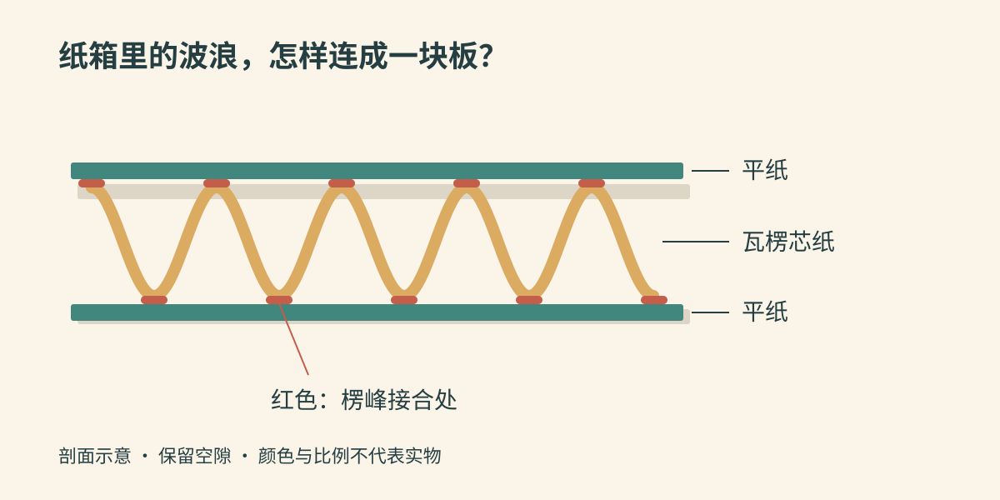
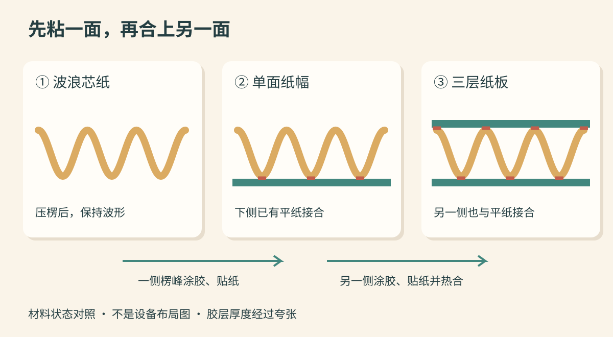

拆开快递，沿纸箱破口看进去，外面和里面各有一层平纸，中间夹着连续的波浪。拿手指捏一捏，能感觉到纸板有厚度，里面却留着许多空隙。

这层波浪是怎样放进去的？工厂先做好一个箱子，再往夹层里塞纸吗？

下面选用**再生原纸制成的三层单瓦楞纸板，以及常见的开槽粘合纸箱**作为代表。先造原纸，再造纸板，最后加工成箱；这几段生产也可能在不同工厂完成。五层纸板、覆膜彩盒和其他箱型，不在这条流程里混讲。

*配图采用随机选定的彩色剪纸风格，以可编辑 SVG 绘制。它们是结构示意图，不是工厂照片；颜色、厚度、波形和胶层大小均经过简化。*

## 一、先把三层纸认清楚

纸板内外的平纸称为**面纸和里纸**，中间用于压出波浪的纸称为**瓦楞原纸**。它们进入瓦楞生产线时，都是卷在纸芯上的连续平纸，并没有预先做好的波浪。

原纸可以使用木材制得的原生纤维，也可以使用回收纸中的纤维。外观同样棕黄，并不意味着配料和性能相同。不同纸种需要分别满足印刷、成形和强度等要求。[DS Smith：箱板纸与瓦楞原纸](https://www.dssmith.com/paper/)

纸是主体材料，**淀粉胶黏剂**负责把各层连起来；后面印刷用的油墨、纸箱侧边接合用的胶，以及使用时的封箱胶带，各有自己的位置，不能统称为“造纸的原料”。

*从上到下为一层平纸、瓦楞芯纸、另一层平纸。红色胶线沿纸板宽度延伸，剖面里只显示为短线；空白处是空隙，不需要灌满胶。*

## 二、旧纸怎样重新变成一卷平纸？

这里从回收纸开始。纸厂把打包的旧瓦楞纸箱等原料拆散，送进装有水的碎浆设备。可以把它想成有搅动机构的大容器：水让纸湿透，搅动使原有纸片逐渐解离，得到含纤维的悬浮浆料。

目的不是把纸磨成越细越好的粉末，而是让纤维重新分散。夹带的塑料、金属等杂物还要经过除杂、筛选和净化移走。制造这类棕色再生包装原纸，通常不必像某些白纸那样专门脱墨。

处理好的纸浆送到纸机，铺上移动的成形网。水先从网中排出，纤维留在网上成为湿纸幅；随后经过压榨部进一步脱水，再贴着蒸汽加热的烘缸运行，蒸发更多水分。最后卷起、分切成适合下游设备的纸卷。[FEFCO：再生纤维与原纸生产](https://www.fefco.org/lca/dscription-of-production-system/paper-production)

这一步出来的是**可以展开的平纸卷**。浆料变成了连续纸幅，但纸箱中间的波浪还没有出现。

## 三、压楞：波浪不是把纸随便揉皱

纸卷安装在放卷架上，展开的纸幅被送往单面机。瓦楞原纸经过热和水分调节后，进入一对带连续沟槽的金属瓦楞辊之间。辊子转动，带着纸前进，让它贴合辊面的轮廓，形成有规律的楞峰和楞谷。

这与把一张纸揉成团不同：波形沿纸幅连续重复，后面才能稳定地涂胶和接合。楞型由辊面轮廓等条件确定，不是简单地把压力调大，就能任意改变波浪形状。[FEFCO：瓦楞纸板成形流程](https://www.fefco.org/technical-information/production-process)

刚成形的芯纸需要保持波形。设备让它受到支承，并在一侧楞峰涂上淀粉胶，再与第一层平纸接合。**胶要落在接触位置，不能把波浪之间的空隙全部填实。**

此时出来的是“一张平纸带着一张波浪纸”的连续纸幅，称为**单面瓦楞纸板**。另一面仍露着波浪，它还不是前面看到的三层成品。[FEFCO：单面纸幅与后续粘合](https://www.fefco.org/technical-information/production-process/more-about-production-process)

## 四、合上另一面：为什么还要加热和控水？

单面纸幅经过输送，来到涂胶和双面机部分。外露一侧的楞峰涂胶后，与第二层平纸汇合，三层结构才齐全。

双面机有一段较长的加热与输送区域。纸板沿热板前进，输送带及加载机构让各层保持合适接触；热量经热板传入，帮助粘合和干燥。加载需要均匀，既要接触良好，又要避免把刚做出的楞形压坏。[BHS Corrugated：双面机热板、加载与输送](https://www.bhs-world.com/en/corrugators/individual-machines/double-facer)

淀粉胶在受热过程中发生糊化，同时水分逐渐离开，接合变得稳定。温度、水分、胶量和运行速度需要相互配合；纸板粘住了却弯翘起来，也不能算得到合格的平整板材。[FEFCO：热板段与水分控制](https://www.fefco.org/technical-information/production-process/more-about-production-process)

*材料状态对照，非设备布局图。为便于比较，三幅图的楞形朝向保持一致，实际纸幅会绕辊转向；红色仅标示接合处，未按真实胶膜厚度绘制。*

连续纸板随后经过纵向分切、压线和横向切断，成为规定尺寸的纸板片，再堆垛送往纸箱加工段。压线是在指定位置形成容易折叠的痕迹，切断则真正分开材料，二者不能混为一谈。

## 五、从一片纸板到一只箱子

以常见的开槽箱为例，纸板要形成四块相连的箱壁、上下摇盖，以及侧边接合用的粘口。

需要印字时，纸板进入印刷单元，表面获得图案。接下来，开槽机构在摇盖之间切出缺口，让每片摇盖能够独立翻折；压线位置则限定箱壁转角和摇盖折起的位置。需要特殊轮廓的箱型会用到模切，本文这只普通开槽箱不必把所有加工方式都走一遍。

在折叠粘合段，纸板沿输送装置向前移动，两侧按压线折入，粘口涂胶并与另一侧搭接、压合。它得到的是**可以压平的箱筒**，通常以扁平状态打包运输，还没有把上下盖全部封死。[FEFCO：开槽箱的印刷、切割与折叠粘合](https://www.fefco.org/regular-slotted-case-rsc)

因此，收货人看到的立体空间，要到装箱时才完全撑起来。工厂预先做好折线、开槽和接缝，让包装人员可以快速完成这一步。

## 六、装上东西，波浪怎样发挥作用？

拿到扁平箱筒，沿折线撑开成方正形状，翻折底部摇盖并按包装方案封合。物品放入后，还要根据形状与运输条件安排衬垫、隔板或缓冲材料，限制物品在箱内移动，最后合上顶盖、封箱。

这里，纸箱提供外部围护，封箱材料保持开口闭合，内部衬垫帮助定位和缓冲。仅仅把东西放进纸箱，不能自动解决晃动和相互碰撞。

理解波浪的作用，可以先想象把两层平纸直接叠在一起，再想象用芯纸把它们隔开并粘牢。后者形成有厚度的组合结构，各层共同抵抗弯曲；芯纸一旦压塌或胶线脱开，协同作用就会受损。瓦楞包装因而能以较轻的材料获得所需的刚度和保护能力。[DS Smith：瓦楞板的结构与性能](https://www.dssmith.com/contentassets/9e13d9878ba548918c161f09f83cfec3/prospectus-in-relation-to-proposed-acquisition-of-sca-packaging.pdf)

但“有波浪”不等于“永远压不坏”。纸板材料、箱体尺寸、折线和接合质量，都会影响整箱表现。

受潮也是常见变化。纸里的纤维会吸收空气中的水分，在高湿条件下变弱，因此存放纸箱要防止雨淋和潮湿影响。摸起来仍完整的纸箱，也可能已经失去一部分原有性能。[DS Smith：瓦楞材料的存放与湿度](https://www.dssmith.com/sheetfeeding/insights/information-downloads/material-guidance/storage-of-corrugated-material)

## 七、能装多重，为什么不能只看厚度？

工厂既检查纸板，也检查成箱效果。纸板是否脱胶、楞形是否压坏、折线是否破裂，都是与前面工序直接相关的观察对象。

需要量化时，**边压试验**针对裁下的纸板试样，沿规定方向对边缘施压；**整箱抗压试验**则把成形箱体放进设备，在压板之间加载。前者评价纸板，后者观察整个箱体抵抗压缩的能力，两项测试的对象不同。[FEFCO：纸板与包装箱试验项目](https://www.fefco.org/node/534)

比较结果还要说明试样状态、温湿度调节及测试条件。实验中短时间测得的破坏载荷，不能直接当作仓库里长期堆码的允许重量；装载方式、受潮、运输损伤和堆放时间都要纳入实际包装验证。

所以，单凭“纸板很厚”或“三层、五层”的名称，不能替所有纸箱承诺同一个承重数值。

---

再看快递箱边缘的波浪，可以把它的来路连起来：

> **回收纸 → 分散并除杂的纤维浆料 → 脱水、干燥后的原纸卷 → 压出波形并粘上一层平纸的单面纸幅 → 贴合另一层平纸的三层纸板 → 切片、印刷、开槽、折叠粘合的扁平箱筒 → 撑开、装物并封合的纸箱。**

那一排空隙，是在连续加工中有意留下的。纸先获得稳定的波形，再在接触处与平纸连成整体，最后借助折线围出盛放物品的空间。
