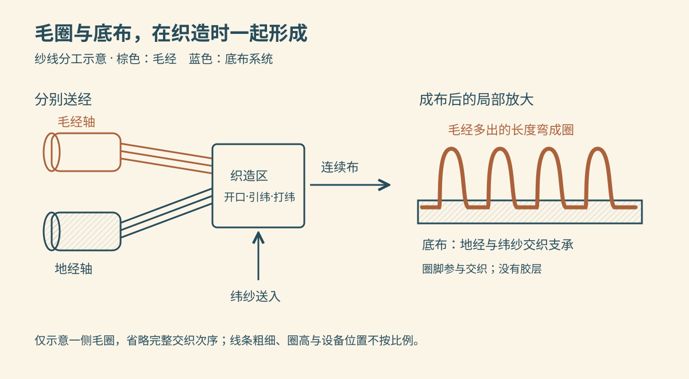
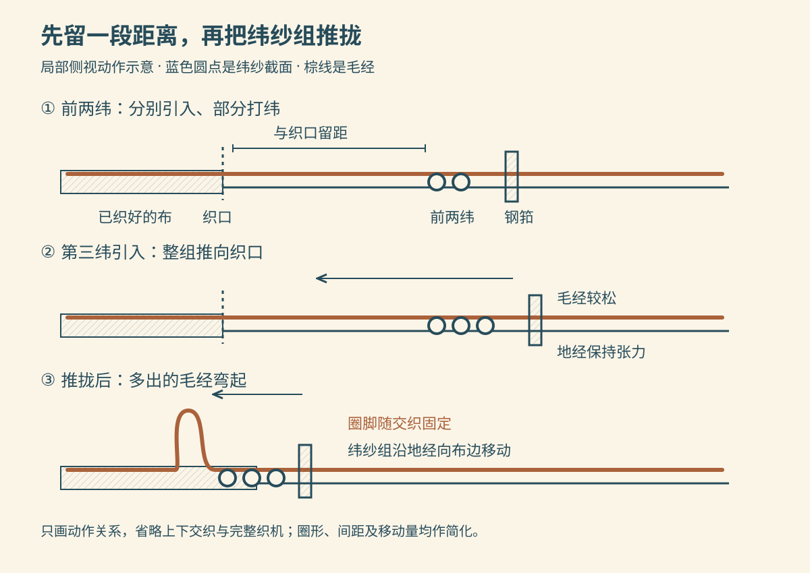

洗完手，把毛巾拢在掌心，轻轻按几下，皮肤上的水珠便转移到布里。把它凑近看，表面并不平整，而是密密地站着一排排小圈；拨开小圈，下面还有一层织得较紧的底布。

这些圈是后来缝上去的，还是把一块平布抓毛抓出来的？

常见机织毛圈毛巾的做法，是在织底布的同时，让另一组纱线弯出圈来。下面选用**普通环锭棉纱、三纬起圈、织后精练漂白的白色毛巾**作为一条代表路线。棉纱可以外购；纺纱、织造和整理也可以分属不同工厂。

*配图采用随机选定的复古双色线描风格，为 AI 辅助编写 SVG 的结构示意图。颜色用于区分纱线，比例与交织细节经过简化，不是工厂实拍，也不是可以直接上机的织造图。*

## 一、先有短纤维，再有长长的纱

棉花采下时，纤维还与棉籽等夹在一起。轧棉将纤维与棉籽分离，纤维打成棉包送往纺纱厂。打开棉包，里面是压紧的纤维团；并没有一根能从田里一直抽到织布机的长线。[Rieter：棉花采收与轧棉](https://www.rieter.com/fileadmin/user_upload/services/documents/expertise/textile-technology/rieter-special-print-cotton-harvesting-south-africa-technology-3011-v3-85646-en.pdf)

纺纱厂先开松、混合、清除杂物，再把棉束喂入梳棉机。机器内部的带齿滚筒等部件把纠缠的纤维逐步梳开，形成较薄的纤维层，随后汇集成松软的**棉条**。它看着像粗绳，却还没有成品纱那样的捻合程度，不能直接拿去织毛巾。[Rieter：开松、清洁与梳棉](https://www.rieter.com/services/expertise/the-rieter-manual-of-spinning)

接下来是并条：几根棉条一同喂入成对的罗拉，前面的罗拉转得较快，把纤维束向前牵伸。合并和拉细相互配合，让输出棉条的粗细更均匀。粗纱机再把棉条牵细、加少量捻，卷成便于送往细纱机的粗纱卷。[Rieter：并条与粗纱准备](https://www.rieter.com/products/systems/spinning-preparation)

在环锭细纱机上，粗纱继续被罗拉拉细，锭子、钢领与钢丝圈配合加捻并卷绕，许多短纤维由此抱合成连续纱线。最后经络筒，成为适合后续加工的筒子纱。**拉细改变纤维束的粗细，加捻让纤维相互抱住，两者共同完成纺纱。** 本文采用普通梳棉路线，不额外加入精梳，也不套用无捻纱工艺。[Rieter：纤维准备与纺纱](https://www.rieter.com/tr/investor-relations/strateji/textile-market-and-spinning-process)

## 二、同样是棉纱，进织机后有三种工作

沿毛巾长度方向走的纱叫经纱，横着穿过的叫纬纱。毛圈织物把经纱分成两组：**地经**与纬纱交织，构成底布；**毛经**也参与交织，但要多送出一段长度，用来形成毛圈。

准备织造时，整经设备从许多纱筒上同时引纱，把它们平行排列并卷到经轴上。经轴可以想成横放的大卷筒，上面卷着一整幅宽度的经纱。地经和毛经分别准备、分别控制送出量；同样织出一段布，起圈的毛经要走更长的路。[CottonWorks：整经与织造准备](https://www.cottonworks.com/wp-content/uploads/2021/04/Weaving-101.pdf)

为了经受织造摩擦，需要上浆的经纱还会经过浆液和干燥，获得临时保护。浆料是加工助剂，后面要按浆料类型退去；它不是把毛圈粘在底布上的胶。本文的白毛巾也不需要再增加染色这道工序。

*左图表示纱线分工，右图表示成布后的局部关系。棕色为毛经，蓝色为底布系统；右图只示意一侧毛圈，省略完整交织次序，双面起圈需相应的组织安排。*

## 三、织机怎样让纱线站成一个圈？

经轴位于织机后部，经纱展开后穿过综眼和钢筘，织好的布从前部引出。综眼是纱线穿过的小孔，随综框升降，把经纱分成上下两层，中间留下供纬纱通过的开口。钢筘像一排密齿梳，经纱穿在筘齿之间；它往复运动，把新送入的纬纱推向已织好的布边。这个不断向前生成布的位置，叫**织口**。

以剑杆引纬为例，细长的剑杆夹持纬纱横穿开口。开口、引纬、打纬不断配合，经纬纱才成为布。[IIT Delhi / NPTEL：织造基本运动](https://archive.nptel.ac.in/content/storage2/courses/116102005/m1-introduction/l1-introduction.htm)

毛圈形成的关键，藏在“推到哪里”和“哪组纱允许多送一点”之中。

以三纬起圈为例，前两根纬纱分别穿入后，只被推到离织口还有一段距离的位置。第三根穿入时，再把这一组纬纱一起推到织口。地经保持较高张力，纬纱组能沿它向前滑；毛经受到较小张力并有额外送出量，随纬纱组被带向织口，多出的长度便向布面弯起，形成毛圈。交织关系随后把圈脚固定在底布中。[Fieldcrest 专利背景：传统三纬起圈周期](https://patents.google.com/patent/US3721273A/en)

*由上到下看动作。圆点表示垂直于画面的纬纱截面，箭头表示推拢方向；仅解释留距与起圈，未画完整综框、剑杆及上下交织。起圈发生在织造中，不需要后来逐圈缝上去。*

真正的设备需要把送经、张力和打纬位置协调起来。圈高不齐，可能关系到这些条件的波动；并不是把毛经放得越松越好。现代毛巾织机有专门的起圈与张力控制机构，但具体机械结构不必与示意图完全相同。[Itema：毛巾织机的起圈与毛经控制](https://www.itemagroup.com/itema-exhibits-cutting-edge-innovations-and-a-complete-range-of-weaving-solutions-at-itm-2022/)

此时得到的是连续的**毛巾坯布**：圈已经有了，表面处理和裁缝却还没完成。

## 四、有了毛圈，为什么还要精练和漂白？

棉纤维以纤维素为主体，但原棉表面还带有蜡质、果胶等成分，织造时也可能引入浆料和油污。这些东西会影响润湿，不能因为一块布标着“纯棉”，就认为刚下织机时已经具有最终的吸水表现。

对于本文选用的织后处理路线，坯布先按所用浆料进行退浆，再经过精练。精练让布与适当的碱液、助剂接触，在受控条件下处理并水洗，移去蜡质等杂质。其目的主要是清洁纤维表面、改善润湿；漂白则进一步处理天然色素，使白度达到要求。两者目的不同，实际产线可以安排分浴或联合处理。[棉织物精练研究：表面蜡质与精练](https://www.sciencedirect.com/science/article/pii/S014486170400298X)、[CottonWorks：棉的精练与漂白原理](https://cottonworks.com/product-innovation/nonwovens/technical-and-performance-guide/)

把湿处理设备想成能容纳布与处理液、带循环和温度控制的工业容器：布与液体充分接触，反应后排液、换水洗去残留。这里受处理的是整幅坯布；不需要先拆成纤维再织一次。浴液配方、布的运行方式和处理时间随设备及产品而变，不能用家里的洗衣程序代替工厂工艺。

洗净后的湿布还要脱水、干燥。脱水先移走能机械除去的一部分液态水，烘干则让余下水分蒸发。干燥机通过供热和空气流动带走水汽，布在设备中按规定方式移动，避免局部久留；具体可采用不同的热风设备和整理组合。整理后，原先湿重、毛圈贴伏的布，成为可以检查和裁缝的干布。[Bursali：毛巾漂白、水洗与干燥流程](https://www.bursali.co.uk/towel-manufacturing)

## 五、长长的布怎样变成一条毛巾？

织造时可以在预定位置做出无毛圈的平织段，用于边部或分隔。整理后的布按产品尺寸分切，需要缝合的边折回，再送过缝纫机，用针线把折边固定，防止裁口散开。纵向是否还需分切、包边，取决于织幅和排布方式。

因此，毛巾上有两类容易混淆的线：布里的经纬纱在织机上相互交织；边缘的缝线是在后道把折边缝住。检查尺寸、织疵和缝边后，才进入折叠包装。[Bursali：裁切、缝边与检查](https://www.bursali.co.uk/towel-manufacturing)

## 六、回到洗手台：水去了哪里？

毛圈把更多纱线带到与皮肤接触的表面，纱线和纤维之间也留下许多细小空隙。布面能被水润湿时，水会沿这些空隙进入、铺开，其中有毛细作用；棉纤维自身也会吸收水分。小圈并不是一只只密封小水桶。

圈高、纱线粗细、捻度和织物结构都会参与吸水与干燥表现，不能单看“很蓬松”就断定一定吸得最快。[Standard Textile：毛圈、低捻棉纱与织物结构](https://www.standardtextile.com/wp-content/uploads/2023/02/StandardTextile-Towel-Lynova.pdf)

新毛巾按洗护标签清洗、充分漂洗再使用。不要只为追求滑软手感不断追加柔顺剂，部分产品明确要求不使用；具体洗涤和烘干方式仍以这条毛巾的标签为准。[Standard Textile：毛巾洗护说明](https://standardtextilehome.com/products/lynova-bath-towels)

使用时，让干爽的一面与水接触，吸湿后换一处；整条毛巾已经很湿时，继续擦的效果自然有限。用后展开晾干，水又要从布里蒸发到空气中。把它揉成一团搁着，会减少暴露给空气的面积。

## 七、怎样看出做出来的效果？

想比较两块毛巾，可以先让它们经历相同的清洗与干燥，再在平放的毛圈区滴相近大小的水滴，观察水滴停留多久、怎样铺开。这只是家庭观察，不能把它当成标准吸水率，更不能凭一次滴水倒推出棉花产地或生产配方。

“多快润湿”“最多留住多少水”“多久晾干”是不同的问题。称重比较含水量时，还要统一试样面积或干质量、浸水及沥水方式；比较干燥时，要统一初始含水量、挂法、温湿度和风。否则一条拧得更干的毛巾先晾干，未必说明它的材料更好。

外观也能对应回工序：局部缺圈提示检查织造，裁口开散提示检查缝边，洗后尺寸变化需要连同洗护条件判断。任何单一现象，都不宜直接归结为“棉不好”。

---

把毛巾重新挂回架上，可以沿着这条线记住它的来路：

> **棉纤维 → 开松梳理后的棉条 → 牵伸加捻后的棉纱 → 分别送出的地经、毛经与纬纱 → 织造起圈的坯布 → 精练漂白、水洗干燥后的布 → 裁切缝边的毛巾。**

掌心碰到的柔软表面，是织机为一组纱线多留了一段长度；擦手时的水，则进入了这些纱线及其间隙。一个小小的圈，把纺纱、织布和整理三段工艺连在了一起。
