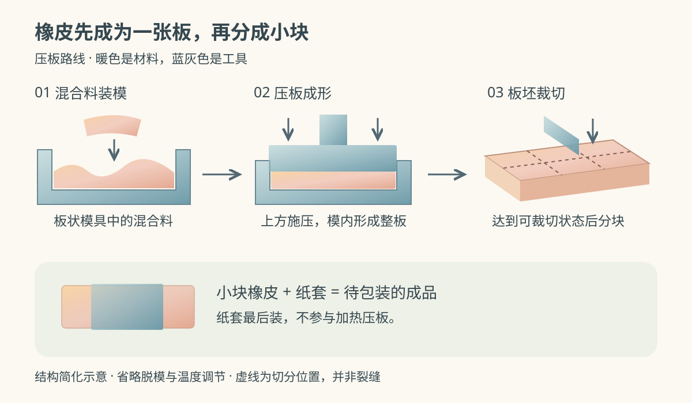
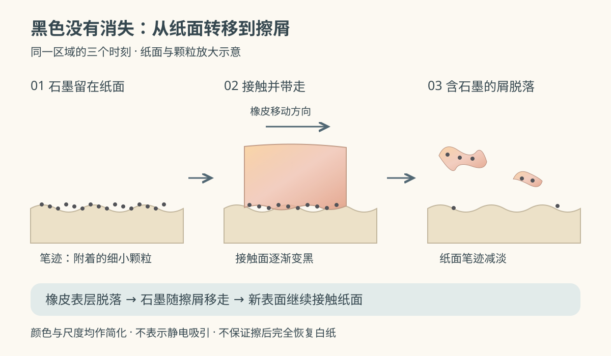

写错一个字，把橡皮从纸套里推出一点，按住作业本来回擦几下。灰黑的笔画淡了，纸上却多出几条黑乎乎的碎屑，橡皮的尖角也磨圆了一点。

字去了哪里？如果只是把纸上的黑色擦掉，为什么连橡皮自己也在变小？

先认清手里的材料：叫作“橡皮擦”的东西，未必由橡胶制成。这里选用**以聚氯乙烯（PVC）为主体、压制成板后裁切的普通塑料橡皮**，用于擦除铅笔笔迹。天然橡胶橡皮、可塑橡皮以及挤出成形的细长橡皮，各有自己的配方和加工路线，不拼进本文这条流程。

*配图采用随机选定的水彩色块风格，以 AI 辅助编写的可编辑 SVG 表现淡彩叠色。它们是原理示意图，不是工厂实拍；颜色、比例与颗粒大小均经过简化。*

## 一、软软的一块，原先是粉和液体

橡皮厂拿到的主要原料之一，是化工厂生产的 **PVC 树脂粉**。树脂经过上游聚合等工序制成，进入这里时已经是聚合物，并不是把盐、石油或树胶直接倒进橡皮模具。沿乙烯路线追溯，上游利用乙烯和氯等制取氯乙烯单体，之后才有树脂生产。[VEC：氯乙烯原料的生产](https://www.vec.gr.jp/enbi/enbi1_2.html)

粉状树脂本身还不是手中柔软的块体。另一类重要原料是**增塑剂**：按配方加入的液体组分，让加工后的材料获得需要的柔软程度。这里的“油状”描述外观和流动状态，不表示可以拿食用油随意替代。历史制造资料也明确记录了将液体软化组分混入粉状 PVC 的做法；其中的老配方不能直接当成今天商品的成分表。[STAEDTLER 历史专利：粉状树脂与软化组分](https://patents.google.com/patent/US4335033A/en)

配方还可以包含细粉状的研磨材料，以及所需的色料等辅助组分。细粉参与调节擦拭表现，色料负责外观；纸套则是后面才加上的包装。蜻蜓的原料介绍把塑料橡皮的树脂、增塑剂和细研磨材料分开列出，并没有给出适用于所有产品的比例。[蜻蜓：橡皮的原料](https://www.tombow.com/mamechishiki/e96/)

所以，白色、柔软、外形相近的两块橡皮，不一定是同一配方。增塑剂本身也有不同种类，不能根据“PVC 橡皮”这个名称，就反推出某一种具体增塑剂。厂商公开过更换增塑剂、同时保持消字性能的过程。[蜻蜓：MONO 增塑剂更换说明](https://www.tombow.com/notice/211124/)

## 二、称好原料，还要边加热边混匀

工人按产品配方分别称量原料，投入搅拌设备。可以把关键部分想成一个装料的容器，里面的搅拌机构不断翻动混合物，让液体分布到粉料中，减少局部干粉和配料不均。

设备在混合期间还要供热。随着受热和搅拌，材料从分开的粉、液变成可供后续成形的均匀混合料。进入下一步的判断并非“看不见粉就行”，还要使料的状态适合所选成形工艺。公开资料说明了加热搅拌，却未统一说明各厂的供热结构，因而不能把某一种夹套或加热器当成所有设备的标配。[SEED：称量与加热混合](https://www.seedr.co.jp/factory/)

温度和时间为什么重要？橡皮既要成为能握住的整体，又要在擦拭时逐渐磨耗。加工并不是让树脂“结合得越牢越好”。蜻蜓的制造介绍特别指出，过度结合会偏离橡皮所需的状态，因此需要控制加热条件。这个过程也不是加水和面，再把水晾干。[蜻蜓：混合中的热与时间](https://www.tombow.com/sp/kids/eraser/factory.html)

## 三、先压一张板，还是直接做一小块？

本文采用压板路线。混合料装入板状模具，模具限制材料向四周扩展的范围，压机从上方施压，让料在模内形成连续的板坯。理解设备时，抓住三处就够了：下方支承模具的台面、中间装料的模腔、上方能靠近并压住材料的压板。

这一步的输入是混合料，输出是一张有厚度的板，板的面积大于单块成品。压力帮助料填入模内并成形，加热条件则关系到材料最后的性能。压机、模具和加热控制需要配合，不能只把它理解成“拿重物把粉压实”。[蜻蜓：加热压板法](https://www.tombow.com/mamechishiki/e84/)

*上排依次为装料、压板和裁切。暖色表示材料，蓝灰色表示工具；裁切虚线是切分位置，不是橡皮内部已有的裂缝。图省略脱模与温度调节细节，不表示成形后立即趁热切割。*

成形料达到可脱模、可裁切的状态后，板坯送到裁切设备。刀具沿设定位置把板分开，得到适合手握的小块；具体是怎样分条、转向和定长，取决于机器布局。**压板建立材料的整体形状，裁切确定单块尺寸**，是两件不同的事。[SEED：压缩成形与裁切](https://www.seedr.co.jp/factory/)

有些细长橡皮采用挤出法，让材料从机头出口连续出来，再切成需要的长度。这是另一种成形选择，并不是压好的板还必须再经历挤出。仅凭成品是长方体，也不能确定它一定来自哪条生产线。

## 四、纸套为什么留到最后装？

裁好的一小块橡皮还要套上纸套、按产品要求包装，再装箱。纸套包住中间一段，两端可以露出；它既提供握持位置，也隔开橡皮与周围物品，减少污物直接接触。[蜻蜓：裁切与包装](https://www.tombow.com/sp/kids/eraser/factory.html)

这也解释了为什么不适合把纸套一拿到手就丢掉。某些橡皮与塑料表面、涂漆表面长时间贴在一起，可能发生粘连。制造商因此建议用后放回纸套。它不是让橡皮“保持湿润”的水分包装，更不需要蘸水才能使用。[SEED：纸套与接触存放](https://www.seedr.co.jp/safety/)

## 五、擦的时候，黑色去了哪里？

铅笔在纸上划过，把含石墨的细小颗粒留在纸面及其细微凹处，形成可见的笔迹。橡皮擦过时，表面接触这些颗粒，把其中一部分从纸上带走；于是橡皮的接触面会变黑。

接着，带着石墨的表层在摩擦中脱落，成为擦屑，露出新的材料表面继续工作。**笔迹变淡和橡皮掉屑，是同一次擦拭中相互关联的变化。** 黑色没有凭空消失，而是换到了橡皮表面和碎屑里。[蜻蜓：橡皮消字的过程](https://www.tombow.com/mamechishiki/e68/)

*从左到右为同一区域擦拭前、接触时和擦拭后。纸面起伏与黑色颗粒均被夸大；右侧保留少量颗粒，表示擦除效果并不必然是完全恢复白纸。*

“少屑”也不必然意味着没有材料脱落。比如一些便于清理的产品，主要是让碎屑聚成较大的团，减少四处散落的小屑；用碎屑数量直接判断擦除能力，会把聚屑方式和实际消字效果混为一谈。[蜻蜓：少屑橡皮仍会产生擦屑](https://www.tombow.com/mamechishiki/e76/)

## 六、怎样用，怎样判断擦得好？

回到作业本，先把纸放平，用另一只手固定纸张，露出一小段橡皮，用干净的接触面轻擦目标位置。细小笔画可以用边角，大块涂痕需要更宽的接触面。擦屑积起来后轻轻扫开，再观察笔迹，不要把含石墨的碎屑反复揉到旁边。

观察时可以分别问两件事：黑色是否减淡，纸面是否仍然完整。写得很重留下的压痕，属于纸面形状的变化，擦掉黑色也未必消得掉；若纸已经起毛或卷皱，继续加力并不是单纯提高消字效果。

想做一个简单比较，可以在同一张纸上用同一支铅笔画几块尽量相近的笔迹，再用不同橡皮以尽量一致的力度、次数擦拭。并排看残留灰度、纸面损伤和擦屑是否容易清理。手工比较难以严格控制压力，因此它只能帮助观察使用差异，不能冒充标准试验或据此排出通用名次。

工厂检验也不会只看“够不够白、软不软”。SEED 列出的品质项目包括硬度、老化、移行性和消字能力；其中消字能力与存放时是否影响接触材料，是不同的检查对象。[SEED：品质检查项目](https://www.seedr.co.jp/safety/)

---

再看看桌上的碎屑，可以把整条来路连起来：

> **树脂粉与液体增塑剂等原料 → 称量、加热混合 → 模内压成板坯 → 裁切、套纸套 → 擦拭时带走石墨，并让含石墨的表层成为碎屑。**

工厂把松散原料做成能握住的一块；使用时，这一块又有控制地损耗自己，把纸上的黑色一点点带走。
