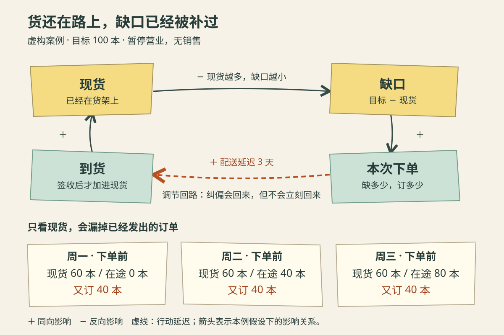

一家文具店装修收尾，准备下周恢复营业。店长希望开门时有 100 本练习册，周一盘点只有 60 本，便订了 40 本。周二还没到货，接班店员又按“缺多少补多少”的办法订了 40 本。周三，另一个店员照做了一遍。

周四第一批货到了，架上正好 100 本，大家停止下单。可周五、周六还有货送来，最后变成 180 本。

每次减法都没错，为什么合起来多了 80 本？问题不在谁不会数数，而在每次决定都只看架上，没有看上一次决定正在路上。

**反馈回路，是一个变量的变化经过一串影响，又返回来改变这个变量的闭合关系。** 在这里，库存影响补货决定，补货经过配送改变库存，新库存又影响下一次补货。它是系统分析的表达方法；画成一个圈，并不意味着现实关系已经得到证实。

下面的店铺、目标、日期安排和数量都是**虚构演示设定**。先回答“重复补货为什么发生”，再讨论营业中的消耗、不可靠的交期，以及怎样验证新规则。

## 一、先把货架上的货和路上的货分开

为了只观察延迟造成的问题，先固定条件：小店本周暂停营业，无销售、退货、损耗和预留订单；原有 60 本全部可售。供应商每笔订单完整交付，周一早上下单，周四早上到货，此后各单同样相隔三个日历日。每天先收货，再盘点，最后决定当天订多少；已下订单不能撤销。100 本是本例给定目标，不是算出的最优库存。

这时有三种容易混淆的数：

| 名称 | 统计时点与口径 | 单位 |
|---|---|---|
| 现货 | 当天收货后、下单前，已经在店里且可售的数量 | 本 |
| 在途 | 当天下单前，已确认但尚未收到的订货数量 | 本 |
| 本次下单量 | 当天新发出的订货数量，不是当天收到的数量 | 本/次 |

现货是一个**存量**，像桶里已经积下的水。到货与售出改变它。在按日记录的账上，关系是：

`下一天现货 = 今天现货 + 两次盘点间到货量 − 两次盘点间售出及其他出库量`。

这里各项都是对应期间的本数；如果使用“每天到货多少本”的流率，就要乘以时间长度，才能与存量相加。下了采购单，不会立刻让现货增加。

Meadows 在系统分析文章中用存量、流入与流出说明积累，并把调节回路及响应延迟分开讨论。本文借用这些概念，以下补货规则和数字推演均为另行构造的案例。[Donella Meadows：Leverage Points，第 9、8 节及存量说明](https://donellameadows.org/archives/leverage-points-places-to-intervene-in-a-system/)

## 二、顺着箭头走一圈，为什么本来应该纠偏？

原规则可以写成：`本次下单量 = max(0，100 − 现货)`。其中 `max` 表示取两项中较大的一个，库存超过目标时下单为零，不会产生负订单。

在现货不足的范围内，沿关系走一圈：现货减少，目标与现货的缺口增大；缺口增大，下单量增大；在供应商按约交付的前提下，稍后的到货增多；到货让现货回升，原来的缺口缩小。

变化绕了一圈，最终抵消了起初的偏离，这叫**调节回路，也称负反馈回路**。这里“负”不表示有害，只表示反馈方向抵消初始变化。

*作者以 AI 辅助编写 SVG 绘制的虚构案例示意，随机风格为便签手绘。沿箭头顺时针读；“＋”表示其他条件相同时同向影响，“−”表示反向影响，不代表好坏。橙色虚线标记三天配送延迟，下面数字均取当天下单前。便签面积和线长不编码数量，图中省略零销售与固定目标。*

另一类是**增强回路，也称正反馈回路**：初始变化绕一圈后被继续放大。例如，假设这家店把新增利润用于增加能带来利润的商品，新利润又支持继续投入，便可能形成增强关系。这个补充假说还需要需求、利润率等条件，不能只凭“越做越大”的描述确认。

两者按作用方向区分，不按结果好坏区分。更要紧的是：**调节方向正确，不保证调整过程平稳。** 本例要检查的，正是纠偏动作什么时候生效。

## 三、逐日记账，重复纠偏在哪里发生？

先原样执行只看现货的规则。到货已经从在途中扣除，新增订单则在当天决定后才计入在途。

| 日期 | 当天到货 | 下单前现货 | 下单前在途 | 本次下单 |
|---|---:|---:|---:|---:|
| 周一 | 0 | 60 | 0 | 40 |
| 周二 | 0 | 60 | 40 | 40 |
| 周三 | 0 | 60 | 80 | 40 |
| 周四 | 40 | 100 | 80 | 0 |
| 周五 | 40 | 140 | 40 | 0 |
| 周六 | 40 | 180 | 0 | 0 |

周一订 40 本，在设定下合理：原有 60 本加这批货，便能达到 100 本。

周二的现货仍为 60，并不能说明周一的动作无效。它只说明三天交期还没走完。但原规则把没有变化的现货再次解释成需要新增 40 本，于是重复覆盖了同一个缺口。周三又重复一次。

到周四，看见目标达成再停单，已经来不及拦住路上的 80 本。最终现货为 `60 + 40 + 40 + 40 = 180 本`，超出目标 `180 − 100 = 80 本`。

这里没有信息传回太慢：每天盘点都是准确的。慢的是**行动变成结果的过程**。如果连盘点报表也晚两天，才会再叠加一种信息延迟，需要分别记录。

本表演示的是一次超调，不能据此声称库存一定持续振荡。由于本周没有销售、多订的货又不能退，达到 180 本后只会停在那里。若要解释反复缺货、积压交替出现，还得加入消耗、后续订货规则和更长时间的变化。

## 四、把尚未生效的动作放回决定里

在这个暂停营业、交期可靠的案例中，可以先换一个可核查的规则：

> **本次下单量 = max(0，100 − 现货 − 已确认在途)。**

这里的“现货＋在途”表示当前已经拥有或已经安排补入的总量，不表示这些货今天全能拿来卖。因为暂时没有出库和欠交需求，这个口径足够完成演示；营业时不能原样照搬。

从周一重新执行：

- 周一：`100 − 60 − 0 = 40`，订 40 本。
- 周二：`100 − 60 − 40 = 0`，不新增订单。
- 周三：仍为 `100 − 60 − 40 = 0`，继续核查交期。
- 周四：40 本到货，现货变 100、在途变 0；`100 − 100 − 0 = 0`。

此后没有额外来货，现货保持 100 本。这个结果不靠减少盘点次数，也不靠要求店员凭耐心等待；它靠把**已经采取、尚未生效的动作**纳入下一次判断。

为什么不能到货后继续把那 40 本留在在途栏？因为同一批货会同时出现在现货和在途，重复计算。订单号、预计到货日和实际签收必须对应，到一批就转移一批；部分到货也只能扣掉实际收到的部分。

新规则阻止的是未来的重复下单。若周三第三笔单已经发出且不能取消，再换规则也无法消除已有的 80 本超额承诺。此时还要另行考虑延后收货、调拨或复业后的销售安排，不能把重算结果当成事情已经撤回。

## 五、在途也不是万能答案

现在改一个会影响行动的条件：小店提前在周二营业，周二、周三各需卖出 40 本，下一批仍到周四才来。

即使周一那 40 本订货真实可靠，手头 60 本也无法满足这两天共 80 本的需求，会少 20 本。把现货与在途加成 100，只能说明总量，不能说明每个时点都够用。

因此，营业中的版本要按预计到货日展开库存：在货来之前会卖掉多少？已承诺给顾客、尚未交付的数量是多少？最早哪一天可能缺货？如果周二新增普通订单要到周五才到，它也救不了周三的缺口。可行行动可能是加急、调货或调整承诺，而不只是把普通订单再加大。

再改一个条件：供应商通知原订单延期。此时“已有 40 本在途”不等于“按原定日期得到 40 本”。应先更新交期与履约判断，再决定是否找替代供应；若另订后原单仍会到，就要处理双重到货。未知不能直接算零，也不能无条件算作准时供货。

这些反例说明，反馈图只把关系显出来，**没有替我们算出正确目标、预测需求或保证供应能力**。真实补货还受起订量、保质期、货架空间、资金和缺货代价影响。100 本是否合适，需要另做判断；本例的成功只是避免了一个已知的重复动作。

同样，“有延迟就少调整”也不是通用答案。若交期变长而需求保持强劲，减少采购可能加重缺货；应先弄清延迟发生在哪里、已有动作能覆盖什么，再调整力度和节奏。

## 六、怎样知道改的是原因，而不只是碰巧好转？

店长先把三天的采购单与签收单配起来，确认多出的 80 本确实来自对同一个缺口的重复下单。这比只看到“新规则上线后库存下降”更接近对机制的检查。

接下来，保留每天相同时点的现货、未交订单及交期、销售与未满足需求，记录当天依据哪条规则下了多少单。用同一段需求和交期记录回放两种规则，比较缺货量、平均现货与超额到货；回放的差异来自规则计算，不能直接当作真实经营效果。

特别要注意，缺货时的销售量可能低于顾客原本想买的数量。若把“没货可卖”记成“没有需求”，回放会低估缺货。需求未知时，应给出不同需求情景，而不是填一个方便的零。

再选少量商品试行，覆盖几个完整补货周期，同时看缺货有没有增加、平均库存有没有减少、交期是否稳定。促销、停业、换供应商都可能改变结果，比较时要单独说明。若计算结果与签收持续对不上，先查漏单、部分交货和重复入账；若账都对而仍缺货，就要检查需求与目标设置，而不是继续责怪配送延迟。

回到复业前的货架，店员仍然每天盘点，只是看到 60 本时多翻一页订单记录。那页纸让“还没到”与“还没做”成为两件不同的事。

下一次面对迟迟不变的结果，可以沿着这条线检查：

> **现在积累了什么 → 我依据什么采取行动 → 动作多久后生效 → 哪些动作还在途中 → 再加一次，会补上新缺口，还是重复补旧缺口？**

把这几步连起来，才有机会在结果显现之前，识别自己正在制造的过量调整。
