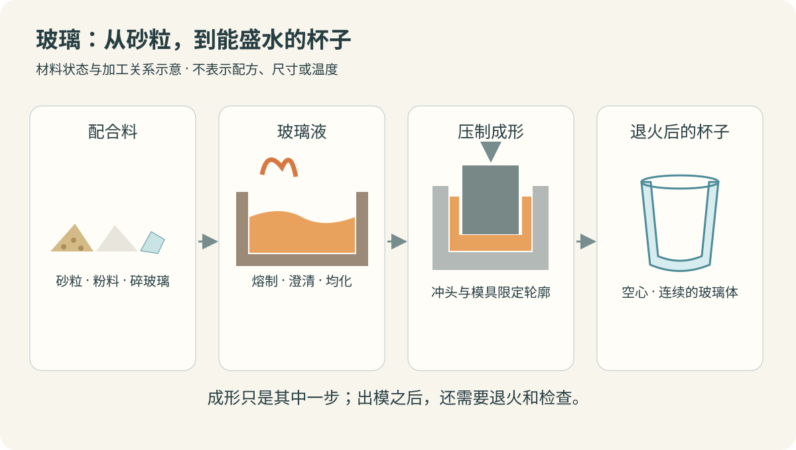
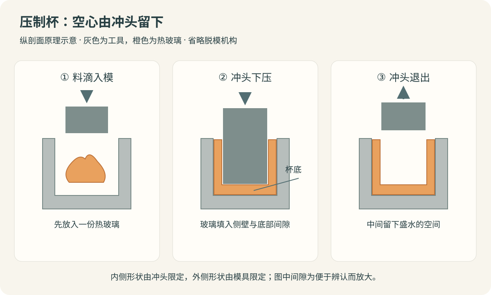
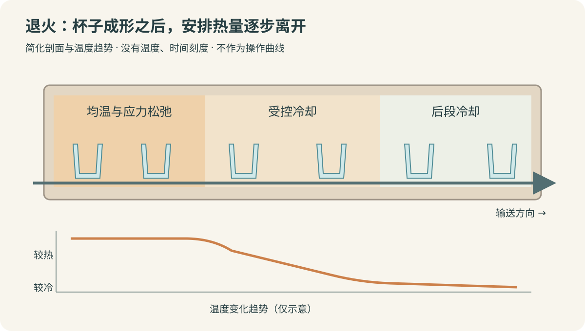

把水倒进一只透明玻璃杯，能看见水面，也能透过杯壁看见桌上的花纹。杯口薄一些，杯底厚一些，中间留着盛水的空间。

如果把它的来路追到工厂，会遇见几种很不相像的东西：砂粒、白色粉料、碎玻璃，以及窑里灼热、黏稠的玻璃液。

这些材料怎样成为一个透明、空心、能拿在手里的杯子？

下面以常见的**钠钙玻璃**为对象，沿着配料、熔制、压制成形和退火往下看。玻璃杯也可以吹制，耐热杯还可能采用其他玻璃配方；本文选择压制杯作为代表，不把不同工艺拼成一条生产线。

*封面及正文配图为按文中原理绘制的矢量示意图。颜色、设备比例和工序间距经过简化，不表示真实生产线尺寸或通用工艺参数。*

## 一、准备原料：玻璃为什么不只用沙子？

钠钙玻璃的主要原料包括石英砂、纯碱和石灰石。[英国玻璃协会：玻璃的原料与用途](https://www.britglass.org.uk/about-glass)

**石英砂**主要提供二氧化硅。石英是矿物，砂是颗粒形态；玻璃厂需要符合要求的硅质原料，不能把随手抓的一把河沙或海沙直接当作同样的配料。

原料中的杂质会影响成品。例如，制造高透光、低色泽的玻璃时，需要控制铁等杂质。英国玻璃协会介绍的低铁硅砂，就用于超白玻璃等产品。[英国玻璃协会：低铁硅砂的使用](https://www.britglass.org.uk/knowledge-base/digital-library-and-information-services/locally-sourced-sand-production)

**纯碱**是碳酸钠。它参与配料，可以降低相对于单独熔制二氧化硅所需的加工温度。但只靠硅砂与纯碱得到的材料，耐水性还不适合普通杯子的用途。

**石灰石**主要提供钙的成分，帮助改善玻璃的化学耐久性，让成品更适合与水等物质接触。这几种原料加热后发生反应，最后不再以一粒砂、一粒纯碱的形式各自留在杯壁里。[康宁：玻璃怎样制造](https://www.corning.com/worldwide/en/innovation/materials-science/glass/how-glass-made.html)

配料中还可以加入**碎玻璃**。它已经经历过一次玻璃制造，重新熔入配合料有助于减少新原料用量和熔制能耗。[英国玻璃协会：碎玻璃回收利用](https://www.britglass.org.uk/our-work/recycling)

不过，碎玻璃也要经过筛选，成分和颜色需要符合产品要求。陶瓷碎片、耐热玻璃等混入普通玻璃包装的回收料，可能影响熔制或成品质量。能回收的玻璃不等于可以不加区分地倒进同一座窑。[英国玻璃协会：回收料的分选与污染物](https://www.britglass.org.uk/sites/default/files/00017-E2-19-Maximising-the-recyclability-of-glass-packaging-web.pdf)

工厂按配方计量各类原料，再混合成**配合料**。这时看见的仍是颗粒、粉料和碎片的混合物，还没有变成透明的整体。

*材料变化示意：颗粒和粉料先成为玻璃液，玻璃液在模具里成形，成形后的杯子还要经过退火。图中橙色表示高温状态，浅蓝色用于辨认玻璃轮廓，不表示成品必然带蓝色。*

## 二、进入熔窑：颗粒怎样成为玻璃液？

玻璃熔窑可以想象成一座保温的高温池炉：外围是炉体，内部由耐火材料形成能容纳玻璃液的池槽，上方有供热空间。

以燃料供热的连续池窑为例，配合料从加料位置进入，燃烧器向炉内供热。原料受热、反应，逐步进入玻璃液；玻璃液再向后续处理区域流动。池内还有由温差等因素引起的循环流动，不能把它想成一条只向前移动、毫不混合的传送带。部分窑炉也利用电极补充热量。[HORN：燃料池窑的结构与供热](https://www.hornglass.com/products/melting-furnaces-and-equipment/end-fired-furnaces)

这一步也不是简单地把砂粒“烧软后黏在一起”。原料发生反应，碳酸盐原料会带来气体释放，原有颗粒逐渐消失，材料成为连续的玻璃液。使用碎玻璃可以减少这部分新原料反应带来的二氧化碳排放。[英国玻璃协会：碎玻璃与熔窑能耗](https://www.britglass.org.uk/knowledge-base/resources-and-publications/balance-between-furnace-operating-parameters-and-recycled)

熔制还要解决均匀性和气泡问题。把原料融进去之后，需要进一步澄清、均化，减少妨碍质量的气泡和成分差异。设备制造商也会通过池窑结构与玻璃液流动控制改善这些过程。[HORN：玻璃液流动、均化与澄清](https://www.hornglass.com/products/melting-furnaces-and-equipment/bubbling-systems)

此时得到的**玻璃液**不是像水那样稀薄的液体。它有明显的黏度，而且黏度随温度改变：温度较高时更容易流动，降温后逐渐变得难以流动。这个特点让玻璃能够被压、吹、拉成不同形状。[康宁：玻璃的黏度与成形](https://www.corning.com/glassclass/index.html)

## 三、送去成形：为什么还要调节温度？

熔窑要完成熔制，成形机则需要一份状态稳定、适合加工的玻璃液。这两处对材料状态的要求不同。

连接熔窑与成形设备的供料通道，常称为**料道**。它像一段有保温结构和温度控制的槽道，让玻璃液经过调节，再送往供料端。加热、冷却和均温要配合，避免同一份玻璃液不同部位的温度差太大。[HORN：料道的温度调节与均温](https://www.hornglass.com/products/glass-conditioning-systems/electrical-forehearths)

如果玻璃液过于容易流动，就难以稳定保持想要的形状；如果已经太黏，又不容易在模具里充分展开。工厂要结合玻璃组成、产品尺寸和设备调整，不能给所有玻璃杯套一个成形温度。

供料设备把玻璃液分成一定量的**料滴**，送入模具。料滴虽然叫“滴”，却可以是一团有分量的黏稠热玻璃。它的用量要与杯子的形状、杯壁和杯底所需材料相匹配。

到这里，材料的状态已经连起来了：

> **颗粒与粉料的配合料 → 熔制、澄清和均化后的玻璃液 → 调节到适合成形状态的料滴。**

## 四、压出杯子：空心是怎样留下来的？

压制玻璃使用金属模具和冲头。模具形成外部轮廓，冲头进入玻璃料，形成内部轮廓。[康宁玻璃博物馆：压制玻璃](https://allaboutglass.cmog.org/definition/pressed-glass)

把它想成一次纵向剖面操作：模具中先放入一团热玻璃，冲头从上方下压，玻璃被挤向冲头周围，逐渐填入冲头与模具之间的空间。

这圈间隙决定杯壁的形状；冲头底端与模具底部之间的间隙，则留下杯底需要的材料。冲头占据的空间，最后成为杯子里面盛水的空腔。

**杯子不需要先做成实心玻璃块，再把中间掏掉。** 内外两套轮廓在成形时共同限定了玻璃的位置。

*压制原理剖面：灰色为模具和冲头，橙色为热玻璃。中图中，冲头与模具之间的间隙容纳杯壁和杯底；右图表示冲头退出后的杯形，后续脱模机构未画出。实际设备还需要控制模具温度、动作和成形时间。*

玻璃接触模具并降温，逐渐获得足以保持形状的刚性，随后退出冲头、脱模，再进入后续处理。模具也不能一直任由热量积累，整套设备需要配合温度控制。

压制适合制造一些较厚实的杯子，也能借助模具形成外部纹样。其他杯子则采用吹制：让热玻璃在气体压力作用下展开，形成空心形状。两种方式都利用热玻璃可加工的状态，但形成内腔的方法不同。[利比：机吹与压制玻璃器皿](https://b2b.libbey.com/solutions/machine-made)

## 五、已经像杯子了，为什么还要退火？

刚成形的杯子虽然有了轮廓，内部温度却未必均匀。表面、杯壁内部和较厚的杯底，冷却速度可能不同。

玻璃降温时会收缩。不同部位如果在不同时间变得难以变形，就可能留下彼此牵制的内应力。这样的杯子看起来完整，却可能在冷却途中、以后受碰撞或温度变化时开裂。[康宁玻璃博物馆：退火](https://allaboutglass.cmog.org/definition/annealing)

因此，成形后的玻璃要进入**退火炉**。连续生产使用的退火炉可以像一条带输送装置的长隧道，杯子沿着炉内向前移动，经过安排好的温度区域。[康宁玻璃博物馆：隧道式退火炉](https://allaboutglass.cmog.org/definition/lehr)

退火先让玻璃在适合应力松弛的温度范围内停留、均温，再受控冷却，尤其要控制容易把应力保留下来的温度区间。厚薄、玻璃组成和装炉方式都会影响过程，不能理解为把所有杯子统一“晾一会儿”。

*退火炉示意：橙色区域表示较热的处理段，浅色区域表示后续冷却段。下方曲线没有温度和时间刻度，只说明先停留、再受控降温的关系，不可用作操作曲线。*

退火与钢化也要分清。退火的目的是减小制造过程中不希望留下的应力；热钢化则通过安排加热和快速冷却，建立特定的应力分布以提高性能。本文讲的是普通退火杯，不能把它的处理过程直接套到钢化器皿上。[康宁：玻璃的强化方式](https://www.corning.com/worldwide/en/innovation/materials-science/glass/how-glass-made.html)

## 六、回到杯壁：沙子不透明，玻璃为什么透明？

先把“一堆砂”和“一粒石英”分开。石英晶体本身可以透明，但砂堆里有许多颗粒表面、颗粒间的空气和不同杂质。光经过这些界面时，不断改变方向，很难保留一个清晰的背景图像。

当原料成为均匀、连续的玻璃体，原先砂粒之间的大量界面不再存在；配合合适的组成、较少的缺陷和光滑表面，可见光就能较顺畅地通过。[宾夕法尼亚州立大学：玻璃为什么透明](https://courses.ems.psu.edu/matse81/node/2154)

这里有两个问题：**材料是否吸收这部分光，以及材料内部和表面是否把光散射开。** 玻璃透明，需要同时考虑这两件事。

例如，气泡、夹杂或粗糙表面会影响透视效果；某些成分又会让玻璃带颜色。透明与无色也不是一回事：有色玻璃仍可能让人看清后面的物体。[康宁：玻璃的透光与颜色](https://www.corning.com/glassclass/index.html)

玻璃内部没有像石英晶体那样的长程周期排列，属于**非晶态固体**。不过，不能把“没有规则晶体结构”单独当成透明的原因，透明的石英晶体就是眼前的反例。

## 七、倒水以后：为什么冷热变化会让杯子裂开？

向较冷的杯子里倒入热水，内侧先受热，外侧和较厚部位还没有跟上。温度较高的部分想膨胀，温度较低的部分却限制了它的变形，于是出现热应力。应力过大，或遇上已有缺陷，就可能引起破裂。[肖特：温差与玻璃热应力](https://media.schott.com/api/public/content/1fafd9a6d9f84a438212b4ea90ada090?download=true&v=67b99a07)

退火减少了制造时留下的应力，却不能阻止使用时产生新的温差。杯子曾经在熔窑里经历高温，也不能证明成品能承受任意冷热变化：熔制时材料可以流动，使用时杯子已经是固体，承受温差的条件不同。

有些耐热器皿使用**硼硅玻璃**。其组成与普通钠钙玻璃不同，较低的热膨胀系数有助于提高对温差的承受能力。[肖特：硼硅玻璃与热膨胀](https://www.schott.com/en-gb/expertise/materials/borosilicate-glass)

但实际杯子的表现还受形状、厚薄、表面损伤和制造质量影响。日常使用应按照产品说明确认用途，不能只凭“透明”“厚实”或“玻璃做的”判断能否倒沸水、直接加热或放入烤箱。

## 八、出厂之前：怎样确认杯子做得合适？

杯子需要检查尺寸、外观和完整性，例如杯口是否有缺口、杯体是否有裂纹、气泡或夹杂是否符合产品要求。内应力则需要相应方法检测，不能只靠肉眼看起来通透来判断。

玻璃容器的工业检测设备会结合照明、相机等检查底部、侧壁和口部，也可通过偏振光检测应力相关缺陷。这说明外观与应力是不同的检查对象；杯子生产线的具体检验项目仍应根据产品要求确定。[Bucher Emhart Glass：容器检查系统](https://www.emhartglass.com/Products/Technology/InspectionEquipment/InlineInspection)、[偏振光应力检测原理](https://emhartglass.com/sites/default/files/publications/2020-10/TNB228RevC%20-%20FleXinspect%E2%84%A2%20B%20Application%20Notes.pdf)

如果评价耐冷热变化能力，还需要明确起始温度、温差、操作方式和判定条件。脱离测试条件的一个“耐温数字”，不足以说明日常操作是否合适。

---

再看桌上的杯子，它的制造过程可以连成一条线：

> **石英砂等原料与合适的碎玻璃 → 计量混合的配合料 → 熔制、澄清和均化的玻璃液 → 调节状态并分出的料滴 → 模具与冲头限定出的杯形 → 退火、检查后的玻璃杯。**

杯壁里的透明整体，来自原料的熔制与反应；中间的盛水空间，来自成形时留下的轮廓；拿到手里时稳定的形状，还经历了出模之后受控的冷却。

一只看起来简单的杯子，需要把材料怎样变化、形状怎样形成，以及热量怎样离开，都安排好。
