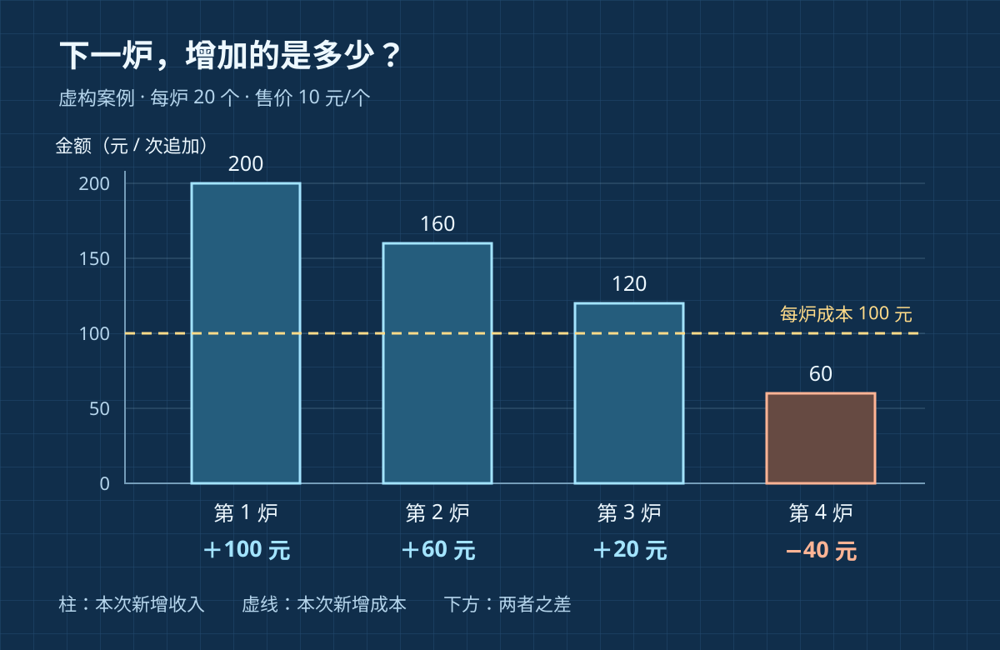

下午两点，面包店的早班账已经结好。上午卖得不错，扣掉当天房租、固定工资和已用原料，账面仍有盈余。店员看着空出的烤箱说：“今天已经赚钱了，下午多烤几炉，总能再赚一点。”

店长却担心，越晚出炉，越可能剩下。第一炉有人等着买，不代表第四炉也能卖完。上午的好成绩，不能回答下午还该做多少。

**边际分析，就是把决定拆成一次明确的增减，比较这一步新增的收益与新增的代价。** 这里的“边际”指变化发生的那一步，不是“小到可以忽略”。OpenStax 将它解释为考察多一点或少一点所带来的成本与收益变化。[OpenStax：边际决策](https://openstax.org/books/principles-economics-3e/pages/2-1-how-individuals-make-choices-based-on-their-budget-constraint)

下面的店铺、金额、销量和设备条件都是**虚构演示设定**，不是真实经营数据。要回答的问题也很窄：在下午既定营业时间内，追加零到四炉中的哪一种，能带来最多新增现金贡献？

## 一、先说清楚“多做一点”是多少

这家店按整炉制作，每炉 20 个，不能只做半炉。下午最多还有四个连续烘焙时段，同一种面包每个售价 10 元，不打折。每炉新增原料、包装及电费合计 100 元；员工已排班到闭店，四种追加数量都不需要加班，也不会挤掉其他产品的制作。

本例先假定下午没有上午剩货，各炉产品品质一致，顾客只买一次，不会因为晚一炉出炉而重复购买。当天卖不掉的追加面包没有回收收入，相关处置不另收费。货款与新增支出都在当天发生，暂不计税费差异。

“多做一炉”的成本是整炉的 100 元，不能等到没卖完时才把剩下面包算作损失：那部分原料已经包含在这 100 元中，再扣一次会重复计算。

店长根据预订和过往相似下午的记录，暂时给出一组销量预测：追加第一炉能多卖 20 个；在已有第一炉的基础上，第二炉还能多卖 16 个；第三炉多卖 12 个；第四炉多卖 6 个。这些是**相邻方案之间的销量差额**，不是四批独立顾客的确定承诺。

因此，追加两炉的总销量预测是 36 个，追加三炉是 48 个。预测包含前面方案的销量；若新鲜的后炉只是替代了前炉本来能卖出的面包，就不能把替代部分再算成新增销售。

## 二、把下一炉单独拿出来算

本文把追加收入减去追加现金支出，称为“新增现金贡献”。它用于比较下午的方案，不等于全店净利润。

| 从哪个方案变到哪个方案 | 新增销量 | 新增收入 | 新增支出 | 这一步新增现金贡献 |
|---|---:|---:|---:|---:|
| 零炉 → 一炉 | 20 个 | 200 元 | 100 元 | ＋100 元 |
| 一炉 → 两炉 | 16 个 | 160 元 | 100 元 | ＋60 元 |
| 两炉 → 三炉 | 12 个 | 120 元 | 100 元 | ＋20 元 |
| 三炉 → 四炉 | 6 个 | 60 元 | 100 元 | −40 元 |

第一步，做第一炉比不做多留下 `20 × 10 − 100 = 100 元`。第二步，再做一炉多留下 `16 × 10 − 100 = 60 元`，所以在当前目标下值得从一炉增加到两炉。

第三步仍然有 `12 × 10 − 100 = 20 元`。第四步却是 `6 × 10 − 100 = −40 元`：这一炉有收入，却让下午方案的总贡献下降。

*作者以 AI 辅助编写 SVG 绘制的虚构数据图，随机风格为蓝图线稿。四根柱表示每一步新增收入，共用左侧金额刻度；虚线为每炉 100 元新增成本。柱高编码金额，横轴是追加顺序，不是小时。柱下数字给出收入减成本后的变化。*

这里销量随追加炉数下降，是本例的需求预测，不是边际分析自带的规律。边际分析负责比较变化，不能替我们证明顾客一定越来越少。

## 三、四炉仍然赚钱，为什么选三炉？

把每一步重新加回去，可以检查刚才有没有只看局部而漏掉整体。

| 下午追加数量 | 预测总销量 | 总收入 | 总追加支出 | 总新增现金贡献 |
|---|---:|---:|---:|---:|
| 零炉 | 0 个 | 0 元 | 0 元 | 0 元 |
| 一炉 | 20 个 | 200 元 | 100 元 | 100 元 |
| 两炉 | 36 个 | 360 元 | 200 元 | 160 元 |
| 三炉 | 48 个 | 480 元 | 300 元 | 180 元 |
| 四炉 | 54 个 | 540 元 | 400 元 | 140 元 |

四炉的 140 元确实大于零，但三炉的 180 元更高。第四炉没有把整个下午变成亏损，却把本来可得的贡献吃掉了 40 元。

如果只看平均数，误会更隐蔽。四炉生产了 80 个，每个生产出的面包追加成本是 `400 ÷ 80 = 5 元`，低于 10 元售价。可店里预测只能卖出 54 个，另外 26 个没有收入。“售价高于平均生产成本”没有处理卖不掉的数量，更不能证明最后一炉值得做。

本例中，每一步净增量依次为 100、60、20、−40 元，并且只有这五种可行数量。枚举总表后，三炉就是当前假设下的最佳方案。我们不需要勉强找出一个“收益恰好等于成本”的炉数：整炉是离散选择，等号完全可能不出现。

上午已经获得的盈余，在这五个下午方案里都一样。把它加到每一行，不会改变排序。房租和固定工资也不是不重要，只是它们在这次短期比较里不变；长期是否继续开店，必须把这些支出重新纳入问题。

## 四、先问哪一个估计会让决定翻转

第三炉只多留下 20 元，比前两炉脆弱。每炉支出 100 元、售价 10 元，所以这一炉至少多卖 `100 ÷ 10 = 10 个`，才能在现金贡献上不减分。多卖 10 个时两种数量的贡献相同，超过 10 个才增加贡献。

若第三炉只能多卖 9 个，它就带来 `90 − 100 = −10 元`，三炉总贡献变成 150 元，低于两炉的 160 元。在其他增量保持设定、第四炉也没有更高收益的情况下，应改选两炉。

若第三炉的合理预测范围是 9—13 个，这一步的贡献就横跨 −10 到＋30 元。此时计算没有得出确定答案，而是指出了值得核实的信息：第三炉究竟有没有至少 11 个新增买家？店长可以确认预订、观察前两炉销售，再在最后可开炉时间前决定。等待本身若会错过顾客，也要把失去的销售计入比较。

反过来，假如临时接到一笔能让第四炉新增销量达到 14 个的确定订单，这一步变为 `140 − 100 = 40 元`，四炉总贡献升到 220 元，选择就应更新。原来的“三炉”依赖销量条件，不能变成店铺永久的口号。

## 五、遇到成组成本，不能见到负数就停

再改一项条件：第三、第四炉必须使用晚间烘焙时段，只要进入这个时段，就要额外支付一次 80 元启动费。假设这时已确认晚间订单，第三炉和第四炉分别都能新增卖出 16 个，其余设定不变。

从两炉变三炉，新增收入 160 元，新增支出为 `100 + 80 = 180 元`，净变化是 −20 元。如果机械地“下一步不划算就停止”，会选两炉。

但从三炉变四炉，不用再付启动费，这一步净增加 `160 − 100 = 60 元`。把两炉一起看，从两炉变四炉的净变化为 `320 − 200 − 80 = 40 元`。原来两炉贡献 160 元，这时四炉贡献 200 元，超过两炉；三炉则只有 140 元。

问题在于可行的调整可能是一组动作。**只检查紧挨着的下一步，并不总能找到所有方案中的最佳结果。** 本例原表的逐步停止法有效，是因为已经检查了全部数量，且后面的净增量没有再次上升。遇到一次性费用、整包采购、最低订单量或组合收益，应比较跨过门槛后的完整方案。

同样，若追加面包会挤掉一笔能净留下 50 元的饼干订单，第三炉原本的 20 元现金贡献就不足以补偿放弃的收益。此时要把这个机会成本纳入比较；若已在方案总额中扣过饼干损失，就不要再扣一遍。边际分析与机会成本可以一起用：前者定位“改变哪一步”，后者补上“因此放弃什么”。

如果加炉会让员工超出排班、影响清洁程序或无法满足质量要求，先检查这个方案是否可行。不能用表里的小额正贡献，替代对这些约束的判断。

## 六、让明天的记录修正今天的表

店长今天据预测安排三炉，但不会把一次计算当作验证完成。关店后要记录追加数量、出炉时间、售价、总销量、剩余量、额外支出，以及缺货期间的询问或预订。

其中最难验证的是“多卖了多少”。某炉卖掉 12 个，不一定代表它让全天销量增加 12 个：顾客也可能本来会买另一炉，或改买其他商品。比较时应看相关时段和商品范围内的总变化，并注明替代关系。

连续收集相似星期、天气和促销条件下的记录，可以改善预测。条件允许时，在多个相近营业日小范围交替安排两炉和三炉，事先固定价格与观察口径，比较总贡献和缺货情况。即使如此，客流差异仍会影响结果；有条件的随机安排有助于减少系统性差异，少量观察则只能提供初步线索。

还要给生产能力留下记录：如果两炉方案总在早早售罄后停止记需求，就会低估第三炉的价值；如果三炉方案恰好只在周末实施，又会把周末客流当成加炉带来的效果。账算对了，只说明推演一致，销量假设仍要靠观察修正。

回到下午两点，店长不再问“今天是否已经赚钱”，而是把下一炉单独写在纸上：

> **与哪个方案相比 → 多做的单位是什么 → 真正多了多少收入与代价 → 哪个门槛会改变结论 → 有没有需要一起比较的整组动作？**

今天暂定三炉，第三炉开炉前再核对预订。这个决定留下了明确的修改位置：变化的是需求、成本或可行方案时，就重算对应的一步，而不必拿上午的好成绩替下午作保证。
