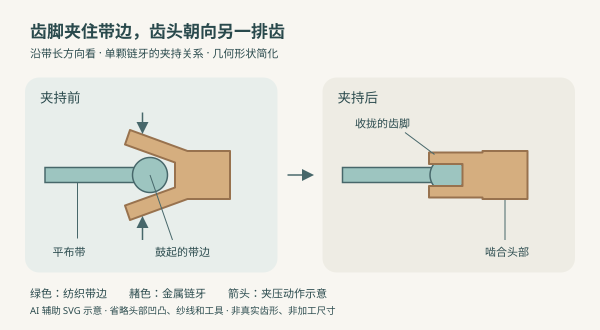
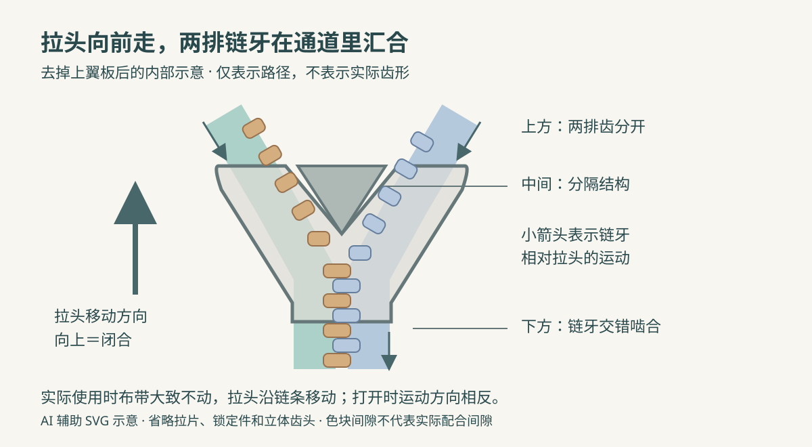

把布袋口两边理平，捏住拉片向前一拉，原先分开的两排金属小齿便接成一条窄链。往回拉，袋口又敞开了。金属齿没有熔化，布带也没有粘在一起，这条接缝却可以反复承受开合。

仔细看，手捏的是**拉片**，沿链移动的整个小零件叫**拉头**；左右的小齿叫链牙，支承它们的是布带。拉片负责把手的动作传给拉头，真正引导链牙合拢的是拉头内部的通道。

下面选一条代表路线：**黄铜扁线冲压植齿、配金属拉头的闭尾拉链**，最后缝进普通布袋。闭尾指末端仍连在一起，不像外套拉链那样可以把两边完全拆开。塑料注塑齿、连续线圈齿和开尾插销都不混入这条流程。

*配图采用随机选定的柔和色块剖面风格，为 AI 辅助编写 SVG 的示意图。颜色区分零件，尺寸和结构细节经过简化；不是工厂实拍，也不是加工图纸。*

## 一、软布带与硬金属，各自从哪里来？

拉链并非在一条金属片上刻出齿，再粘上两条布。布带、链牙、拉头先沿各自的加工路线准备，随后才装配到一起。[YKK：拉链的零件与装配流程](https://www.ykk.com/english/ykk/tech/02.html)

布带从纱线开始。这里采用常见的聚酯纱线机织带：纱筒提供长线，经纱顺着带长排列，纬纱横向穿过。窄幅织机反复让经纱分开、引入纬纱，再把新纬纱推紧，逐渐织出可以卷起来的长带。它要柔软，才能随袋口弯曲；也要能承受齿和缝线传来的拉力。

但布带各处并不一样。靠链牙的一边有鼓起的芯绳结构，给金属齿提供较厚的夹持位置；拉头接触的区域需要耐受摩擦，外侧则留给缝纫。不能随便剪一条薄布，就认为它与专门织出的拉链带没有区别。[YKK：布带不同区域的织造与芯绳结构](https://www.ykk.com/ykk/tech/06.html)

金属这一路使用**黄铜扁线**，也就是铜锌合金加工成的连续扁平线材。黄铜来自合金熔制及后续金属加工，进入植齿设备时已是固态线材，既不是铜矿石，也不是一锅金属液。YKK 的生产介绍展示了铜锌熔制、成形后再加工拉链零件的上游过程；实际拉链厂也可以采购准备好的材料。[YKK Americas：黄铜材料的来路](https://ykkamericas.com/why-choose-ykk/vertically-integrated-production/)

拉头及止码还需各自的金属材料，不能因为链牙是黄铜，就断定所有零件都是同一种合金。布带颜色、金属表面颜色也不能单独证明它们的成分。

## 二、扁线怎样变成一排抓住布带的小齿？

植齿机有坚固的机座，工作头内布置冲头、模具和夹压机构。线材从导向位置送入，布带也沿自己的导路经过工作区。送料机构每次推进一小段，让冲压动作在重复的位置发生；输出端逐渐出现带齿的长布带。[振宇：扁线植齿设备](https://www.zyzm.com/zipper-teeth-making-machine/metal-zipper-flat-wire-teeth-making-machine-.html)

这一步并非只把扁线切成一堆方块。金属需要形成朝向另一排齿的啮合头部，以及能夹住布带边缘的齿脚。冲切分出轮廓，模具压出头部的凹凸形状，再由夹压动作让齿脚抓住带边。**头部负责与对侧链牙配合，齿脚负责留在自己的布带上。**

扁线冲压可以有不同模具安排。公开的链牙制造专利展示了轮廓修切、头部冲点、形成齿脚、夹带及切断等动作；本文只用它说明材料怎样变成夹在布带上的链牙，不把某项专利的工位顺序当作所有工厂的统一配置。[链牙制造专利：扁线成形与夹带](https://patents.google.com/patent/CN1748893A/en)

*沿带长方向看单颗链牙的局部截面。左图把齿脚张开以便辨认，右图显示夹持关系；齿头凹凸、纱线和工具省略，不能据此推断模具轮廓或夹压力。*

夹好一颗，布带再前进一段，下一颗又落在规定位置。齿间距必须与配套拉头及另一排齿协调；忽疏忽密，即使每颗齿看着完好，也未必能顺畅啮合。

此时得到的是长长的**单边牙带**。两边配合后才成为能够啮合的链条，仍不是一根有起点、终点的成品拉链。金属表面的去毛刺、抛光或其他整理按产品路线完成，目的之一是让边缘与接触面适合滑动；电镀、着色等并非每个型号都要照同一个顺序做。

## 三、小小拉头，为什么要另外制造？

拉头的形状比一片弯铁皮复杂。上下翼板限制链牙的位置，侧边引导两排齿，中间的分隔部分让通道呈 Y 形。拉片则通过连接部位装到拉头上，使手能够提起和牵引它。

这里采用常见的金属压铸拉头路线：金属在熔化装置中受热成为熔液，压铸机把它送入合拢模具的型腔，待凝固后开模取出零件。模具两半装在机台上，型腔与内部成形部位共同限定零件的外形和通道。材料从液态成为固态，得到的是待整理、装配的小铸件，而不是把整条布带送进模具浇铸。

零件经所需清理、表面处理后装配拉片等部件，形成可供穿链的拉头。具体合金、加热温度与附件数量随型号而异；有锁定机构的拉头还会增加相应结构。[YKK：拉头部件与模具成形](https://www.ykk.com/english/ykk/tech/04.html)

## 四、长链怎样成为一根定长拉链？

布袋口只需要一段长度，连续链条便要定寸。去齿设备在规定位置清除一小段链牙，留下布带空段，供止码安装和后续切断使用。去齿时目标是取下齿，不能把承担连接作用的布带也切伤。[宏业：金属拉链定寸去齿设备](https://www.zippermc.com/metal-close-end-zipper-machine/hy-101j-full-auto-metal-zipper-gapping-machine-cnc-location)

随后要完成装下止、穿拉头、装上止和切断。以一种闭尾自动设备为例，机器先形成下止，定位空段，再由供料机构送入拉头与上止，夹持机构牵引牙带通过装配位置，最后在空段切开布带，送出单根成品。这里“切断”的对象是布带，与前面的“去齿”不同。[闭尾拉链装配设备：下止、穿头、上止与切断](https://patents.google.com/patent/CN217242938U/zh)

**上止**挡住拉头，避免它从顶端滑出；**下止**限制底端行程，并保持闭尾拉链下端的连接。装好后仍要检查开合与零件位置，不能把“已经切成一根”当作合格判定。

## 五、拉一下，齿为什么会合上？

把拉头内部想成一个上下都有约束的 Y 形通道。闭合时，两排分开的齿从两个分支进入，沿通道向中间靠拢，错位排列的齿头依次进入相邻齿的配合位置，成为一条啮合链。向反方向运动时，中间的分隔结构又把它们引向两边。

*图中大箭头是拉头的闭合方向，小箭头是链牙相对拉头的运动方向，两者不能混读。圆角色块只表示左右链牙的位置，不是实际齿形；图未画拉片、锁定件和齿头的立体凹凸。*

所以，拉头是逐颗引导啮合的工具。离开拉头之后，链牙靠相互配合的形状保持连接。这个动作也解释了为什么零件尺寸需要匹配：换一个“差不多大”的拉头，内部通道未必能把齿送到正确位置。[YKK：Y 形通道与链牙啮合](https://www.ykk.com/english/ykk/tech/01.html)

## 六、缝进布袋，才完成它的用途

工厂交出的拉链还需要与袋口面料、缝线一起工作。缝制时把左右布带分别固定在开口两侧，检查端点对齐、布带平展，再沿可缝区域缝合。针线穿过布带与袋布，把两者连起来；缝线承担连接，链牙承担开合，两者各有位置。

缝线和袋口边缘需要避开拉头运行的通道，具体距离随拉链规格和袋口做法确定。缝好后先让袋口平放，来回拉动，检查是否把里布卷入、布带是否起皱。这里也没有一个适用于所有袋子的固定缝距。

使用时，先让袋口两侧靠近，再顺着链条方向拉动。塞得太满，把拉头当成硬拽两边布料的工具，会增加开合阻力。若夹进里布，应停止硬拉，轻轻回退拉头并整理布料，而不是继续把布卷进去。[YKK：使用中的受力与夹布处理](https://ykkafrica.com/precautions/)

## 七、顺滑和牢固，要分别检查

轻轻拉几次，可以发现明显卡顿、夹布或闭合后自行分开的现象，却测不出拉链能承受多大的力。

工厂的横向强力试验，会夹住已经啮合链条两边的布带，按规定条件向两侧拉，观察承受能力；止码保持力和拉片连接强度又有各自的夹持与施力方式。比较结果必须看同一试验对象和条件，不能把横向强力直接当作拉片可以悬挂的重量。[YKK：拉链强力测试方法](https://www.ykkfastening.com/quality/methods.html)

缝成布袋后，整体表现还包括袋布与缝线是否牢靠。拉链本体通过测试，不等于任何缝法和装载方式都能获得同样结果。

---

再拉上袋口，可以沿着两条材料来路回想：

> **纱线 → 带有加厚边缘的布带；黄铜扁线 → 冲压成形、夹到带边的链牙。牙带配合拉头，经过定寸、装止码与切断，成为一根闭尾拉链，再由缝线连接到布袋上。**

拉片走过的一小段距离，让一颗颗齿依次进入合适的位置。能够反复开合的接缝，就是这样从软纱线、硬金属和精确的零件配合中做出来的。
