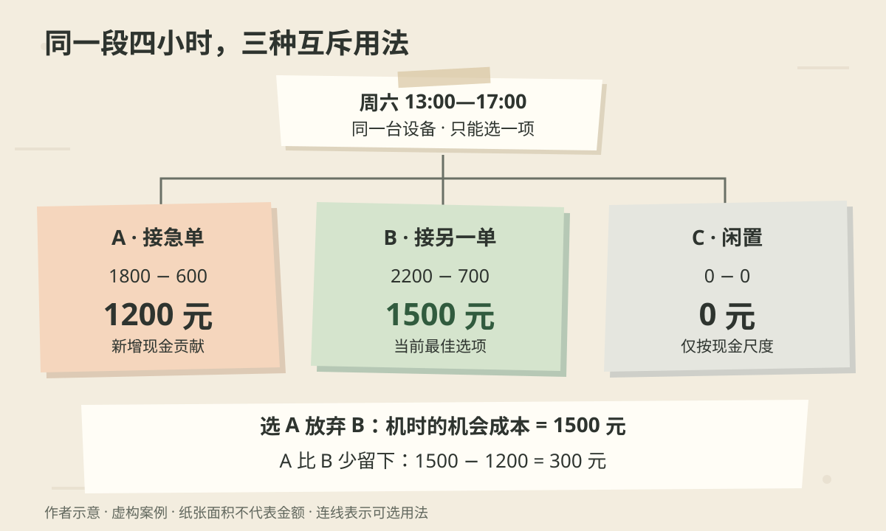

周五下午，一家小印刷店收到一笔周六交货的急单。客户愿意付 1800 元，纸张、耗材和额外电费合计 600 元。店员算了一下：“还能留下 1200 元，为什么不接？”

老板翻开排班本：周六只剩四小时机时，另一个客户也在等回复。两笔订单各要四小时，接了这一笔，另一笔就做不了。

争议不在减法，而在那四小时原本还能做什么。

**机会成本，是作出选择时放弃的最佳替代方案的价值。** 它让我们把没有出现在当前报价单上的选项也放进比较。这是经济学中的选择概念，不是一条“永远选收入最高的事”的生活准则。[圣路易斯联储：Money and Missed Opportunities](https://www.stlouisfed.org/publications/page-one-economics/2019/10/01/money-and-missed-opportunities)

下面的店铺、报价、机时和客户条件均为**虚构演示设定**。我们先回答一个窄问题：在相同交付风险下，周六这四小时怎样安排，能带来更多新增现金贡献？随后再检查这个问题省略了什么。

## 一、先圈出真正稀缺的东西

这家店有一台能完成订单的设备，周六 13:00—17:00 可用，其余时间已有安排。每笔候选订单都需要连续四小时，已经包含调机、印刷和清理；不能拆单，不能延后，也暂时没有可用的外包服务。

两名客户都已确认：只要店铺今天接受报价，就会下单；如果拒绝，就转找别家。因而两个选项在作出决定时都真实可选，却无法同时完成。尚未接受任何一笔，所以此时拒绝不会触发违约费用。

这里被占用的是**同一个时段的同一台设备**。如果忘了这个约束，就容易把“每笔都能留下钱”误写成“每笔都应该接”。

比较口径也要统一。本文把订单收入减去因接这笔单才增加、拒绝就可避免的支出，称为“新增现金贡献”。材料按为本单新购计算，没有库存转卖问题；两单都在交货时收款，演示暂不计税费差异和资金时间价值。房租、设备原有折旧、已排班员工的固定工资，在三个选项下不变，不放进这次差额比较。

这不是整家店的净利润。店铺长期能否生存，仍然要看全部收入能否覆盖全部成本。

## 二、把另一条路也写进表里

| 周六四小时的用法 | 本次收入 | 可避免的新增支出 | 新增现金贡献 |
|---|---:|---:|---:|
| A：急单 | 1800 元 | 600 元 | 1200 元 |
| B：另一笔订单 | 2200 元 | 700 元 | 1500 元 |
| C：设备闲置 | 0 元 | 0 元 | 0 元 |

表里先保留“闲置”，是为了让“不接单”也成为可比较的选项。本例假设这四小时无需检修，闲置也没有其他现金收益；它的零只指这张表的评价尺度，不代表休息或保留弹性在任何情况下都没有价值。

现在逐步比较：

1. 接 A，店铺新增现金贡献为 `1800 − 600 = 1200 元`。
2. 不接 A，剩下 B 与 C；其中 B 的 1500 元高于 C 的 0 元。
3. 所以，把四小时给 A，会放弃 B 的 **1500 元新增现金贡献**。
4. A 相比最佳替代方案的差额为 `1200 − 1500 = −300 元`。

这时可以拒绝 A、接受 B。A 的现金贡献仍然是正的，只是同样的资源有更好的去处。

*作者以 AI 辅助编写 SVG 绘制的虚构案例示意，风格随机选为纸张拼贴。三张纸代表互斥选项，面积不代表金额；从上方时段分出的连线表示“可选择的用法”，不表示任务顺序。绿色标出当前评价尺度下的最佳选项。*

有两个数字很容易混淆：**1500 元是选择 A 时这段机时的机会成本；300 元是 A 比 B 少带来的现金贡献。** 机会成本并不是两者的差。

也不能把 B 的 2200 元收入全部当成损失。放弃 B 时，700 元新增支出同样不用支付，真正放弃的是净留下的 1500 元。

既然已经算过 `A 的贡献 − B 的贡献`，就不要再扣一遍“机会成本 1500 元”。直接比较两个完整方案与单列放弃的收益，是同一件事的两种表达；叠加使用会重复计算。[MIT 管理会计课程：相关成本、机会成本与沉没成本](https://ocw.mit.edu/courses/15-963-management-accounting-and-control-spring-2007/eb7db9ee4af99a5f9c54d4b2c42a8886_lec3.pdf)

## 三、“最佳替代”为什么不能随便凑？

假设又有 D 客户询价，订单能留下 900 元，但也要占满这四小时。选择 A 时，机会成本仍然是 B 的 1500 元，不能把两笔放弃订单相加，写成 2400 元。因为即使拒绝 A，也不可能同时拿到这两笔贡献。

反过来，如果两个小单各用两小时，分别留下 900 元和 800 元，而且连同调机在内确实能在四小时内做完，那么最佳替代就可能是“小单组合”，贡献为 1700 元。此时不能只挑其中一单当参照。

**被比较的单位应当是可执行的完整安排。** 要找的是“不这样做，我实际能采取的最好安排”，而不是报价单上最大的一个数字，也不是所有想象中好处的总和。

这也解释了为什么不能给每个人的空闲一小时统一标个工资价。如果那一小时根本接不到付费工作，把月薪除以工时后得到的数字，不会自动成为那次选择真实放弃的收入。仍需问：那个替代活动能否发生，它对当事人有什么价值？

## 四、已经花掉的钱，放在哪一边？

老板想起，为了争取 A 客户，上周已经付了 300 元打样费。他说：“不接单，那 300 元不就白花了？”

演示再补一个条件：这笔钱无论接不接都不能退，样品也没有转售价值。它属于当前决策中的**沉没成本**。沉没成本强调的是已经发生且不可收回；不能仅凭“已经付款”就判定一笔钱应被忽略。[MIT 同一讲义：Opportunity Costs and Sunk Costs](https://ocw.mit.edu/courses/15-963-management-accounting-and-control-spring-2007/eb7db9ee4af99a5f9c54d4b2c42a8886_lec3.pdf)

从现在往后比较，选 A 留下 1200 元，选 B 留下 1500 元，差额仍是 300 元。即使为了复盘，把上周的打样支出也纳入两条完整历史，结果是 A 留下 900 元、B 留下 1200 元，差额照旧。

错误发生在只给“不接 A”扣打样费，却假装接了 A 就能让过去那笔支出消失。

如果客户承诺“接单后另外返还 300 元打样费”，情况就变了：这是一笔尚未发生、取决于选择的未来收入。若 1800 元报价尚未包含它，A 的新增现金贡献变成 1500 元，与 B 持平。我们需要核对返还条件，不能用“沉没成本不用管”把未来返款一并抹掉。

## 五、改一个条件，结论就可能掉头

机会成本依赖当时可用的替代方案，不是印在 A 订单上的永久标签。

| 改变的条件（各行独立） | 重新比较 | 对当前决定的影响 |
|---|---|---|
| B 客户已转找别家，没有其他订单 | A 留下 1200 元，闲置留下 0 元 | 在原定现金尺度下，接 A 更好 |
| A 客户将报价提高到 2100 元，支出仍为 600 元 | A 与 B 都留下 1500 元 | 现金贡献持平，再比较其他条件 |
| 出现额外可用四小时，能无额外代价完成另一单 | A 不再挤掉 B | 重新比较接两单的完整安排 |

第二行还给出一个可操作的门槛：在本例全部条件不变时，A 的报价达到 `600 + 1500 = 2100 元`，才与 B 的现金贡献打平。这不是通用定价公式；若加急会增加废品、加班或延期风险，支出和评价尺度都要调整。

现实中，B 也未必像开头设定的那样确定。假设 B 有 60% 的概率成交，未成交时四小时只能闲置，成功时才发生 700 元支出；A 则确定成交。若店铺暂按期望现金贡献比较，B 是 `60% × 1500 + 40% × 0 = 900 元`，低于 A 的 1200 元。

在这个简化情景中，B 的成交概率达到 `1200 / 1500 = 80%` 才打平。但 **60% 只是演示假设**，不能因为算式完整就把它当成可靠预测。若等待 B 的期间还能接别的单，或者失败也会产生备料损失，就要补上那些分支；若店铺承受不了现金波动，期望值本身也不足以作决定。

还要防止把目标缩得太窄。A 可能有后续合作价值，B 可能有更高的返工风险；这些需要客户记录与履约证据支持。若老板决定优先维持 A 的合作，可以明确说“愿意放弃眼前 300 元贡献来争取这段关系”，再设观察期限，检查后续贡献能否补偿代价。不能直接把“以后会有大单”填成确定收入，让想要的选项自动胜出。

## 六、把比较留在排班本里

回到周五下午，店铺可以先做几件具体的事：确认两位客户的报价和答复期限，核对机时是否包含调机清理，检查有无可行外包或其他时段，再把新增收入、可避免支出与被挤掉的安排写在一起。

在最初的确定条件下，结果是接受 B；若 A 愿意提高报价，就按更新后的条件重算。不能一面口头答应 B，一面仍把“拒绝 B 无代价”当成前提。

交付后，记录实际材料消耗、机时、返工和到账金额，与事前估计比较。没有选择的订单不会产生可直接观察的实际结果，因此一次交付不能证明那条放弃的路一定好或坏；但多次记录可以帮助修正耗时和成本估计，客户询价与成交记录也能改善对订单确定性的判断。

这家店以后再遇到急单，先问的就不只是“这笔单能留下多少钱”，还会问：

> **占用了什么资源 → 不接它能做什么 → 哪个替代安排真实可行 → 放弃的净价值是多少 → 哪个条件变化会让选择改变？**

机会成本把没走的那条路带回桌面。把那条路描述清楚，才知道眼前这笔看起来能赚钱的生意，究竟值不值得占用周六的四小时。
