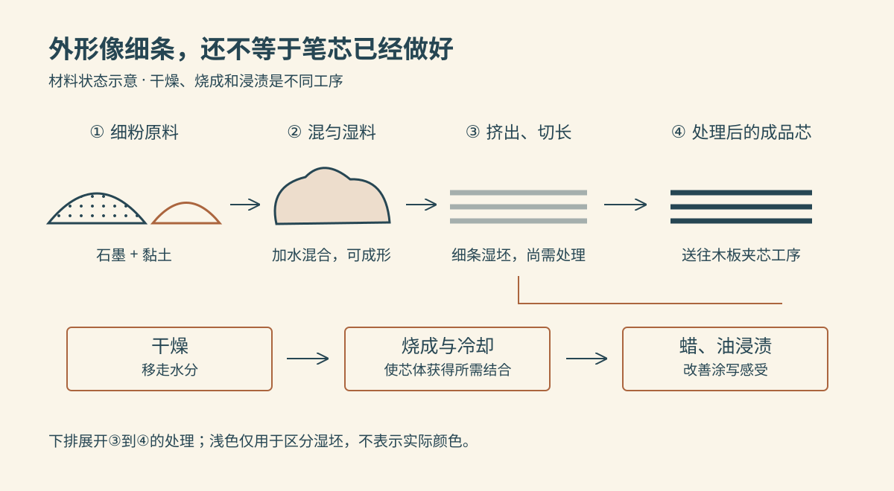
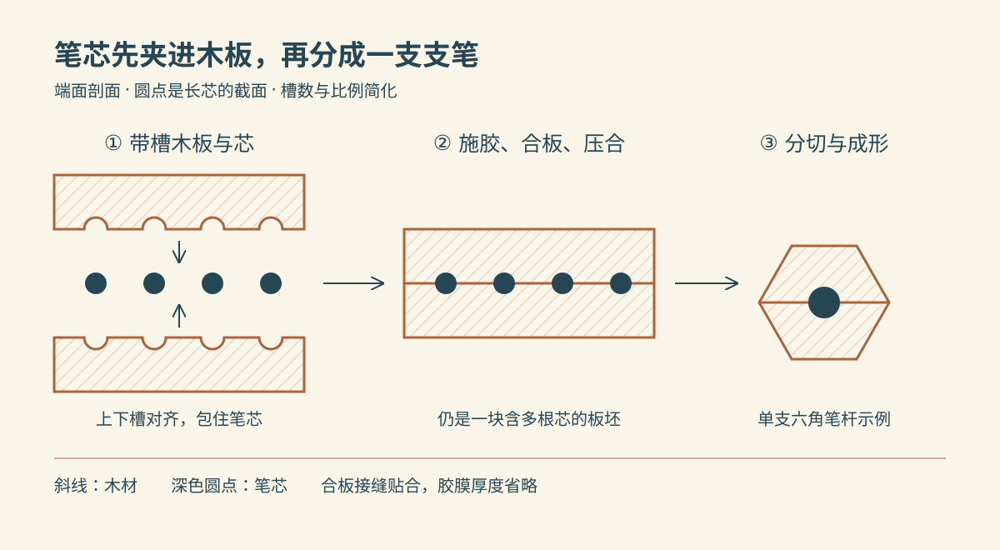

把铅笔插进卷笔刀，转上几圈，薄薄的木屑卷出来，中间露出一个黑色尖头。它在纸上走过，留下一条灰黑色的线。

看着笔杆末端那个居中的黑点，很容易想象：工厂先在木棍里钻一条细长的孔，再把笔芯穿进去。

常见木杆铅笔走的却是另一条路：**先分别做好笔芯和带槽木板，把芯夹在两片木板之间，再加工出一支支笔。** 下面选用传统石墨—黏土烧成芯、木板夹芯的黑色书写铅笔，不把彩色铅笔、自动铅笔细芯和木粉复合笔杆的工艺混进来。

*配图采用随机选定的复古教材双色线描风格，以可编辑 SVG 绘制。它们是结构与状态示意图，不是工厂实拍；槽数、尺寸、颜色和工序间距均经过简化。*

## 一、笔芯里的“铅”，究竟是什么？

这类铅笔的书写材料是**石墨**，并不是金属铅。石墨是一种碳材料，经过原料处理后，以细粉状态参与制芯；不能把矿石直接切成细条，就当作这条生产线里的笔芯。

与石墨一起配料的还有细的**黏土**。它承担结合材料的作用，配合后续烧成，让松散粉料成为能够保持形状的芯。水帮助混合料获得适合加工的状态，随后又需要通过干燥移走。

对这类传统配方而言，黏土比例较高，笔芯通常偏硬；石墨比例较高，通常偏软。改变配方，就能制出不同书写感觉的笔芯，但没有适用于所有品牌、所有型号的固定配比。[STAEDTLER：笔芯原料与制造流程](https://e.staedtlercdn.com/fileadmin/user_upload/Company/Newsroom/Press_Release_2020/STAEDTLER_Factsheet_pencil_production_A4_EN.1596184770.pdf)

木材在这里承担另一项任务：包住细芯，方便握持和削尖。胶把芯与木壳、两片木板连接起来；表面的漆负责外观和表面处理。这几种材料都不会代替石墨成为主要的黑色笔迹。

## 二、粉料怎样变成一根细芯？

工厂按所需硬度准备细石墨和黏土，加水充分混合。混料设备反复搅拌、揉合，让材料分布均匀，得到可成形的湿料。这里既要把原料处理细，也要混匀；留下粗粒或局部配料差异，都会妨碍连续、均匀的书写。

随后利用压力使湿料通过成形孔，出来的便是长而细的芯条。可以把挤压端想成一个装料腔，前端有规定孔径的出口：压力推动里面的料向出口移动，出口限定芯条的截面。出来的是柔弱的湿坯，还不是能装进木杆的成品芯。

芯条经过切长、干燥，再送去烧成。**干燥是移走水分，烧成则使芯体获得所需的结合与硬度，两步不能合称为“晾硬”。** 厂商公开的石墨芯资料也把湿法成形、干燥、烧成分别列出。[KOH-I-NOOR：石墨芯材料与工序](https://www.koh-i-noor-benelux.com/shop/handleiding/KINKleurenkaarten/GRAFIET.pdf)

烧成是在有保温炉膛的工业炉内进行，细芯由耐热承载件支承并按生产安排装炉，炉内供热使它们经历受控的升温和后续冷却。具体炉型、热源和装载方式会因生产线而异；这里不把它画成芯条穿过明火的流水线，也不拿一个最高温度当作通用操作条件。

烧成后的芯还要浸渍蜡、油等材料，改善落笔时的滑动感觉。处理对象是**已经成形、烧过的芯**，并非在木杆外面涂一层油就完成了这步。[STAEDTLER：干燥、炉内硬化与蜡油浸渍](https://e.staedtlercdn.com/fileadmin/user_upload/Company/Newsroom/Press_Release_2020/STAEDTLER_Factsheet_pencil_production_A4_EN.1596184770.pdf)

*上排显示材料状态，下排列出细芯后续经历的工序。湿坯与成品芯都呈细条状，不能仅凭轮廓判断是否完成烧成；图中颗粒与芯径未按比例绘制。*

## 三、木头先成为薄板，再开出槽

另一边，木材被加工成适合制笔的板条。以制笔常用的香柏木板材流程为例，原木先锯成木料，干燥后再切成木块和薄板，并筛去不适合的缺陷。板条还可以经过染色、蜡处理，改善颜色一致性与后续加工表现。[Pencils.com：从木料到制笔板条](https://blog.pencils.com/pencil-making-today-2/)

进入铅笔厂时，板条比一支笔宽，能够并排容纳多根笔芯。开槽机让板条经过旋转刀具，在一个大面上铣出几条平行长槽，槽沿未来笔杆的长度方向延伸。

为什么在意木纹和槽面？笔芯细而长，需要连续的贴合位置。如果槽边毛糙、形状不匀，涂胶和贴合也会受影响。木纹顺直、加工后表面整齐的板条，更容易做出合适的槽，也有利于日后削尖。[制笔木材供应商 CalCedar：木纹、开槽与粘合](https://blog.pencils.com/why-incense-cedar-matters/)

此时，桌上有两类已经准备好的零件：一批细芯，以及一批开好槽的木板。它们接下来才汇合。

## 四、两片木板怎样把芯夹住？

工厂在相应接合位置施胶，将笔芯逐根放入一片木板的槽中，再盖上另一片带槽的木板。上下槽对准后，就在每根芯周围围成木壳。

组合件随后由夹持、压合装置保持贴合，等待胶接稳定。这里的压力用于让接合面接触良好，不能把细芯当成需要压扁的夹层。此时得到的仍是**一块含有多根芯的板坯**，还没有分成可以握在手里的铅笔。[Pencils.com：放芯、合板与夹紧](https://blog.pencils.com/pencil-making-today-2/)

*从左到右为合板前、粘合后、单支成形后。视线沿笔杆长度方向看向端面，圆点代表向画面深处延伸的长芯；只画四槽便于辨认，不表示工厂固定生产四支。接缝线不代表留有空气层，胶膜厚度省略。*

胶也解释了一种使用体验：有的铅笔削着削着，芯会整截松动。芯与木壳之间结合不好，就失去了连续支承。反过来，粘合做得好有助于保护笔芯，却不能保证它经受任意摔落都不发生内部断裂。

## 五、板坯怎样分成六角笔杆？

胶接稳定后，板坯进入成形设备。旋转刀具沿各根芯所在的位置加工木料，把板坯分开，并铣出所需的笔杆轮廓。六角形来自木壳的加工，里面的芯仍可以是圆的；换成圆杆或三角杆，也不意味着把同样形状的孔钻进整根木棍。

裸笔杆再经过表面涂装、标记等工序。是否装金属箍和橡皮、是否预先削尖，取决于产品；这里选用普通无橡皮尾的铅笔，不强行让它经历装橡皮这一步。[STAEDTLER：笔杆成形与表面加工](https://e.staedtlercdn.com/fileadmin/user_upload/Company/Newsroom/Press_Release_2020/STAEDTLER_Factsheet_pencil_production_A4_EN.1596184770.pdf)

到了这里，细芯有了可以握持的外壳。工厂做好的整体，仍要在使用时削去端部的一小段木头，才能让芯接触纸面。

## 六、写下去，为什么会留下线条？

卷笔刀让笔杆沿刀刃转动，逐步切去木材和端部芯料，形成尖头。削好后，木壳支承大部分芯，露出的短尖承担纸面上的接触。伸得很长的尖端更容易受弯，所以画细线需要尖头，并不等于露出的芯越长越好。

落笔时，摩擦使含石墨的细小材料留在纸面。石墨的层状结构有利于形成顺滑的涂写痕迹；纸上看到的线条，来自固体芯料的转移。[KOH-I-NOOR：石墨结构与纸面涂写](https://www.koh-i-noor-benelux.com/shop/handleiding/KINKleurenkaarten/GRAFIET.pdf)

笔杆上的 H、B、HB 是理解书写表现的线索。在同一系列内，H 方向通常偏硬、笔迹较浅，B 方向通常偏软、笔迹较深。但不同厂商的标记不能直接当作完全相同的测量值，纸张、尖头形状和下笔力度也会改变结果。[Pencils.com：硬度标记与品牌差异](https://pencils.com/pages/pencil-buying-guide)

想观察差别，可以在同一张纸上，用相近的尖头和力度分别写字，再轻轻铺一小块灰面。这能比较自己的使用感受，却不是测出笔芯硬度的标准试验；单凭一道颜色很深的线，也无法倒推出石墨与黏土的配方。

## 七、怎样看出它做得好不好？

制造环节会筛查芯是否偏心、木杆是否崩缺等问题。[Pencils.com：成形后的缺陷筛查](https://blog.pencils.com/pencil-making-today-2/)

到了使用者手里，可以把观察对应回工序：削出的木面是否整齐，对应木材与切削表现；笔芯有没有松动，关系到粘合；写出的线是否连续、是否夹着明显刮纸的粗粒，关系到芯料加工和书写条件。

但一支削断的铅笔，并不能单独证明某道工序不合格。卷笔刀刀刃状态、之前是否摔过、削法与尖头长度，都可能参与这个结果。比较产品表现时，应尽量保持工具、纸张和操作条件一致。

---

再看那一圈木屑，可以把铅笔的两条来路合起来：

> **石墨与黏土 → 混匀湿料 → 成形细芯 → 干燥、烧成、浸渍后的笔芯；木材 → 板条 → 带槽木板。两者经施胶、放芯、合板，成为夹芯板坯，再分切成形、涂装，最后削尖书写。**

木头让一根细芯便于握持，芯料则在纸上逐渐留下自身的一部分。那条看似简单的灰线，先后经过了粉料加工、炉内处理和木工装配。
