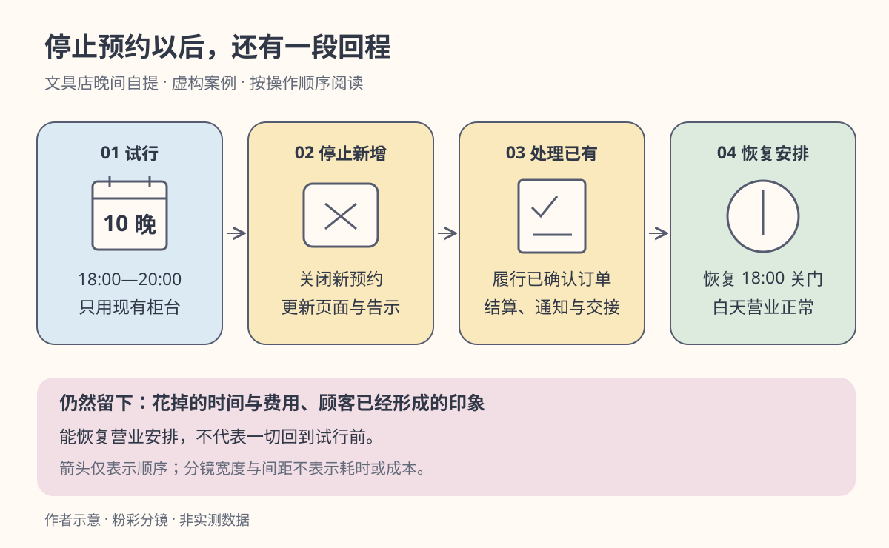

一家文具店平时六点关门。有顾客说，下班赶不过来，希望能晚一点取走预订的文具。店员建议延长到八点，店长却担心增加排班后没有多少人来。

“先试两周，不行就停。”听起来两边都能接受。但下一句就出现了分歧：要不要马上订一套取货柜？要不要出售半年有效的晚间自提套餐？已经答应顾客的订单，停掉以后怎么办？

同样叫“试两周”，有的方案只是换张营业告示，有的已经带上半年承诺。时间短，不等于退路短。

**可逆决策关注的是：作出选择后，如果结果不理想，能否在可接受的时间和代价内回到可用的状态。** 它帮助我们决定该先做有限尝试，还是在行动前投入更多核查。

亚马逊的 2015 年股东信用“单向门”和“双向门”区分难以逆转与可以改回的决定，并主张采用不同的决策过程。这是管理经验中的比喻，不是对成功概率的科学定律。[原文：2015 Letter to Shareholders，PDF 第 5 页](https://ir.aboutamazon.com/files/doc_financials/annual/2015-Letter-to-Shareholders.PDF)

下面的店铺、金额、时段与判断门槛均为**虚构演示设定**。我们要回答的是“怎样安排一次值得做、退得出的试行”，暂时不回答“是否永久延长营业”。后面的退出表和观察规则是本文为案例设计的方法，并非股东信规定的标准。

## 一、先把一项决定拆成几份承诺

店长准备在两个星期的周一至周五，共十个晚上，提供 18:00—20:00 的预约自提。顾客当天 17:00 前预约，当晚取货；不接受跨试行期的晚间承诺。只用现有商品和柜台，不增加专用品类。

开始之前，先把容易捆在一起的动作拆开：

| 动作 | 怎样退出 | 退出后仍留下什么 |
|---|---|---|
| 发布明确截止日期的试行告示 | 关闭预约入口，更新告示 | 已看到旧信息的人仍可能到店，需要提示与解释 |
| 安排十晚额外值守 | 按事先约定的排班变更方式结束 | 已完成班次的费用与时间无法退回 |
| 订制固定取货柜 | 取消订单或转卖，要看具体条件 | 定制费用、安装痕迹和转卖损失可能保留 |
| 出售半年晚间自提套餐 | 需要处理剩余服务承诺 | 退款、替代服务和顾客信任问题不会随关门消失 |

前三列连起来看，才看得见“退出”是不是一句空话。一个预约入口可以迅速关闭，并不说明它承载的每项承诺都随之结束。

因此，这次只做前两项。值守人员事先同意试行排班及变更方式，店长保留原有白天营业安排；柜子和长期套餐留到下一次决定。这里的拆分没有证明晚间自提值得长期做，却减少了为了回答初步问题而提前承担的承诺。

## 二、能停止，与能恢复，是两件事

“今晚以后不再接单”叫停止新增动作；“所有已接订单都有去处，人员安排结束，白天营业正常”才接近完成恢复。两者之间可能隔着几天，甚至更久。

店长把退路写具体：当天 17:00 关闭预约前，先检查是否继续开放下一晚；若决定结束，已确认的当晚订单仍按约履行。值守人员按预先约定结算，预约页面与门口告示同步修改，未完成交付逐单联系。由店长负责完成这些动作，而不是让每位店员各自理解“停止”。

*作者以 AI 辅助编写 SVG 绘制的情境示意，随机风格为粉彩分镜。沿上排箭头读操作顺序，不表示因果证明或耗时比例；下排提醒恢复营业安排后仍有残留影响。粉蓝表示试行，粉黄表示退出过程，粉绿表示恢复，文字同时标明含义。*

这里有三个需要核实的量：**多快能停止增加承诺、多快能处理存量承诺、哪些影响无法收回。** 不必强行把它们合成一个“可逆指数”。一天能改回的排班和一年都还要履行的服务，放进一个分数反而容易遮住差别。

恢复也不是把世界倒回试行前。顾客知道了这项服务，员工已经付出了时间，费用已经发生。我们只能判断这些残留是否可接受，不能把它们说成不存在。

## 三、把退路算清楚，再判断值不值得试

本例约定，每晚额外值守及用电合计 120 元，十晚最多 1200 元；告示和预约设置一次性支出 100 元；另预留 200 元处理结束时的通知与交接。假定无需支付剩余未实施晚上的值守费，商品仍可在白天销售，不新增装修、设备或其他采购承诺。

在这些明确条件下，按“十晚完全没有新增收益”计算，已列出的试行及收尾支出为：

`100 + 10 × 120 + 200 = 1500 元`。

这不是现实中的全部损失上限。它不包含尚未识别的索赔、声誉影响或被挤掉的其他工作；只要出现新的费用条件，就要重算。店长另行判断，1500 元的已知现金支出可以承担，试行不会干扰白天营业，值守安排也能执行，因此才进入下一步。

但“承担得起”仍不足以推出“值得试”。如果试行只收获一句“有人喜欢”，它可能没有回答任何会改变决策的问题。店长真正需要弄清的是：晚间服务是否带来足够的**新增购买**，以及关门后的交接能否稳定完成。

为便于估算，先假设每笔真正新增的购买，扣除商品进货与该订单直接支出后，平均留下 15 元贡献。仅覆盖每晚 120 元额外支出，需要 `120 ÷ 15 = 8 笔/晚`；如果还要在十晚内覆盖上述 1500 元全部支出，则需要 `1500 ÷ 15 = 100 笔`，平均十笔一晚。

八笔与十笔回答的是不同问题：前者看一个后续晚上的运行支出，后者看整次试行的已列支出。试行可以有学习成本，不要求两周必须回本；但如果长期运行也持续不足八笔，就需要重新考虑价格、服务范围或是否继续。真实贡献不是固定 15 元时，应按订单实际金额重新汇总。

## 四、十笔自提，并不等于十笔新增购买

假设第一周五晚共有 50 笔晚间自提，平均十笔一晚。直接乘以 15 元得到 750 元，再减去五晚的 600 元，就会得到“每周多赚 150 元”的结论。

漏掉的条件是：这些顾客原本会不会白天来买？如果只是换个时间取走同一笔货，店铺增加了值守费，却没有增加这笔购买。

店长做两种情景推演，而不是把询问顾客得到的意向当成已知事实：

| 第一周情景，均为演示假设 | 真正新增购买 | 原本也会购买、只改取货时间 | 新增订单贡献 | 减去五晚运行支出后 |
|---|---:|---:|---:|---:|
| 50 笔全部新增 | 50 笔 | 0 笔 | 750 元 | ＋150 元 |
| 只有 20 笔新增 | 20 笔 | 30 笔 | 300 元 | −300 元 |

表中最后一列没有扣一次性设置与收尾费用，不能当作整个试行的利润。它只说明：同样是 50 次自提，新增程度不同，运行判断会翻转。

因此，每晚除了记预约、完成交付和实际贡献，还要看全店相关商品的全天购买变化，记录天气、促销、缺货以及顾客是否只是更改取货时间。与此前相似星期比较，可以提供线索；但第一周恰好赶上开学，也可能自然多卖，不能把所有增量归给晚间服务。顾客说“否则不会买”同样只是辅助信息。

在试行开始前，店长就写好复盘安排：每天检查订单交接与额外支出；第五晚检查是否仍在已知预算内、有没有白天服务受影响；第十晚结束本轮，决定停止还是申请下一轮有限试行。若发生未按约完成的交付，先暂停新增预约并解决存量问题。没有足够证据时，不自动延长，更不直接推出半年套餐。

如果初步结果接近门槛，下一轮可以增加可比日期，固定价格与宣传条件，检验估计是否稳定。可逆性让店长有机会边做边学习，**但不会自动让观察变成可靠的因果结论**。

## 五、什么时候“小试一下”仍然不合适？

先改一个合同条件：假设值守安排一旦确认十晚，即使提前结束也必须支付全部费用。那么第五晚停止只能避免继续开展服务，不能节省剩余 600 元。原来的退出计算需要重写，不能沿用“每少做一晚省 120 元”。

再改一个承诺：店铺在试行时售出了半年套餐。即便第十晚把预约按钮关掉，服务承诺仍在。这时更合适的做法是在开始前缩短承诺范围，或明确并核实可执行的退出安排，而不是等发现不划算时才宣布“我们只是试试”。

还有些影响来不及等到复盘。假设试行采用公开贴出顾客联系方式的取货名单，撤掉名单也无法收回已经被看见的信息。技术上能删除，不等于后果可逆。这样的流程应先改掉，不能因为只有十晚就降低要求。

反过来，小范围试行也可能低估真正方案。现有柜台需要人工值守，未来自动取货柜的费用结构与便利程度却不同。试行能够说明这个时段是否有人愿意来、交接有哪些困难，却不能直接证明自动柜必然盈利或必然失败。试行与未来方案相差的条件，要在下一轮重新验证。

所以，“双向门”更适合看作一组待核查的问题，而不是给项目盖一个永远有效的标签。规模、期限、涉及的人和外部承诺一变，原来的退路可能就失效了。

## 六、把决定留在仍然能改变的位置

回到文具店，店长最后批准的是十晚、有截止日期、使用现有柜台的预约自提。她没有因此认定晚间服务一定赚钱，只是确认：这次尝试能回答一个有价值的问题，已列支出可承担，停止和交接有明确负责人。

第十晚结束时，要分别检查两件事：服务带来了什么信息；事先写下的退路是否真的可走。即使销量不错，若每次退出都要临时找人兜底，也说明下一轮方案还需修改。即使销量不足，若及时结束并查清新增需求很少，这轮也留下了可用于后续决定的信息。

下一次听见“先试试，不行再说”，可以把话接完整：

> **这次究竟承诺什么 → 怎样停止新增承诺 → 已有承诺由谁收尾 → 留下哪些不可收回的代价 → 能学到什么 → 到哪一天重新决定？**

当这些答案能写在同一张纸上，“先试两周”才从一句安慰，变成一项能够执行、能够检查的决定。
