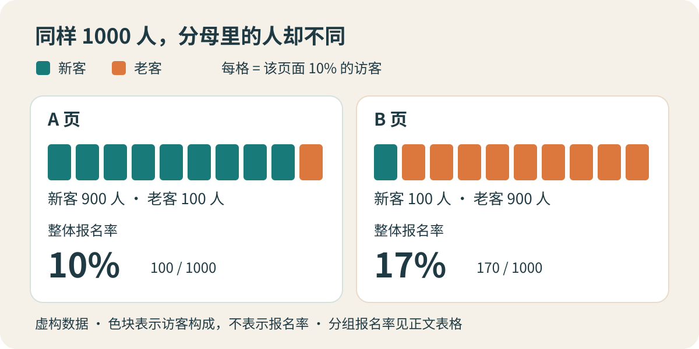

周一复盘，运营拿出两个报名页面的数据：A 页来了 1000 人，100 人报名；B 页也来了 1000 人，却有 170 人报名。看上去，把流量都交给 B 就行了。

另一位同事把访客分成新客和老客，发现新客在 A 页的报名比例更高，老客也一样。两张表都没有算错，结论怎么会掉头？

这个问题可以借助**辛普森悖论**来理解：同一组数据中，分组内的关联方向与汇总后的方向可能相反。它是统计现象，不是一条“凡事都要拆细看”的管理定律。[Judea Pearl：Understanding Simpson’s Paradox，定义见第 1 页](https://ftp.cs.ucla.edu/pub/stat_ser/r414.pdf)

下面的页面、人数和业务条件均为**虚构演示设定**，不来自真实实验。我们要依次回答三个问题：本周实际表现如何，换成同样的人群结构怎样比较，以及这些数据能否支持更换页面。

## 一、先弄清楚分母里是谁

团队统计的是某一周首次进入活动页的独立访客，每人只进入一个页面组。报名指首次进入后的 7 天内完成报名，每人最多计一次，等最后一名访客的观察窗口结束后再汇总。

“老客”指进入页面之前已有购买记录的人，“新客”指此前没有购买记录的人。身份在首次进入时固定，不因本次报名或后续购买重新分类。身份无法确认者另行核查，不能随手归到新客；演示表假设所有人身份已知。

| 进入页面前的身份 | A 页报名人数 / 访客人数 | A 页报名率 | B 页报名人数 / 访客人数 | B 页报名率 |
|---|---:|---:|---:|---:|
| 新客 | 72 / 900 | 8% | 6 / 100 | 6% |
| 老客 | 28 / 100 | 28% | 164 / 900 | 约 18.22% |
| 合计 | 100 / 1000 | 10% | 170 / 1000 | 17% |

表里每一个百分数，都用该格的报名人数除以对应的访客人数。老客的 28% 是 28 除以 100，不能拿 28 除以整页的 1000 人，再与 B 页老客的报名率比较。

这一周，B 页确实获得了更多报名，整体报名率也更高。这是对**实际进入各页面的人群**的描述。争议出在下一句：“所以 B 页本身更能促成报名。”这已经开始追问原因，不能直接从合计行跳过去。

## 二、汇总比例，悄悄换了两次权重

A 页的访客中，九成是新客；B 页的访客中，九成是老客。而在两个页面里，老客报名率都明显高于新客。

这意味着 B 的整体结果，主要由较高报名率的老客贡献；A 的整体结果，主要由较低报名率的新客贡献。汇总时，两页并没有用同一套人群比例。

*作者绘制的虚构数据示意，采用随机选定的彩色卡片风格。青绿色表示新客，橙色表示老客；每条共有十格，每格代表该页面 10% 的访客，不代表报名人数。下方数字是整体报名率，不能从色块数量直接读出。*

把汇总率写开，隐藏的权重就出现了：

> **整体报名率 = 新客占比 × 新客报名率 + 老客占比 × 老客报名率。**

对 A 页，计算是：

`90% × 8% + 10% × 28% = 7.2% + 2.8% = 10%`。

对 B 页，使用未四舍五入的分组比例：

`10% × (6/100) + 90% × (164/900) = 0.6% + 16.4% = 17%`。

所以，不能直接把两组报名率相加再除以二。简单平均暗中规定两类访客各占一半，已经改变了原来的问题。

反转也不是只要“人数不一样”就一定发生。这里同时存在两项重要差异：新老客的报名率相差很大，两页的新老客构成又明显不同。构成变化足够大，才把分组内的优势盖了过去。

## 三、把同一把尺子放在两页旁边

如果团队想比较“面对相同新老客结构时，两页的观察报名率如何”，就要先确定共同的结构。

为了演示，假设下一轮目标访客预计新老客各半。把两页都按这一比例重新加权，也叫**标准化比较**：保留各自的分组报名率，替换分组在整体中所占的比重。

| 共同结构：新老客各占 50% | 新客贡献 | 老客贡献 | 标准化报名率 |
|---|---:|---:|---:|
| A 页 | 50% × 8% = 4% | 50% × 28% = 14% | 18% |
| B 页 | 50% × 6% = 3% | 50% × (164/900) ≈ 9.11% | 约 12.11% |

A 页此时高出约 **5.89 个百分点**。这个差值是百分比的相减，不能写成“高出 5.89%”而不说明比较口径。

18% 也不是本周 A 页实际实现的报名率，更不是已经保证的未来成绩。它回答的是一个限定问题：**把当前观察到的分组报名率放进新老客各半的人群结构，算出来是多少？**

一半一半不是普遍正确的权重。如果目标人群有八成新客，就应让两页都使用 80% 与 20%；如果目标结构还不知道，应先展示几个可能情景，不能为支持喜欢的页面挑一套比例。

这里还能做一次独立检查：A 的新客报名率比 B 高 2 个百分点，老客高约 9.78 个百分点。只要两页使用同一套非负且合计为 100% 的权重，加权后的差值就是这两个正数的加权平均，因此仍然为正。**在本例的固定分组率下，换一套共同权重会改变领先幅度，却不会让 B 重新领先。**

## 四、分组赢了，也还没有证明页面更好

到这里，算术疑问已经解决，业务决策还没有。

假设 A 主要投在拉新渠道，B 主要发给已有客户；渠道安排造成两页的客户结构不同，而购买经历又可能影响报名意愿。这是团队对数据生成过程的一个解释，需要用投放记录和用户行为来核查，不能把表格本身当作证明。

即使新老客身份记录无误，同一身份内仍可能存在差别：A 页老客可能刚买过相关商品，B 页老客可能多年没有回来；两页的优惠、投放日期或渠道也可能不一致。按新老客分组，只处理了这一个维度，未必让两组人真正可比。

还有一种容易踩中的边界：有人建议进一步按“看完页面后是否领取优惠券”分组。可是页面本身可能影响领券，而领券又影响报名。若问题是页面带来的总效果，把领券状态固定住，可能挡掉页面发挥作用的一部分路径；按这种事后行为筛选，也可能引入选择偏差。**能在报表里拆出一列，不代表它适合用来调整比较。** 对该分组该不该采用，需要先说明因果关系；Pearl 的讨论也强调，选择汇总还是分组不能只凭统计表本身。[同文第 2 节：数据生成机制与因果解释](https://ftp.cs.ucla.edu/pub/stat_ser/r414.pdf)

此外，B 页新客只有 100 人，其中 6 人报名。样本中的 6% 不能当作一个永远不变的常数。本文的整数只用来展示反转，没有完成不确定性估计，也没有证明两个页面存在稳定的效果差异。

## 五、接下来该怎样验证，而不是继续争哪张表对

团队此时可以保留两个结论：本周 B 的实际总体报名率是 17%；按新老客各半重新加权，A 的观察报名率更高。两句话分别对应不同的问题，不需要删掉其中一句来维护另一句。

如果真正要决定默认使用哪一页，可以在有条件时设计下一轮比较：在新客、老客内部各自随机分配 A 与 B，同一个人保持同一版本，统一优惠、观察窗口和报名口径。这样能减少人为把不同访客送往不同页面造成的系统差异。

在查看结果之前，约定面向哪种目标人群汇总、主要指标是什么、最低值得采取行动的差异有多大，再据此规划样本量和分析方式。下一轮同时看分组人数、分组率、按预定目标结构得到的总体差异及其不确定性；不要一看到领先就提前宣布结束。

若没有条件做这样的比较，当前结果仍可用于提出假说、查找渠道差异和安排小范围验证，但应保留“观察关联”的结论强度。目标客群、优惠或页面内容变了，旧的分组报名率也需要重新估计。

更换页面还可能牵涉报名质量和服务成本。报名率回答“有多少访客报名”，无法单独回答“哪种方案更值得长期采用”；若业务真正关心的是有效报名，就应事先定义有效的标准和观察期。

---

回到周一的会议，最有用的变化，是有人在“10% 对 17%”旁边补上了那两行人数。

以后遇到两个总体比例，可以顺着问下去：

> **分母包含谁 → 分组内怎样 → 各组占比是否不同 → 用同一目标结构会怎样 → 这种分组是否符合事情发生的过程 → 还缺什么证据才能行动。**

辛普森悖论帮助我们看见比例里的构成。算清权重，能解释结论为何反转；要判断改变一项措施会带来什么结果，还得继续追问这些人为什么会出现在这里。
