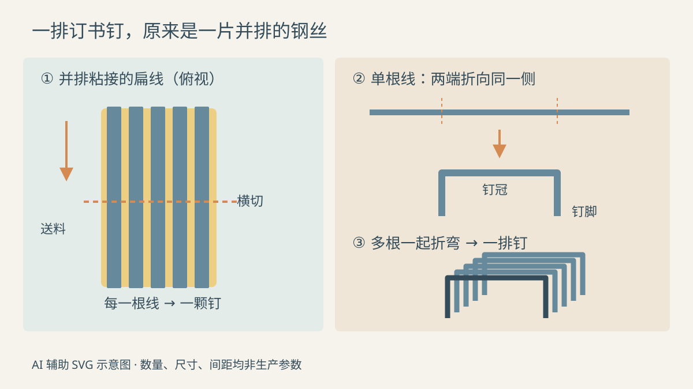
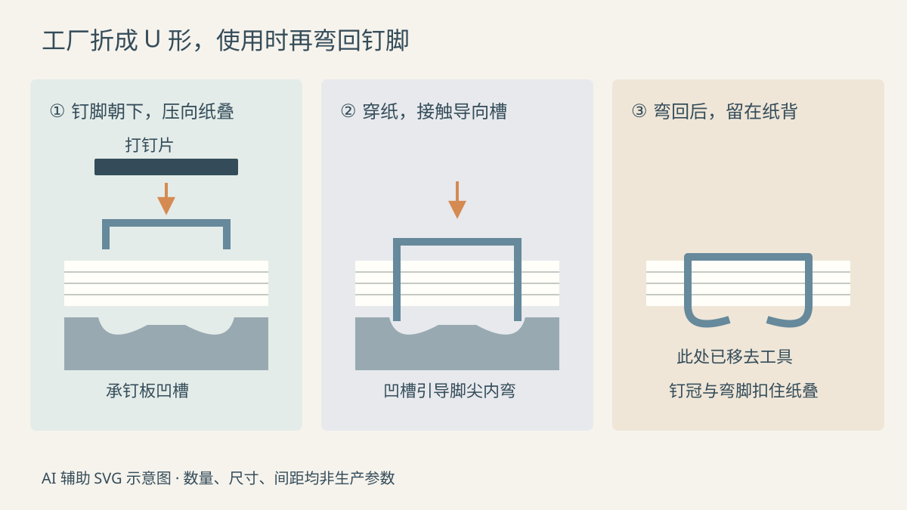

把几张纸叠齐，塞进订书机，手掌向下一压，便听到一声轻响。纸面多了一道短短的银色横杠，翻到背面，能看到两只弯回来的钉脚。

再打开钉槽，里面却是一整排小钉。为什么它们能连在一起，压下去时又只出来一颗？那两只钉脚，是出厂时就弯好的吗？

这里选**镀锌钢丝制成、用胶连接成排的普通办公 U 形订书钉**，沿“多根线先粘成带，再切段折弯”的路线讲解，最后装入普通向内弯脚的桌面订书机。单线逐颗成形、骑马订现场制钉和装修用射钉另有安排，不并入这条流程。

*配图随机选用柔和色块剖面风格，为 AI 辅助编写的可编辑 SVG 示意图。颜色用于区分材料与零件，数量、间隙和比例经过简化，不是工厂实拍或加工图纸。*

## 一、钢丝、镀层和胶，分别做什么？

一颗小钉可以分成中间的**钉冠**和两边的**钉脚**。这三段原本是同一段钢丝：中间保留为横梁，两端折向同一侧，成为两只脚，并不是先做两根小针再焊到横梁上。

主体钢来自钢铁生产，上游轧成线材，再加工为能成卷供应的钢丝。本文的生产线从采购的镀锌圆钢丝开始：到厂的已经是连续、固态的细线，不是矿石，也不需要在制钉机里重新熔成钢水。

钢材既要承受穿纸时的压力，也要能够在成形和使用时弯曲。具体钢种、线材状态与截面要随产品确定，不能认为所有办公钉都用同一种含碳量的钢。锌层主要用于防护钢表面，不承担把整排钉连起来的任务；后面施加的**胶**才负责让相邻钢丝暂时成为一个可搬运、可送料的整体。

所选设备路线明确从镀锌线开始，随后拉拔、轧扁和粘带；实际工厂也可以直接采购合格的扁线或线带。[SSS Hardware：制钉生产线的输入材料与工序](https://www.3shardware.com/staple-machine/education-staple-making-machine-and.html)

## 二、圆线怎样变成扁线？

先把线卷放到放线架上，牵引机构拉住线头，让钢丝经过拉丝模。模具里有逐渐收窄的孔，钢丝被牵着通过，截面缩小，长度增加。需要较大变形时，可以分道次加工，并配合润滑与冷却；不是用刀把钢丝外面削掉一圈。[《Wire Technology》：拉拔时的牵引、模孔与截面变化](https://booksite.elsevier.com/samplechapters/9780123820921/Sample.pdf)

接着是轧扁。可以把关键部位想成一对面对面的转辊，钢丝从两辊间的窄缝穿过，受挤压后由圆截面变成适合制钉的扁截面。拉拔主要调整线材尺寸，轧扁则把截面整理到所需宽度与厚度，二者不能笼统地写成“拉成细丝”。

出来的仍是长长的钢丝，没有被切成钉，也没有与旁边的线连起来。粗细、宽厚不稳，后续成形与送料就难以一致。这里不列一个通用线径：看起来同样大小的钉，不一定具有相同截面，也未必适配同一台订书机。

## 三、先粘成带，为什么反而容易做成一排钉？

多只线盘分别放线，导向和校直部件把扁线排在同一个平面里，让它们平行、并排前进。施胶装置把胶施到线阵上，使相邻线粘在一起；连接稳定以后，原先一根根分散的长线便成为可以继续输送或收卷的**线带**。

线带看着像窄金属薄板，内部却仍是一根根独立钢丝。沿着线的方向看，能找到相邻线的边界。这一点决定了后面的结果：切断、折弯的是整片线带，片内每根线最终各自成为一颗钉。

胶接还要有稳定过程。所参考的组合设备配有自动干燥炉，线带沿输送路径通过炉内处理区，再向出口前进。加热服务于胶层干燥，不是把钢丝烧红后锻造；公开页面没有给出统一的热源结构、温度和停留时间，不能据此补出一套配方。不同胶体系与设备的处理条件应分别确定。

线带本身也是可以买卖的中间产品。供应商 Tecnofil 将冷轧、粘线后的线带用于办公钉等产品，并说明会进行过程控制与交货前冲压试验。因此，有的制钉厂从卷好的线带开始，并不意味着它省掉了前面的材料加工，只是这些工作由供应商完成。[Tecnofil：多线线带的制造、用途与试验](https://www.tecnofil.net/en/steel-wire-manufacturer/wire-band/)

*左图为线带俯视，右图分开显示单根线的变化与成排结果。只画五根便于辨认，线间缝隙被放大；淡黄色表示胶接区域，不表示整片实心胶板。折弯线横跨各根线，每根线都贡献一颗钉。*

## 四、切出长度，再把两头折下来

线带进入制钉机，送料辊牵着它沿导路前进。切刀与配合刀口横跨线带，在规定位置剪断，得到一小片仍然并排粘连的直线段。

这里有两个容易混淆的方向：**沿钢丝方向截取的长度，要留出一颗钉的钉冠与两只脚；横向并排的钢丝数量，则关系到这一排有多少颗钉。** 线带宽度不能直接当成单颗钉冠的宽度。

随后，短片进入成形位置。机架上的冲头与模具相对合拢，模具限定弯曲的位置，让每根线的两端折向同一侧，中段成为钉冠。可以想象许多小铁丝肩并肩接受同一次折弯，原来平放的小片，变成了截面呈 U 形的一排钉。

这类“并排胶接—横向切段—模具折弯”的关系，在制钉设备专利中有明确描述。专利还展示了输送、顶出和尺寸检查的实现方式；本文只取其材料与工具的作用关系，不把某个专利的运动机构当作所有工厂的配置。[EP2064011B1：线带切段与成排折弯](https://patents.google.com/patent/EP2064011B1/en)

办公钉有对应的小规格成形设备。例如 SSS 的办公钉机说明适用于 24/6、26/6 和 10 号系列，以液压缸带动执行机构完成线带成形。这说明模具与送料条件必须适应产品，不能把装修用大钉的设备参数直接缩写到办公钉上。[SSS Hardware：办公订书钉成形设备](https://www.3shardware.com/staple-machine/staple-pin-punching-machines-for-office-and.html)

成品端部还须具有适合穿纸的形状，检查时要关注端口、毛刺和两脚是否整齐。钉尖的具体刃口及加工安排随产品改变，不能把所有小钉都想成磨出圆锥尖的缝衣针。完成检查、计数和装盒后，整排钉才来到文具抽屉里。

## 五、按下订书机时，胶与钉脚各完成一项任务

取一排符合订书机标识的钉，按该机型的装钉方式放进钉槽。以常见上装钉机为例，钉冠跨在导轨上，两脚向下落在两侧，推钉件把整排钉送向出口。

轻微粘连让整排钉便于拿取，也使它能有序前进。手按下压柄时，打钉片对准最前一颗，将它与后面的钉排分离，再压向纸面。胶的工作到这里基本结束：**纸张靠金属钉扣住，不靠钉排上的胶粘住。**

两只脚先穿过纸叠，接着碰到底座的金属承钉板，也叫砧板。普通向内弯脚模式下，板上的凹槽引导脚尖向内转；继续下压，钉脚沿槽弯回，留在纸叠背面。松手后，金属保留了这次弯曲，纸面上的钉冠与背面的弯脚共同限制纸张散开。[Bostitch：压柄、打钉件、推钉件与承钉板](https://bostitchoffice.com/articles/ultimate-guide-to-staplers/)

*视线沿钉排方向看单颗钉。纸层厚度、凹槽和间距放大，第二幅仅示意开始接触，第三幅省略工具以显示结果。这里画普通内弯模式；平脚订书机另有使钉脚贴平的机构，不能照此推断全部结构。*

所以，小钉经历了两次用途不同的弯曲：工厂把直线两头折成便于穿纸的钉脚，使用现场再把穿出来的脚弯回去。若只有向下压的打钉片，没有下面合适的承钉结构，不能指望两只直脚自行整齐扣住纸背。

## 六、订得牢，要同时看钉、机器和纸

使用前先核对适用钉型，再核对机器标明的装订能力。同样的钉脚长度，不代表钉冠宽度与线材截面也相同；能塞进钉槽，也不等于送料与出钉一定合适。

纸叠太厚时，钉脚可能不能充分穿出并弯回；盲目换长钉也不能解决所有问题，因为机器必须能容纳和驱动它。厂家标示的张数还带有纸张条件。例如 Rapesco 某款长臂机明确以 80 g/m² 纸说明容量，并另列兼容钉型，不能把那一张数照搬到厚卡纸上。[Rapesco：纸张条件、容量与兼容钉型示例](https://rapesco.com/product/eco-grs-long-arm-stapler-black/)

检查成品钉时，可以测钉冠宽度、脚长、截面，并观察两脚平行程度和排钉是否整齐；检查实际装订时，则应在兼容机器上，用相同纸种、张数和装订位置试订，观察是否正常出钉、是否穿透、背面是否弯合、翻页时纸是否容易松脱。

这些观察各自对应不同问题。一颗钉歪了，原因可能是钉本身变形，也可能是装钉不正、纸太厚或机器状态不佳，不能仅凭结果倒推出钢材不合格。发现卡钉时，停止继续压，按机器说明排除，手指避开出钉口。

---

再看纸面那道银色横杠，可以把它的来路连起来：

> **镀锌圆钢丝 → 拉拔、轧扁后的长线 → 多线并排粘成线带 → 横切后的直线短片 → 模具折弯形成的整排 U 形钉 → 分离出单颗、穿纸、由承钉板引导弯脚。**

装盒时的胶，让小钉保持队形；纸背那两道弯脚，才让几张散纸成为一份可以翻阅的文件。
