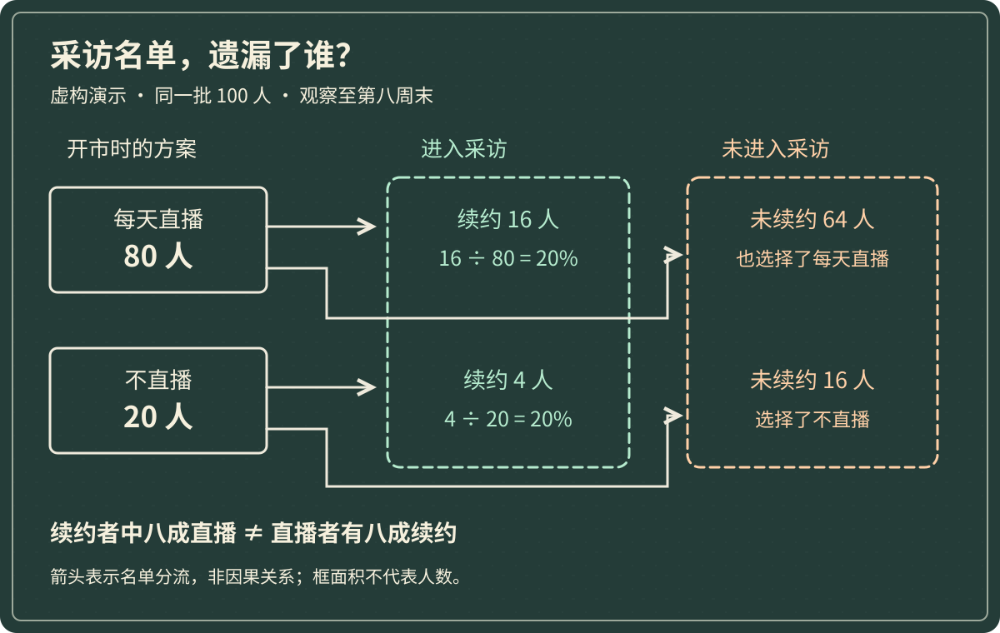

市集准备招募下一期摊主。运营采访了本期结束后继续续约的 20 位摊主，发现其中 16 位每天开播介绍商品。宣传同事马上拟好标题：“八成留下来的摊主坚持直播，新人也该每天播。”

准备报名的小林却想知道另一件事：这一期每天直播的人，一开始有多少？如果退出的人也播得很勤，只问留下来的摊主，得到的经验可能缺了半边。

**幸存者偏差指的是：观察对象经过了存续或成功等筛选，却把筛选后看到的情况，当作原来整个人群的情况。** “幸存”不一定涉及生命，也可以是仍在营业、仍在名单上、仍有机会接受采访。

Denrell 关于组织学习的研究指出，现存组织及成功报道会让失败者在可观察样本中不足，从而使某些做法显得更有效。这提醒我们检查经验是怎样被收集的，并不意味着所有成功经验都错。[原始研究：Vicarious Learning, Undersampling of Failure, and the Myths of Management，2003](https://pubsonline.informs.org/doi/10.1287/orsc.14.2.227.15164)

以下市集、人数、行为分组和结果全部是**虚构演示设定**。我们先回答“这批摊主中，直播组与非直播组的续约情况怎样”，再检查它是否足以支持小林每天开播。续约只是本例的观察结果，不等于盈利，也不等于经营成功。

## 一、先回到开市时的名单

这个市集本期持续八周。开市当天共有 100 位摊主，每人只有一个摊位；中途新加入的人不进入这次比较。观察窗口统一截止于第八周结束，续约指截止时已经确认参加下一期。

为了避免事后改分组，运营查的是开市前已确认的方案：80 人选择“每天直播介绍商品”，20 人选择“不直播”。主案例暂时假定所有人都按原方案执行，记录完整。现实里有人中途停播或换方案时，必须另外记录变更，不能把退出者随手移进“不直播”组。

这 100 人才是要追踪的起点。到了采访时，记者看到的却只有续约的 20 人。两张名单之间有一道筛选：**没有续约，就没有进入这次采访。**

假设运营从报名和续约记录里补齐其余 80 人，得到下面这张表。“未续约”包括提前离场和正常结束后不再参加，本例不擅自把它们都叫失败。

| 开市前确定的方案 | 起点人数 | 八周末续约 | 八周末未续约 | 本组续约率 |
|---|---:|---:|---:|---:|
| 每天直播 | 80 人 | 16 人 | 64 人 | 16 ÷ 80 = 20% |
| 不直播 | 20 人 | 4 人 | 16 人 | 4 ÷ 20 = 20% |
| 合计 | 100 人 | 20 人 | 80 人 | 20 ÷ 100 = 20% |

补齐名单不是去找几个失败故事与成功故事对冲。关键是同一批人、同一个观察期限，并且每个人的去向都有位置。

## 二、八成和两成，回答的是两个问题

采访者的计算没有错：在续约的 20 人里，直播者占 `16 ÷ 20 = 80%`。这回答“续约者中有多少人直播”。

小林想问的却是“选择直播的人中有多少人续约”。这时分母必须换成起点的 80 位直播者，结果为 `16 ÷ 80 = 20%`。不直播组则是 `4 ÷ 20 = 20%`。

*作者以 AI 辅助编写 SVG 绘制的虚构数据示意，随机风格为黑板粉笔。箭头表示名单按结果分流，不表示直播导致续约；薄荷绿框是被采访的续约者，浅橙框是被采访遗漏的未续约者，文字同时标明类别。框的面积不编码人数，人数以标注为准。*

沿图看，直播组的 64 位未续约者并没有凭空消失，只是被采访条件挡在了画面外。续约者中直播的人很多，首先可能是因为**起点选择直播的人本来就很多**：本例开市时也是八成。

因此，采访结论最多保留为：“这次采访的续约者中，八成选择了直播。”它无法单独支持“每天直播更容易续约”，更不能把 80% 当作新人直播后的续约概率。

这也不是说，补齐分母后必然发现直播无效。两组刚好同为 20% 是本例设定；换一组完整数据，差异可能为正，也可能为负。幸存者偏差提醒我们补查筛选过程，不负责预先指定答案。

## 三、补全名单，也还没有证明原因

小林接着问：“两组续约率一样，是不是说明直播没用？”这个推论仍然走得太快。

假设经验不足的摊主更愿意尝试直播，而经验丰富的摊主已有固定顾客，即使不直播也比较容易续约。那么，两组结果相同，可能掩盖了起点差异。反过来，如果直播组本来就占据更好的入口摊位，更高的续约率也未必来自直播。

这里至少有两个不同的缺口：采访遗漏未续约者，是样本筛选问题；直播者与非直播者原本就不同，是比较条件问题。补全名单解决了前一个缺口，并不会自动解决后一个。

运营可以继续记录开市前的经营经验、商品种类、位置和既有客源，再在可比条件内观察差异。但这些记录仍可能遗漏重要因素，人数拆细后也可能太少。不能把多加几列资料，写成已经排除了所有解释。

对于小林，眼前最可靠的变化是：**不再用“续约者八成都直播”替代自己的投入判断。** 他需要另外估算开播占用多少时间、是否挤掉备货和现场服务，以及带来的购买是否真是新增。这张续约表没有记录利润与新增购买，无法替他算出直播的回报。

## 四、找不到的人，不能一律填成失败

现实中常见的困难是，运营能联系到续约者，退出者却不再回复。如果只在当前摊主群里再发一次问卷，即使收回很多份，也可能重复同一道筛选。

把主案例改一个条件：仍然知道起点直播组有 80 人，却只能确认其中 16 人续约、44 人未续约，另有 20 人状态不明。不直播组的 20 人记录仍完整，其中 4 人续约。

此时不应删除那 20 人后计算 `16 ÷ 60`，也不能默认为他们全部未续约。可以先算两端，说明缺失信息允许多大的变化：

| 对直播组 20 位状态未知者的假设 | 直播组续约总人数 | 以原始 80 人为分母的续约率 |
|---|---:|---:|
| 全部未续约 | 16 人 | 20% |
| 全部续约 | 36 人 | 45% |

所以，仅按已掌握的信息，直播组续约率可能在 20%—45% 之间。这是把未知者放在两个极端得到的**可能范围，不是置信区间**，也没有声称两端同样可能。它说明当前记录不足以确定具体比例；即使补齐后比例更高，也还要回到上一节检查比较条件。

下一步应查原始报名编号、续约确认和离场记录，保留未能确认的状态及核查日期。联系退出者时还应问清原因：换城市、时间冲突和持续亏损，不能仅因都没有续约就混成同一种经营结果。

主案例之所以能直接算出 20%，是因为我们明确假定记录完整。现实不满足这个条件时，结论必须跟着收窄。

## 五、只研究留下来的人，什么时候反而合理？

如果运营的问题是“下一期已经续约的这 20 位摊主，需要多少直播电源和网络支持”，只统计续约者就符合目标。退出者不会在下一期使用设施，把他们算进来反而会改变问题。

问题出在从“留下来的人需要什么”，跳到“新人怎样做才能留下来”。前者描述一个已筛选群体，后者要比较进入这个群体的不同路径，必须看到没有进入的人。

成功者访谈仍然有价值。例如摊主提到直播时无法同时照看现场顾客，可以提示一个值得检查的机制。但访谈中的经验应先成为待验证的假设：是不是所有时段都会冲突？有没有助手时是否不同？退出者有没有遇到同样的问题？

也不要因此只读失败案例。单独采访退出者，同样无法得到所有开市者的续约率。判断需要的不是把注意力从一端移到另一端，而是弄清自己到底在描述哪批人，以及哪些人没有机会被看见。

## 六、把一段成功经验，改成可核查的问题

运营最终把招募说明中的“新人应该每天直播”删去，保留了对续约者习惯的描述，并附上完整起点人数。小林也没有因此放弃直播；他只是把“别人留下来时都做过”与“这件事适合我”分开了。

下一期，运营决定从开市当天就保存完整名单、初始方案和后续变更，在同一个截止日记录每个人是否续约、是否仍在营业及退出原因。盈利另设口径记录，不用续约替代。未知项保留为未知，不在汇总前悄悄删掉。

这样做仍不能直接证明直播的因果效果，却能让下一次讨论知道分母从哪里来，缺失在哪里，也能检查今年的观察是否适用于下一期。

下次听到“做得好的人都有这个习惯”，可以顺着问：

> **最初有哪些人 → 什么条件让他们进入眼前的样本 → 没留下来的人做过什么 → 当前比例的分母是谁 → 补齐之后，还缺哪些比较条件？**

成功经验可以成为起点。要把它变成自己的行动依据，还得给那些没出现在采访里的人，留出一个位置。
