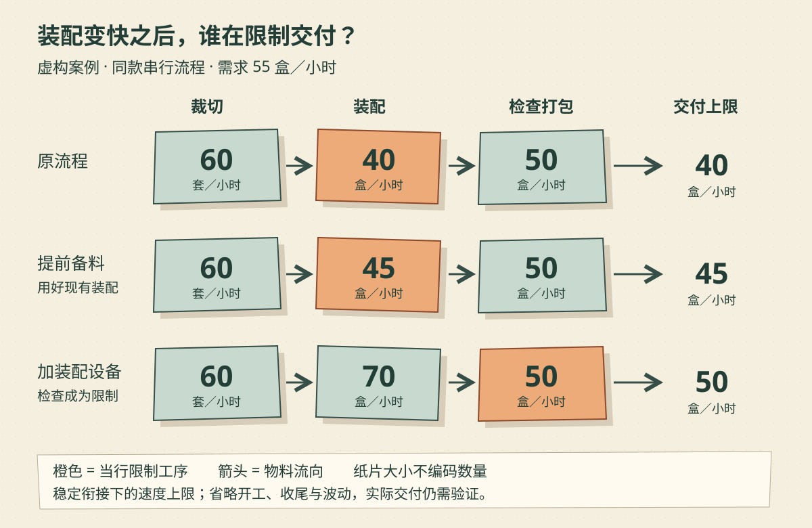

礼盒作坊里，裁切师傅刚换了一套工具，每小时能多做二十套纸板。老板本以为这周终于能少欠一些货，到了发货区却发现：成品没多，装配台前的半成品反而堆得更高了。

裁切师傅没有偷懒，工具也确实提高了效率。问题是，顾客买的是装好、检查完的礼盒，纸板裁得再快，也得经过后面两道工序。

**约束理论把注意力放在限制整体目标的因素上：先找出它，再围绕它安排改善。** 它是一套管理方法，不能仅凭“总有短板”就断言所有组织都能用同一个算式优化。Goldratt Research Labs 将识别约束、用好约束、让其他安排配合、提升约束能力以及重新识别，概括为五个聚焦步骤。[方法来源：Introduction to Theory of Constraints](https://www.goldrattresearchlabs.com/introduction-to-toc)

下面的作坊、产能、需求和费用都是**虚构演示设定**。本文只讨论同一种礼盒的串行生产，先问怎样提高持续交付速度，再问为此付出的代价是否值得。它不覆盖约束理论的全部工具。

## 一、先确定我们到底要增加什么

作坊要增加的是“每小时完成检查、能按约交付的合格礼盒数”，不是某个工位的动作次数，也不是半成品库存。

每个礼盒必须依次经过裁切、装配、检查打包，不能跳步，没有外包或替代路线。三道工序各有独立的人员和设备，前一道完成一套，才能交给后一道。本例假定材料充足、产品相同、无返工，工序间可以暂存半成品。

| 环节或需求 | 当前能力或数量 | 口径 |
|---|---:|---|
| 裁切 | 60 套／小时 | 可供下一道装配的完整纸板套件 |
| 装配 | 40 盒／小时 | 装好的礼盒 |
| 检查打包 | 50 盒／小时 | 检查合格并完成包装的礼盒 |
| 可交付订单需求 | 55 盒／小时 | 当前观察期内可实际交付的同款需求 |

这里的产能是给定工作安排下可持续的有效能力，不是设备铭牌上的峰值。数字用于描述流程已启动、各工序衔接稳定时的速度；不能直接据此保证“从空台开工的一小时也能发出四十盒”。开工、收尾和中间运输仍会占用时间。

在上述简化条件下，长期可持续交付速度的上限为：

`min（60，40，50，55）= 40 盒／小时`。

为什么取最小值？每交付一个盒子，都要占用一次装配。装配每小时只能提供四十个，后面即使能检查五十个，也没有足够的盒子可查。裁切多做出来的纸板又不能直接交给顾客。

这不是把几个部门随意排名，而是在检查它们是否共同限制同一个输出。现实中若发生停机、缺料或衔接失败，实际交付还可能低于这个上限。

## 二、局部多做二十套，去了哪里？

工具升级前，若裁切持续做满 60 套，装配持续消耗 40 套，装配前的库存每小时净增加：

`60 − 40 = 20 套`。

裁切升级到 80 套后，装配和检查能力没变，整体上限仍是 `min（80，40，50，55）= 40`。若裁切也按新能力做满，库存反而每小时净增加 `80 − 40 = 40 套`。

这两个增长量都假定裁切持续有料、装配持续有活且有地方存放；仓位有限时，裁切最终会被迫停下，并不可能无限堆积。

所以，“裁切能力增加二十套”和“交付增加二十盒”是两件事。前者已经发生，后者还被装配挡着。老板若只奖励每道工序多做，可能是在奖励更多东西停在路上。

这也不等于裁切改善毫无价值。如果新工具能省材料、减轻操作负担或降低故障风险，它仍可能值得买。只是这些收益需要分别核算，不能冒充已经增加的成品交付。

## 三、先找装配损失的时间，再考虑添设备

老板观察装配台，发现师傅会离开工位找配件、搬空箱。进一步测定后，在本例中确认：把这些准备工作提前做好，保留正常休息和安全要求，现有装配台可以稳定做到每小时 45 盒。

40 到 45 是案例给定的改善结果，现实必须通过记录验证，不能看到有人走动就认定那是五盒的损失。找配件也可能是在处理上游错料，根因未必在装配师傅身上。

现在重新计算：

`min（60，45，50，55）= 45 盒／小时`。

用好现有装配能力后，整体上限增加了五盒。这对应五个聚焦步骤中的“用好约束”。接下来，其他安排要配合这一决定：裁切按装配实际消耗补充套件，检查工位及时接走成品，不让装配因为找料或后方堵塞停下。

“配合”不要求所有工位都永远以同样速度运转。裁切可以分批工作、在需要时补充；它的富余能力还能帮助追赶短暂停顿。要控制的是长期投料量与消耗量的关系，避免拿“每分钟都忙”作为唯一评价标准。

也不能为了不堆货，把装配前的备料降到零。一旦裁切短暂停顿，装配便无料可做。需要留多少备料，应根据补充所需时间、波动和空间来确定；本例的平均速度表不足以算出一个通用数量。

## 四、装配翻倍，交付会跟着翻倍吗？

供应商又提出一项方案：增加装配设备，把装配能力从 45 提升到 70 盒／小时。老板这次先把新数字放回整条流程。

*作者以 AI 辅助编写 SVG 绘制的流程对照示意，随机风格为剪纸拼贴。箭头表示物料流向；橙色纸片标记各行限制产能的工序，右侧给出交付上限。框面积不表示产能，单位和数值以文字为准；需求统一为 55 盒／小时，数据均为虚构。*

新上限是 `min（60，70，50，55）= 50 盒／小时`，不是 70。装配释放出来后，检查打包成了新的限制环节。若检查也升到 65，整体上限则为 `min（60，70，65，55）= 55`，这时需求先限制了交付。

这就是为什么改善之后要重新识别约束。旧瓶颈不再限制整体时，继续围着它加人加设备，可能已经无法多交一盒。五步法强调避免沿用过时安排；Goldratt 日本的术语说明也强调，投资扩容前先利用已有能力。[方法来源：五个聚焦步骤](https://www.goldratt.co.jp/toc-dictionary/5fs)

但“能多交五盒”还没有回答“值不值得扩容”。为了比较，假设这五盒都有订单承接，每盒售价扣除新增材料、包装等随盒发生的支出后，留下 20 元；下面两项改进费用尚未包含在这 20 元中。

| 方案变化 | 持续交付的增量 | 每小时新增贡献 | 每小时另付的改进费用 | 每小时净变化 |
|---|---:|---:|---:|---:|
| 原流程 → 提前备料，装配到 45 | 5 盒 | 5 × 20 = 100 元 | 15 元 | ＋85 元 |
| 提前备料 → 加设备，装配到 70 | 5 盒 | 5 × 20 = 100 元 | 120 元 | −20 元 |

15 元是本例额外备料服务费；120 元是假定按实际运行小时收取、可随时取消的设备与操作服务总费用，没有另计安装或退出费。固定房租等在方案间不变，这里没有重复分摊。这是一组用于说明判断的费用设定，不是设备报价。

按这些条件，先做备料改善值得；在此基础上租设备却使每小时贡献少二十元。装配从 45 升到 70 的二十五盒能力，只有五盒能穿过后面的检查环节，不能拿 `25 × 20` 来计算收益。

如果实际设备必须签一年合同，或扩容同时影响交期违约费用，就得改用整个承诺期的收益和支出重算。这里的小时账不能代替投资评估。关于增量与总量的区别，也可以参照此前的[边际分析](/blog/marginal-analysis/)。

## 五、怎样的反例会让“先补装配”失效？

先把需求改成每小时 30 盒，其余恢复原流程。此时上限为 `min（60，40，50，30）= 30`。即使把装配做到 45，也没有新增订单可交。若唯一目标是增加已售礼盒，当前应查需求端；当然，缩短工作时间或降低加班成本可能另有价值，需要另设评价口径。

再把“各工序独立用人”的条件取消。假如同一个人既裁切又检查，60 和 50 是他分别专职做这两件事时的能力，就不能同时放进原算式。一个盒子要占用他 `1/60 + 1/50` 小时，单凭这名员工的时间，持续产出已不可能超过约 `27.3 盒／小时`。共享资源把两个看似宽松的工序绑在了一起。

还有一种情况是产品混杂。某种礼盒装配只需一分钟，另一种却要四分钟；只统计“盒数”会隐藏不同订单对约束时间的占用。此时应先按产品分别记录加工时间、需求和贡献，再比较订单组合，不能把平均每小时四十盒当成不变能力。

最后，排队最多的地方也不一定就是持续约束。一次集中投料、运输按大批交接、短暂故障，都可能产生很长的队伍。判断应结合一段时间内的实际处理量、等待原因和上下游状态，而不是拍一张车间照片就决定买哪台机器。

这些反例分别改变需求、资源共享、产品组成和时间波动。它们说明简单取最小值有明确前提；发现前提不成立时，应重画关系、重算能力，而不是把不符合预期的数据排除掉。

## 六、让下一次改善能被检验

老板最终决定先试行提前备料，暂不租新装配设备。试行期间，每个班次同时记录：各工序完成量、装配停顿及原因、班初班末在制品、合格交付量，以及额外支出。

在制品记录尤其重要。某天多发了十盒，可能只是发掉昨天已完成的库存，并不说明今天的流程能力提高了；反过来，新增装配产出还停在检查台，也不能算成已交付收益。

比较前后表现时，要选需求充足、产品相同、工时相近的时段，并记录人员和停机变化。先观察装配是否接近 45，再看合格交付是否同步增加，最后看额外费用是否符合假设。不能只挑最好的一小时，也不能用少量试行结果保证长期表现。

如果装配确实变快而交付不变，就沿着多出来的五盒去找：停在检查台了，进入返工了，还是已经没有订单可交？这比直接宣布“模型不管用”更能指出下一步该查什么。

回到开头，裁切师傅的效率仍然是事实，但老板已经换了问题：

> **要增加的最终结果是什么 → 哪些环节共同限制它 → 当前限制在哪里 → 改这里能多交付多少 → 代价是否值得 → 改完后限制移到了哪里？**

作坊不再靠让每个人一直忙来判断进步。真正需要追踪的是，沿着整条流程走到顾客手里的礼盒，究竟有没有增加。
