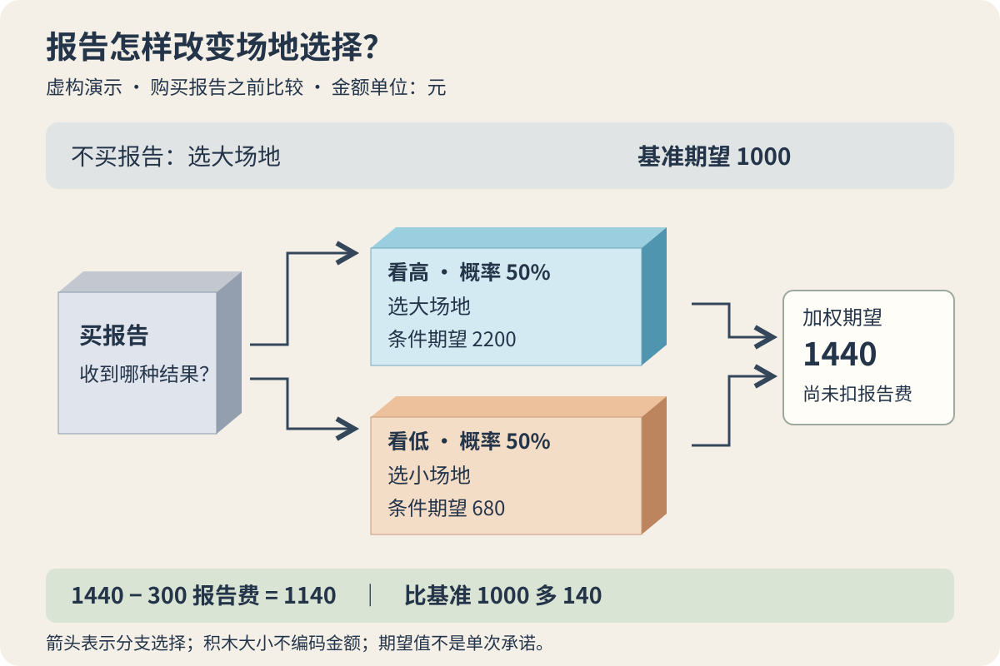

小周准备办一场周末陶艺体验活动。大场地能接更多人，租金也高；小场地便宜，但报名热闹时会装不下。两处都要在周三前确认，真正的报名高峰却在周四。

一家调查服务商提出，可以在订场地之前交一份需求预测，收费 300 元。同事觉得：“少猜一点总是好的。”小周却拿不准：预测可能出错，即便更准一些，也未必值这笔钱。

**信息价值关注的是：获得消息后调整行动，能比现在直接作决定改善多少结果。** 报告有多少页、包含多少数据，都不能直接回答这个问题。要先知道没有它会选什么，再看有了它能怎样选。

以下活动、金额、概率和预测表现均为**虚构演示设定**。本文使用决策分析中的期望收益方法，目标是比较这一次活动的预期现金结余；暂时假定小周能承受所列损失，也接受按期望值比较方案。它不是心理定律，也不保证单次结果。

## 一、先算不买报告时会怎么做

本例把潜在付费需求简化成两种状态：高需求为 60 人，低需求为 20 人。大场地最多接待 60 人，小场地最多接待 20 人。价格、课程和宣传不变，场地大小本身不改变潜在需求；超过容量的人无法参加，本次没有加场或外包选项。

每位实际参加者的费用，扣除材料、按人计费的服务等支出后，留下 100 元。大场地的固定新增支出为 3000 元，小场地为 1400 元，都包含本次场租及固定人员安排。于是，小场地在两种需求下都接待 20 人，现金结余均为 `20 × 100 − 1400 = 600 元`。

小场地方案另有一项事先谈好的转介合作：高需求时，把无法接待的顾客介绍给另一家机构，合计获得 400 元转介净收入。这些顾客参加对方的活动，不属于小周的接待人数。这项合作同样是演示设定，只进入高需求、小场地这一格。

| 选择 | 高需求：60 人 | 低需求：20 人 |
|---|---:|---:|
| 大场地 | 60 × 100 − 3000 = 3000 元 | 20 × 100 − 3000 = −1000 元 |
| 小场地 | 20 × 100 − 1400 + 400 = 1000 元 | 20 × 100 − 1400 = 600 元 |
| 不举办 | 0 元 | 0 元 |

所有金额都针对本次活动，相同的既有办公室费用不进入比较；尚未购买的预测报告费也没有扣除。假定没有其他差异支出或退出费用。

小周目前把高、低需求各按 50% 估计。这是案例给定的先验判断，不是因为“只有两种情况，所以各一半”；现实应说明估计来自哪些可比活动，以及它有多不确定。

期望值的算法是把每种结果乘以对应概率再相加。它是概率加权的平均数，不是这次必然拿到的金额。[OpenStax：Mean or Expected Value](https://openstax.org/books/introductory-statistics-2e/pages/4-2-mean-or-expected-value-and-standard-deviation)

- 大场地：`50% × 3000 + 50% × (−1000) = 1000 元`。
- 小场地：`50% × 1000 + 50% × 600 = 800 元`。
- 不举办：`0 元`。

因此，按当前目标和假设，不买报告时选大场地，基准期望结余为 **1000 元**。后面评价报告，要与这个最佳现有选择相比，不能随意挑一个表现较差的方案来衬托它。

## 二、先给消息的价值画一个上限

暂时想象，有人能在周三前准确告诉小周最终是哪种需求，而且消息免费。

知道是高需求时，就选大场地，留下 3000 元；知道是低需求时，就选小场地，留下 600 元。两种需求发生的概率仍然各为一半，消息不会把低需求变成高需求。

这样，先知道状态再选择的期望结余是：

`50% × 3000 + 50% × 600 = 1800 元`。

相对于不买消息的 1000 元，最多改善 `1800 − 1000 = 800 元`。这就是本例的**完美信息期望价值**：先在每种状态下挑最佳行动，再加权，最后减去没有新信息时的最佳期望收益。[捷克生命科学大学决策理论教材，第 2.7.1 节](https://orms.pef.czu.cz/DecisionTheory.html)

800 元是当前方案、收益和评价标准下的信息价值上限，不是报告的合理报价。若一份报告收费 900 元，只服务于这次场地选择，且不带来其他收益，那么即便它完全准确，也不值得按这个标准购买。收费 300 元虽然低于上限，却仍需要检查实际能改善多少。

这个上限还有另一种读法：不买报告时一直选大场地，高需求下已经选对；只有低需求时能通过改选小场地，把 −1000 元变成 600 元，改善 1600 元。低需求概率为一半，所以平均改善 `50% × 1600 = 800 元`。消息的价值来自能够改掉的选择。

## 三、八成准确，要拆成哪两种错误

服务商的报告只有“看高”和“看低”两种结果。我们明确设定：真正高需求时，80% 报告看高、20% 看低；真正低需求时，80% 看低、20% 看高。两类条件下的表现都已给出，不能只凭一句“总体准确率八成”完成下面的计算。

把概率展开成 100 场同类活动的想象账本，可以看清报告结果怎样组成。这只是概率换算，**不是服务商的真实验证样本**，也不是说小周要办 100 场。

| 实际需求 | 报告看高 | 报告看低 | 合计 |
|---|---:|---:|---:|
| 高需求 | 40 场 | 10 场 | 50 场 |
| 低需求 | 10 场 | 40 场 | 50 场 |
| 合计 | 50 场 | 50 场 | 100 场 |

收到“看高”时，对应左列的 50 场，其中 40 场是真高，所以更新后的高需求概率为 `40 ÷ 50 = 80%`。收到“看低”时，对应右列，高需求概率为 `10 ÷ 50 = 20%`。

这两个后验比例恰好也出现了 80%，是先验各半、两类预测表现对称共同带来的结果。如果高需求原本很少，不能直接把“高需求时八成报对”倒过来当成“报高后八成真高”。需要重新填四格表；这也是此前[基准率一文](/blog/base-rate/)所讨论的区别。

## 四、买到的不是一个答案，而是一套分情况选择

收到“看高”时，大场地的条件期望结余为 `80% × 3000 + 20% × (−1000) = 2200 元`；小场地为 `80% × 1000 + 20% × 600 = 920 元`。这时选大场地。

收到“看低”时，大场地为 `20% × 3000 + 80% × (−1000) = −200 元`；小场地为 `20% × 1000 + 80% × 600 = 680 元`。这时选小场地。两种情况下，所选方案也都优于不举办的 0 元。

*作者以 AI 辅助编写 SVG 绘制的决策示意，随机风格为等距积木。箭头表示收到报告后采用的选择，不表示报告造成需求；蓝块为看高分支，橙块为看低分支，文字同时标注含义。积木大小不编码金额，所有金额均为虚构演示的期望值。*

现在回到**尚未看到报告**的购买时点：看高、看低各有 50% 的概率，因此采用这套分情况选择后，未扣报告费的期望结余为：

`50% × 2200 + 50% × 680 = 1440 元`。

报告带来的信息价值为 `1440 − 1000 = 440 元`；再扣 300 元报告费，净改善为 **140 元**，最终期望结余为 **1140 元**。不完美信息的期望价值，同样比较“利用消息后的最佳期望收益”和原有基准，而不是拿预测准确率直接乘营业收入。[决策理论教材，第 2.7.2 节](https://orms.pef.czu.cz/DecisionTheory.html)

可以用一个更短的算式复核：报告看高时，仍选原来的大场地，没有改变行动；看低时，小场地的条件期望结余 680 元，比继续选大场地的 −200 元多 880 元。看低有一半概率，故总改善为 `50% × 880 = 440 元`。

也不能只拿看高后的 2200 元减原来的 1000 元，就声称报告值 1200 元。那把一种较有利消息出现后的判断，冒充了购买前对所有可能消息的评价。

## 五、哪些条件一变，这份报告就不值得买

**第一种变化是，收到消息也改不了场地。** 假如周二就必须付不可退、不可换的全款，报告周三才来，而且没有其他可调整行动，那么仍然只能使用已经选定的场地。预测更准也不会改善本例的场地选择，信息价值为零。若还能调整人员或材料，则要把这些行动重新列入模型，不能沿用这个零值。

**第二种变化是，报告没有强到足以改变选择。** 设看到某条消息后，高需求概率为 p。大场地期望结余为 `4000p − 1000`，小场地为 `400p + 600`。两者相等时，`3600p = 1600`，即 p 约为 44.4%；高于它选大场地，低于它选小场地，等于时两者同值。

假如另一份较弱报告，只会把高需求概率更新为 45% 或 55%，无论结果怎样仍选大场地。在后验与先验一致、没有其他行动可改的条件下，它对这次选择的期望价值就是零。它不是毫无信息，而是没有让任何分支跨过行动门槛。

**第三种变化是，拿到信息还有额外代价。** 当前净改善只剩 140 元。如果除 300 元报告费外，还需要 200 元人工整理，而且尚未计入任何一处，那么总成本变成 500 元，超过 440 元的信息价值。按相同标准就不应购买。等报告期间场租上涨、合适场地被订走，也会改变收益表或可选方案，不能只看报告标价。

**第四种变化是，小周不能承受亏损。** 大场地在低需求时损失 1000 元，买报告也不能消灭误判；若报告看高却实际低需求，另加报告费后现金结余为 −1300 元。如果这会影响已承诺的必要支出，期望值较高不足以支持购买并照报告行动。应先加入可承受损失的约束，或改用体现风险偏好的评价方式，再重算基准与信息价值。

800 元、440 元和 140 元都依赖当前问题的边界。报告若还能服务后续十场活动，需要另算后续收益与适用性；若只会让人更安心，也不能未经说明就把这种感受填成现金收入。

## 六、付款前，先核查最容易被高估的一项

按主案例的全部假设，小周可以花 300 元购买报告：它在预期上净改善 140 元。但这只是条件成立时的结论。现实中最值得核查的，通常是“两类需求下都能达到八成判断正确”从哪里来。

小周应要求查看预测发布在报名之前的记录，并分别统计高需求、低需求下的看高和看低次数；只展示猜对的活动没有意义。样本中的票价、城市、客群和提前天数，也应与这次活动尽量可比。样本少或场景不同，就应把预测表现当作不稳定估计，重新检查 440 元是否仍站得住。

还要注意怎样观察“实际需求”。小场地坐满 20 人，不能证明需求只有 20 人：容量把实际成交截住了。应同时保留超过容量的有效报名、候补和转介记录，并注明这些人是否真的愿意按原价付款。否则，预测表现可能只是用受场地限制的成交数自我验证。

活动结束后，保存订场前的先验、报告、选场动作、最终需求记录及实际收支。一次猜对不能证明服务稳定，一次猜错也不足以否定全部价值；后续可比活动累积起来，才能逐步修正概率与收益假设。

同事再问“要不要多买一点资料”，小周现在能把问题说得更具体：

> **不买时会选什么 → 什么消息会让我改选 → 改选在各种结果下能改善多少 → 消息能否及时到达 → 全部获取成本是否低于预期改善？**

这次暂定购买，不是因为“更准确总是值得”，而是因为报告能在看低时触发换小场地，且在给定表现与成本下，预期改善还有 140 元余量。只要预测表现、场地承诺或获取成本变了，就回到那一格重算。
